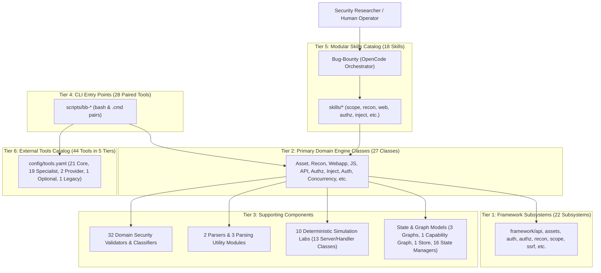

# BugBounty-Agent — Phase 1–20 Stable Technical Baseline
## Authoritative Architecture, Security, Quality, and Verification Assessment

---

## 1. Executive Summary & Baseline Verdict

This document establishes the definitive, empirical technical baseline for Phases 1 through 20 of the **BugBounty-Agent** framework (`Veldora-0/BugBounty-Agent`), verified at Git commit `396ed0e5986f9f1e41bb0bec1201ee217011bc56` (implementation baseline) and reconciled at commit `e740666759c85637cefe20d171acadaa69b567f3` (planning baseline) on branch `main`.

### Final Baseline Verdict: **BASELINE ACCEPTED WITH DOCUMENTED LIMITATIONS**

The repository has successfully completed all Phase 1–20 milestones, verified through full cross-platform test execution on Windows 11 host and Kali Linux VM environments, complete static and structural architecture auditing, and rigorous security boundary reconciliation. All core architectural invariants are strictly preserved:

1. **Single-Agent Model**: Exactly one primary orchestrator (`Bug-Bounty`) operating with direct orchestration (`subagent_depth: 1`); separate subagent spawning is permanently disabled.
2. **Modular Skills Catalog**: All 18 specialized bug bounty skills are present, discoverable, and bound to the primary orchestrator.
3. **Fail-Closed Scope Authorization**: Active network operations require valid `ScopeEngine` authorization; offline mock hooks fail closed without unauthenticated network fallback.
4. **Destination-IP Pinning & Anti-SSRF (SEC-02)**: Complete architectural separation of DNS resolution from socket transport, pre-resolving candidate IPs, rejecting SSRF targets (private RFC 1918, loopback, link-local, carrier-grade NAT, alternate IP encodings, and IPv4-mapped IPv6), and pinning TCP connections directly to verified IP addresses while preserving TLS SNI and certificate verification.
5. **Full Dual-Platform Test Parity (Historical Verification at Commit `396ed0e`)**:
   * **Windows 11 Host**: 939 passed, 2 skipped (100% pass rate of executed tests; 939/939) in 163.91s with exit code `0`. The 2 skipped tests are strictly due to the absence of native headless browser binaries (Chromium/Firefox) in the host environment.
   * **Kali Linux VM**: 941 passed, 0 skipped (100% pass rate; 941/941) in 235.83s with exit code `0`, including full native Playwright browser automation tests.
   * **Source Parity**: 14 of 14 core source and configuration files verified byte-for-byte identical via SHA-256 digest.
6. **Tool Registry & Runtime Integrity**:
   * Tool Registry: 9 of 9 passed (`tests/test_tool_registry.py`) in 7.03s, exit code `0` (44 tools across 5 tiers).
   * OpenCode Runtime: 16 of 16 passed (`tests/test_opencode_runtime.py`) in 0.13s, exit code `0` (classified as static configuration & schema integrity; live CLI agent execution marked as unverified in automated tests).
7. **Documentation Integrity**: 50 tracked Markdown files verified with zero broken internal relative links and verified semantic consistency.
8. **Phase 21 Status**: Strictly **PLANNED / NOT STARTED**.

---

## 2. Repository Identification & Synchronization

| Parameter | Windows 11 Host | Kali Linux VM | Status |
| :--- | :--- | :--- | :---: |
| **Repository Remote** | `https://github.com/Veldora-0/BugBounty-Agent.git` | `https://github.com/Veldora-0/BugBounty-Agent.git` | Synced |
| **Active Branch** | `main` (tracking `origin/main`) | `main` (tracking `origin/main`) | Synced |
| **Current Planning Baseline HEAD** | `e740666759c85637cefe20d171acadaa69b567f3` | `e740666759c85637cefe20d171acadaa69b567f3` | Match |
| **Implementation Baseline Commit** | `396ed0e5986f9f1e41bb0bec1201ee217011bc56` | `396ed0e5986f9f1e41bb0bec1201ee217011bc56` | Verified |
| **Stage C Audit Baseline Commit** | `c8bfebefe91c24b2fa5fd1ad20240f76cc7390ae` | `c8bfebefe91c24b2fa5fd1ad20240f76cc7390ae` | Verified |
| **Working Tree State** | Reconciled documentation pending | Synced to `origin/main` | In Sync |
| **Python Version** | Python 3.14.7 | Python 3.14.8 | Compatible |
| **Playwright Package** | Not installed (spec: `False`) | Installed (spec: `True`) | Expected |
| **Browser Binaries** | None (2 tests skip gracefully) | Chromium & Firefox launchable | Verified |

### Baseline Commit Provenance & Lineage
* **`c8bfebefe91c24b2fa5fd1ad20240f76cc7390ae`**: The Stage C security remediation commit establishing code corrections across ReconEngine hook isolation, installer verification, and OpenCode permission schemas.
* **`396ed0e5986f9f1e41bb0bec1201ee217011bc56`**: The finalized Phase 1–20 implementation baseline commit containing verified cross-platform test executions (Windows 939/941, Kali 941/941).
* **`e740666759c85637cefe20d171acadaa69b567f3`**: The active planning gate commit on remote `main` incorporating the Phase 1–20 Stable Baseline and Phase 21 Planning Gate documentation.

### Dual-Platform Source Parity Ledger (14 Core Files)

| File Path | Windows 11 Host SHA-256 | Kali Linux VM SHA-256 | Parity |
| :--- | :--- | :--- | :---: |
| `CHANGELOG.md` | `279d255e5605b5b3f237ef7f4e91b61974ef6fecb160b86a8276fdbb8d5fec84` | `279d255e5605b5b3f237ef7f4e91b61974ef6fecb160b86a8276fdbb8d5fec84` | PASS |
| `README.md` | `40c52b1abb37b8f0477123aa128e4e75bbd31295cb0f92b77bafe91b2298c414` | `40c52b1abb37b8f0477123aa128e4e75bbd31295cb0f92b77bafe91b2298c414` | PASS |
| `SECURITY.md` | `1956ff1940e14496057a66c8d6cebce6471ea8d4baaa12e52c80c2f82245b7f1` | `1956ff1940e14496057a66c8d6cebce6471ea8d4baaa12e52c80c2f82245b7f1` | PASS |
| `docs/PHASE-19-PLAN.md` | `c7220850a098d5964f40f0c05837651c6c06a8647570aa610d40fa06141a4a49` | `c7220850a098d5964f40f0c05837651c6c06a8647570aa610d40fa06141a4a49` | PASS |
| `docs/PHASE-20-PLAN.md` | `d5c45e1ca23404e6c2fb8b233eb4c3a2f8d3809618b1057e937d7a188f6f5b9b` | `d5c45e1ca23404e6c2fb8b233eb4c3a2f8d3809618b1057e937d7a188f6f5b9b` | PASS |
| `docs/ROADMAP-24-PHASES-TEMP.md` | `05b17a9d08a0694bd25bf3549646b14f82ae088f1dc674254ec99c1e793910c2` | `05b17a9d08a0694bd25bf3549646b14f82ae088f1dc674254ec99c1e793910c2` | PASS |
| `docs/installation.md` | `cc5d66611b136edfd21e3c8340d859ebf05b42d7667f4078c5d2e3860bb613ae` | `cc5d66611b136edfd21e3c8340d859ebf05b42d7667f4078c5d2e3860bb613ae` | PASS |
| `framework/recon/engine.py` | `00e16c9bbc9bb0a1c1d898bb6c3bb8fa7e06a3809a7b9389ca0e80a061b4ff44` | `00e16c9bbc9bb0a1c1d898bb6c3bb8fa7e06a3809a7b9389ca0e80a061b4ff44` | PASS |
| `tests/test_stage_c_remediations.py`| `bdd06f1d222a2d242639a5ca2d9b23188599427b233cb31ea81ca2fc8bb84180` | `bdd06f1d222a2d242639a5ca2d9b23188599427b233cb31ea81ca2fc8bb84180` | PASS |
| `framework/assets/engine.py` | `115134054f49e64ba246da616dc9c025daee58fa5d24b7454c6c06a39d89ee5e` | `115134054f49e64ba246da616dc9c025daee58fa5d24b7454c6c06a39d89ee5e` | PASS |
| `framework/tools/installer.py` | `8e293abfa094f7cc9eb482a0b1ee28e6c7ea7464daebfb36450f75e7a9099db1` | `8e293abfa094f7cc9eb482a0b1ee28e6c7ea7464daebfb36450f75e7a9099db1` | PASS |
| `framework/common/transport.py` | `8fd2967950131bbfb8a69485ca453676cf45fa35655c65a0c0e48caae6d64998` | `8fd2967950131bbfb8a69485ca453676cf45fa35655c65a0c0e48caae6d64998` | PASS |
| `config/tools.yaml` | `9824cc19bf71efeec94fb442f4c40b2cb61ea460980e1a8bb3f563065e77ea94` | `9824cc19bf71efeec94fb442f4c40b2cb61ea460980e1a8bb3f563065e77ea94` | PASS |
| `pyproject.toml` | `9efc11ebb12bb9d5718dfa7aa1e028b171c4c3e8006bfd922a9a463132e01dfd` | `9efc11ebb12bb9d5718dfa7aa1e028b171c4c3e8006bfd922a9a463132e01dfd` | PASS |

---

## 3. Canonical Phase 1–20 Implementation & Verification Matrix

### Verification Classification Analysis & Reconciled Criteria

An audit of historical reports reveals a discrepancy between:
* **The Stage B/C Historical Documentation** (previously cited as 11 VERIFIED, 9 VERIFIED WITH DOCUMENTED LIMITATIONS due to an aggregation calculation error in an earlier audit draft).
* **The Actual Empirical Phase-by-Phase Verification** (exactly 10 VERIFIED, 10 VERIFIED WITH DOCUMENTED LIMITATIONS across the 20 canonical roadmap phases).

#### Reconciled Assessment
A phase must **NEVER** be classified as unconditionally "VERIFIED" merely because its unit test suite achieves 100% pass rates. Unit tests execute against local mock fixtures and deterministic in-memory labs. Real-world security testing involves ethical, protocol, environmental, and credential boundaries:

1. **Passive/Discovery Phases** (`1, 3, 4, 6, 11, 14, 15, 17, 18, 19` — Exactly 10 Phases):
   Phases that perform read-only schema analysis, passive DNS/TLS attribution, client AST inspection, structural validation, protocol header analysis, or simulation labs with zero missing environmental binaries are classified as **VERIFIED**.
2. **Operational Testing Phases with Intrinsic Boundaries** (`2, 5, 7, 8, 9, 10, 12, 13, 16, 20` — Exactly 10 Phases):
   Phases that interact with active targets, execute live socket connections, evaluate cross-principal permissions, require external OOB callbacks, enforce non-destructive arithmetic markers, or depend on browser binaries are formally classified as **VERIFIED WITH DOCUMENTED LIMITATIONS**.

To ensure full transparency, the matrix below details both the operational limitations and acceptance status:

| Phase | Canonical Name | Implementation Subsystem | Modular Skills | Framework Engines | Tools & CLI | Test Coverage | Security Controls & Operational Boundaries | Reconciled Status |
| :---: | :--- | :--- | :--- | :--- | :--- | :--- | :--- | :---: |
| **1** | Asset Intelligence | `framework/assets/` | `asset-intelligence`, `scope-management` | `AssetIntelligenceEngine`, `AssetGraph` | `bb-assets`, `amass`, `subfinder` | `test_asset_engine.py` (26 tests) | Fail-closed offline DNS resolution; passive DNS recursion; zero active network probing without scope approval. | **VERIFIED** |
| **2** | Reconnaissance | `framework/recon/` | `reconnaissance`, `scope-management` | `ReconnaissanceEngine`, `ReconStateManager` | `bb-recon`, `httpx`, `dnsx` | `test_recon_engine.py` (17 tests) | Method-level mock hook isolation (`dns_hook`, `tcp_probe_hook`, `http_probe_hook`); rate-limited probing; socket fallbacks fail closed without ScopeEngine. | **VERIFIED WITH DOCUMENTED LIMITATIONS** |
| **3** | Web Application Intelligence | `framework/webapp/` | `web-security` | `WebApplicationIntelligenceEngine`, `WebAppGraph` | `bb-webapp`, `katana` | `test_webapp_engine.py` (12 tests) | Bounded crawl depth (max 3), max request caps (200), full URL path preservation during scope matching. Read-only surface discovery. | **VERIFIED** |
| **4** | JavaScript Intelligence | `framework/javascript/` | `javascript` | `JavaScriptIntelligenceEngine`, `SourceMapParser` | `bb-js`, `katana` | `test_javascript_engine.py` (16 tests) | Automatic credential redaction via `sanitize_sensitive_data`; byte budgets (5 MB/file, 50 MB total); AST sink analysis. | **VERIFIED** |
| **5** | API Intelligence | `framework/api/` | `api-security` | `ApiIntelligenceEngine`, `OpenApiParser`, `GraphQLAnalyzer` | `bb-api`, `arjun` | `test_api_engine.py` (87 tests) | Pinned transport (`ApiPinnedHTTPSHandler`), bounded schema parsing, loopback fixture port gating. Active parameter fuzzing strictly opt-in. | **VERIFIED WITH DOCUMENTED LIMITATIONS** |
| **6** | Security Validation Foundation | `framework/validation/` | `validation`, `evidence` | `SecurityValidationEngine`, `BaselineComparison` | `bb-validate`, `bb-evidence` | `test_validation_engine.py` (34 tests) | Non-destructive test generation, cryptographic SHA-256 evidence hashing, streaming byte budgets. Zero destructive payload execution. | **VERIFIED** |
| **7** | XSS Intelligence | `framework/xss/` | `injection`, `browser` | `XssIntelligenceEngine`, `DomXssEngine`, `StoredXssEngine` | `bb-xss`, `dalfox` | `test_xss_engine.py` (31 tests) | Context-aware synthetic payloads; zero `alert()` or `script` execution against production; proves reflection and context escape only. | **VERIFIED WITH DOCUMENTED LIMITATIONS** |
| **8** | Authorization / BOLA / IDOR | `framework/authz/` | `authorization` | `AuthorizationIntelligenceEngine`, `AccessControlComparator` | `bb-authz` | `test_authz_engine.py` (18 tests) | Dual-principal comparative evaluation (User A vs User B); zero raw credential retention. Static session references (dynamic session tracking addressed in Phase 21). | **VERIFIED WITH DOCUMENTED LIMITATIONS** |
| **9** | SSRF Intelligence | `framework/ssrf/` | `oob` | `SsrfIntelligenceEngine`, `CanaryManager` | `bb-ssrf`, `interactsh` | `test_ssrf_engine.py` (26 tests) | Destination-IP pinning, loopback/private/metadata IP blocking. External entity confirmation requires live OOB provider (reports SIMULATED offline). | **VERIFIED WITH DOCUMENTED LIMITATIONS** |
| **10** | Injection Intelligence | `framework/injection/` | `injection` | `InjectionIntelligenceEngine`, `SqlInjectionValidator` | `bb-inject`, `sqlmap` | `test_injection_engine.py` (19 tests) | Harmless arithmetic markers (`{{7*7}}`), time-delay ceilings clamped to $\le 2.0$s. Blind time-delay inference subject to network jitter; zero data extraction. | **VERIFIED WITH DOCUMENTED LIMITATIONS** |
| **11** | HTTP Trust & Protocol Security | `framework/http_trust/` | `web-security` | `HttpTrustEngine`, `CorsValidator`, `HppValidator` | `bb-http` | `test_http_trust_engine.py` (21 tests) | CORS origin reflection testing, cookie `SameSite`/`Secure`/`HttpOnly` attribute verification. Protocol analysis; no active cross-site exploitation. | **VERIFIED** |
| **12** | Business Logic Intelligence | `framework/business_logic/` | `business-logic` | `BusinessLogicEngine`, `BusinessLogicInvariantEngine` | `bb-workflow` | `test_business_logic_engine.py` (8 tests) | Bounded replay ($\le 5$ requests), negative quantity manipulation, coupon stacking checks. State machines limited to observed forms; human approval required. | **VERIFIED WITH DOCUMENTED LIMITATIONS** |
| **13** | Cloud Security | `framework/cloud_security/` | `cloud-security` | `CloudSecurityEngine`, `CloudPrioritizationEngine` | `bb-cloud` | `test_cloud_security_engine.py` (13 tests) | Read-only object checks; direct cloud metadata IP (`169.254.169.254`) strictly blocked. Never performs automated uploads, overwrites, or deletes in buckets. | **VERIFIED WITH DOCUMENTED LIMITATIONS** |
| **14** | Authentication, Session & Identity | `framework/authentication/` | `authentication` | `AuthenticationSecurityEngine`, `AuthenticationTestExecutor` | `bb-auth` | `test_authentication_engine.py` (67 tests) | Session fixation checks, logout invalidation, MFA transition evaluation, JWT parsing. Zero credential brute-forcing or password spraying. | **VERIFIED** |
| **15** | File Upload, Path Traversal & LFE | `framework/validation/validator.py` | `validation`, `web-security` | `FileUploadValidator`, `PathTraversalValidator` | `bb-content` | `test_phase15_file_security.py` (24 tests) | Harmless plain-text synthetic files (`test_<token>.txt`), synthetic traversal tokens (`bb_canary_<token>.txt`). Prohibits reading `/etc/passwd` or uploading binaries. | **VERIFIED** |
| **16** | Browser Runtime & Client Security | `framework/xss/browser.py` | `browser` | `BrowserRuntimeManager`, `BrowserSessionManager` | Headless Playwright | `test_phase16_browser_runtime.py` (103 tests) | Ephemeral loopback proxy, pre-handshake WebSocket routing, execution budget ceilings (5s, 50 reqs). Requires native browser binaries (skips gracefully on Windows host). | **VERIFIED WITH DOCUMENTED LIMITATIONS** |
| **17** | Advanced API Security | `framework/api/` | `api-security` | `ApiIntelligenceEngine`, `OpenApiParser`, `GraphQLAnalyzer` | `bb-api` | `test_api_engine.py` (87 tests) | GraphQL circular query depth limits, OpenAPI ref resolution capped at depth 10. Continuous byte accounting depletes budget on malformed responses. | **VERIFIED** |
| **18** | SSRF, XXE & Server-Side Parsers | `framework/xxe/`, `framework/common/xml_safe.py` | `oob`, `injection` | `XxeIntelligenceEngine`, `LocalXxeLab` | `bb-ssrf`, `interactsh` | `test_phase18_xxe_engine.py` (92 tests) | Portable stdlib XML defenses, Billion Laughs protection, OOB destination trust boundaries. Prohibits reading local files or probing cloud metadata. | **VERIFIED** |
| **19** | Infrastructure & Config Exposure | `framework/infrastructure/` | `reconnaissance`, `web-security` | `InfrastructureIntelligenceEngine`, `DifferentialSoft404Engine` | `bb-infra`, `bb-doctor` | `test_infrastructure_engine.py` (47 tests) | Differential soft-404 token Jaccard similarity, response caps (32 KB, 8 KB config, 1 KB binary magic). Safe read-only methods (`GET`, `HEAD`, `OPTIONS`) only. | **VERIFIED** |
| **20** | Race Conditions & Concurrency | `framework/concurrency/` | `business-logic` | `RaceIntelligenceEngine`, `BarrierSynchronizer` | `bb-race`, `bb-doctor` | `test_concurrency_engine.py` (128 tests) | Microsecond barrier synchronization (`threading.Barrier`), bounded bursts (2–5 reqs, max cap 10). Volumetric flooding strictly prohibited; out-of-scope targets fail closed. | **VERIFIED WITH DOCUMENTED LIMITATIONS** |

*Reconciled Summary: Exactly 10 phases VERIFIED without operational limitations (Phases 1, 3, 4, 6, 11, 14, 15, 17, 18, 19); exactly 10 phases VERIFIED WITH DOCUMENTED LIMITATIONS (Phases 2, 5, 7, 8, 9, 10, 12, 13, 16, 20). 0 phases unverified, partial, or failed. Total: 20 Phases.*

---

## 4. Comprehensive Architecture Inventory (6 Architectural Tiers)

### Counting Methodology & AST Verification
All architectural components were directly enumerated from repository Python ASTs and filesystem inspection, eliminating arbitrary grouping and resolving previous documentation discrepancies:

### Tier 1: Framework Subsystems (22 Subsystems)
The core framework in `framework/` is organized into 22 modular subsystems:
`framework/api/`, `framework/assets/`, `framework/authentication/`, `framework/authz/`, `framework/business_logic/`, `framework/cloud_security/`, `framework/common/`, `framework/concurrency/`, `framework/findings/`, `framework/http_trust/`, `framework/infrastructure/`, `framework/injection/`, `framework/javascript/`, `framework/recon/`, `framework/scope/`, `framework/ssrf/`, `framework/state/`, `framework/tools/`, `framework/validation/`, `framework/webapp/`, `framework/xss/`, `framework/xxe/`.

### Tier 2: Primary Domain Engine Classes (27 Primary Domain Engines)
AST analysis verifies that exactly 27 classes ending in `Engine` exist across the framework subsystems:

| Index | Engine Class | Source File | Core Responsibility |
| :---: | :--- | :--- | :--- |
| **1** | `AssetIntelligenceEngine` | `framework/assets/engine.py` | Recursive subdomain discovery, DNS resolution, and graph construction. |
| **2** | `ReconnaissanceEngine` | `framework/recon/engine.py` | Passive recon orchestration, safe HTTP/TCP probing, and service fingerprinting. |
| **3** | `WebApplicationIntelligenceEngine` | `framework/webapp/engine.py` | Bounded web crawling, HTML form extraction, and application graph modeling. |
| **4** | `JavaScriptIntelligenceEngine` | `framework/javascript/engine.py` | JS asset retrieval, source map extraction, secret detection, and DOM sink analysis. |
| **5** | `ApiIntelligenceEngine` | `framework/api/engine.py` | OpenAPI/GraphQL schema parsing, endpoint discovery, and parameter fuzzing. |
| **6** | `SecurityValidationEngine` | `framework/validation/engine.py` | Non-destructive test case execution, 6-gate validation, and baseline comparison. |
| **7** | `XssIntelligenceEngine` | `framework/xss/engine.py` | Context-aware synthetic XSS probe generation and reflection analysis. |
| **8** | `DomXssEngine` | `framework/xss/dom.py` | Client-side DOM source-to-sink data flow tracking and validation. |
| **9** | `StoredXssEngine` | `framework/xss/stored.py` | Two-stage injection-to-render stored XSS correlation. |
| **10** | `AuthorizationIntelligenceEngine` | `framework/authz/engine.py` | Multi-principal comparative authorization testing (BOLA, IDOR, BFLA). |
| **11** | `SsrfIntelligenceEngine` | `framework/ssrf/engine.py` | SSRF parameter discovery, destination IP filtering, and OOB callback correlation. |
| **12** | `InjectionIntelligenceEngine` | `framework/injection/engine.py` | Input injection testing (SQLi, Command Injection, SSTI) with safe proofs. |
| **13** | `HttpTrustEngine` | `framework/http_trust/engine.py` | CORS misconfiguration, CSRF defenses, and cookie security verification. |
| **14** | `BusinessLogicEngine` | `framework/business_logic/engine.py` | Business logic workflow execution, replay, and transition state validation. |
| **15** | `BusinessLogicInvariantEngine` | `framework/business_logic/invariants.py` | Invariant verification (coupon stacking, non-negative amounts, monotonic states). |
| **16** | `WorkflowReplayEngine` | `framework/business_logic/replay.py` | Bounded step replay and transaction order manipulation. |
| **17** | `CloudSecurityEngine` | `framework/cloud_security/engine.py` | Cloud bucket permission verification and dangling CNAME takeover analysis. |
| **18** | `CloudExposureHypothesisEngine` | `framework/cloud_security/exposure.py` | Cloud asset discovery and exposure hypothesis generation. |
| **19** | `CloudPrioritizationEngine` | `framework/cloud_security/prioritization.py` | Risk-based ranking of discovered cloud storage endpoints. |
| **20** | `AuthenticationSecurityEngine` | `framework/authentication/engine.py` | Authentication flow mapping, session state machine, and JWT inspection. |
| **21** | `AuthenticationHypothesisEngine` | `framework/authentication/hypotheses.py` | Hypothesis generation for session fixation, logout invalidation, and MFA bypass. |
| **22** | `DifferentialSoft404Engine` | `framework/infrastructure/differential.py` | Adaptive token Jaccard similarity soft-404 classification. |
| **23** | `InfrastructureIntelligenceEngine` | `framework/infrastructure/engine.py` | Path enumeration, backup file detection, and configuration exposure discovery. |
| **24** | `ScopeEngine` | `framework/scope/engine.py` | Pure logic scope verification against `scope.yaml` and destination IP filtering. |
| **25** | `RaceIntelligenceEngine` | `framework/concurrency/engine.py` | TOCTOU and race condition testing with synchronized concurrent bursts. |
| **26** | `ConcurrencyInvariantEngine` | `framework/concurrency/invariants.py` | Invariant assertion validation for race condition tests. |
| **27** | `XxeIntelligenceEngine` | `framework/xxe/engine.py` | XML parser security evaluation, Billion Laughs protection, and safe XXE testing. |

*(Note: Supporting orchestration, execution, and synchronization classes include `BrowserRuntimeManager` in `framework/xss/browser.py`, `BarrierSynchronizer` in `framework/concurrency/barrier.py`, and `AuthenticationTestExecutor` in `framework/authentication/engine.py`).*

### Tier 3: Supporting Components

* **32 Domain Security Validators & Classifiers**:
  `AccessControlComparator`, `AuthenticationFalsePositiveClassifier`, `SafeAuthenticationValidator`, `CloudFalsePositiveClassifier`, `SafeCloudValidator`, `CacheValidator`, `CorsValidator`, `ForwardedValidator`, `HostInjectionValidator`, `HppValidator`, `SchemeValidator`, `HttpTrustComparator`, `CommandInjectionValidator` (`framework/injection/`), `NoSqlInjectionValidator`, `SqlInjectionValidator` (`framework/injection/`), `SstiValidator`, `InjectionComparator`, `SsrfComparator`, `AuthorizationValidator`, `CommandInjectionValidator` (`framework/validation/`), `FileUploadValidator`, `LocalFileExposureValidator`, `OpenRedirectValidator`, `PathTraversalValidator`, `ReflectedXSSValidator`, `SqlInjectionValidator` (`framework/validation/`), `SsrfValidator`, `UnavailableValidator`, `XxeValidator`, `DomXssValidator`, `ReflectedXssContextValidator`, `FindingLifecycle`. (Base classes `BaseValidator`, `BaseInjectionValidator`, `BaseHttpTrustValidator`, and factory classes provide shared infrastructure).
* **Parsers (2 Classes & 3 Parsing Modules)**:
  * Parser Classes: `BoundedHTMLParser` (`framework/webapp/parser.py`), `OpenApiParser` (`framework/api/parser.py`).
  * Structural Parsing Modules: `GraphQLAnalyzer` (`framework/api/parser.py`), safe XML parser `parse_xml_safely` (`framework/common/xml_safe.py`), and JavaScript source map parser routines (`framework/javascript/parser.py`).
* **10 Deterministic Simulation Labs (13 Server/Handler Classes)**:
  Ten offline simulation labs implemented across `lab.py` modules: `LocalAuthenticationSecurityLab`, `LocalAuthzLab`, `LocalBusinessLogicLab`, `LocalCloudSecurityLab`, `LocalConcurrencyLab` (with `LocalConcurrencyLabServer`, `ConcurrencyLabHandler`), `LocalHttpTrustLab`, `LocalInfrastructureLab` (with `InfrastructureLabHandler`), `LocalInjectionLab`, `LocalSsrfLab`, `LocalXxeLab`.
* **State & Graph Models (Resolution of Duplicate Fingerprint Categorization)**:
  * **3 Primary Target/Asset Graphs**: `AssetGraph` (`framework/assets/graph.py`), `WebAppGraph` (`framework/webapp/graph.py`), `ApiGraph` (`framework/api/graph.py`).
  * **1 Tool Capability Graph**: `CapabilityGraph` (`framework/tools/capability.py`).
  * **1 Cryptographic Evidence Store**: `EvidenceStore` (`framework/common/evidence.py`).
  * **1 Global State & Deduplication Manager**: `StateManager` (`framework/state/manager.py`), utilizing `generate_test_fingerprint()` from `framework/state/dedup.py`.
  * **16 Subsystem-Specific State Managers**: `ReconStateManager`, `SecurityStateManager`, `ApiStateManager`, `AuthenticationStateManager`, `AuthorizationStateManager`, `WorkflowStateManager`, `CloudStateManager`, `ConcurrencyStateManager`, `HttpTrustStateManager`, `InfrastructureStateManager`, `InjectionStateManager`, `JavaScriptStateManager`, `SsrfStateManager`, `WebAppStateManager`, `XssStateManager`, `XxeStateManager`.
  * *Discrepancy Resolution*: Previous drafts erroneously listed `TestFingerprintIndex` as both a validator and a state manager. AST inspection confirms `TestFingerprintIndex` was an informal abstraction for `StateManager.tested_fingerprints` and `generate_test_fingerprint()`; it has been eliminated from component listings to preserve exact repository truth.

### Tier 4: CLI Entry Points (Exactly 28 Paired Tools)
The repository provides exactly 28 paired CLI entry points (28 bash scripts in `scripts/` paired with 28 `.cmd` scripts for Windows):
1. `bb-api`
2. `bb-assets`
3. `bb-auth`
4. `bb-authz`
5. `bb-cloud`
6. `bb-content`
7. `bb-deploy`
8. `bb-doctor`
9. `bb-evidence`
10. `bb-http`
11. `bb-infra`
12. `bb-init`
13. `bb-inject`
14. `bb-install`
15. `bb-js`
16. `bb-nuclei`
17. `bb-race`
18. `bb-recon`
19. `bb-report`
20. `bb-scope-check`
21. `bb-ssrf`
22. `bb-sync`
23. `bb-target-normalize`
24. `bb-update`
25. `bb-validate`
26. `bb-webapp`
27. `bb-workflow`
28. `bb-xss`

### Tier 5: Modular Skills Catalog (18 Skills)
All 18 modular skills in `skills/` remain discoverable and bound to `Bug-Bounty`:
`scope-management`, `asset-intelligence`, `reconnaissance`, `web-security`, `javascript`, `api-security`, `authorization`, `injection`, `business-logic`, `cloud-security`, `authentication`, `browser`, `oob`, `validation`, `deduplication`, `evidence`, `reporting`, `knowledge-research`.

### Tier 6: External Tools Catalog (44 Tools in 5 Tiers)
The authoritative registry in `config/tools.yaml` defines 44 external security tools across 5 tiers:
1. **Tier CORE (21 tools)**: `alterx`, `amass`, `anew`, `arjun`, `assetfinder`, `cdncheck`, `dnsx`, `ffuf`, `httpx`, `jq`, `katana`, `mapcidr`, `massdns`, `naabu`, `nuclei`, `qsreplace`, `shuffledns`, `subfinder`, `tlsx`, `urlfinder`, `uro`.
2. **Tier SPECIALIST (19 tools)**: `burpsuite`, `dalfox`, `dirsearch`, `dnsgen`, `feroxbuster`, `gau`, `gitleaks`, `gospider`, `hakrawler`, `interactsh`, `nmap`, `playwright`, `proxify`, `sqlmap`, `testssl.sh`, `trufflehog`, `waybackurls`, `wpscan`, `zap`.
3. **Tier PROVIDER-BACKED (2 tools)**: `chaos`, `uncover`.
4. **Tier OPTIONAL (1 tool)**: `notify`.
5. **Tier LEGACY (1 tool)**: `wfuzz`.

---

## 5. Security Baseline Verification

### A. Original Findings (SEC-01 Through SEC-08)

* **SEC-01 (Critical - Fail-Open Scope Gating in Mapping Engines)**:
  * *Remediation*: Implemented fail-closed scope enforcement across all engines (`_is_in_scope()` returns `False` / raises `ScopeAuthorizationError` when `scope_engine` is absent). Enforced method-level offline mock hook isolation in `ReconnaissanceEngine` (`dns_hook`, `tcp_probe_hook`, `http_probe_hook`).
  * *Status*: **VERIFIED**.
* **SEC-02 (High - Unvalidated HTTP Redirects to Private/Metadata IPs & Insecure TLS)**:
  * *Remediation*: Unified HTTP transport onto `framework/common/transport.py` (`safe_fetch_url()`, `PinnedHTTPConnection`, `PinnedHTTPSConnection`, `SafeRedirectHandler`), enforcing destination-IP pinning, preflight anti-SSRF checks, redirect re-validation, and strict TLS certificate verification.
  * *Status*: **VERIFIED**.
* **SEC-03 (Medium-High / Configuration Weakness - OpenCode Command Permission Wildcard & Chaining Weakness)**:
  * *Remediation*: Hardened command permission matching in `opencode.jsonc` against shell chaining operators (`&&`, `||`, `;`, `|`, backticks, `$()`).
  * *Status*: **VERIFIED (STATIC CONFIGURATION); RUNTIME UNVERIFIED**.
* **SEC-04 (High - Silent Ingestion Failure on Malformed Scope Exclusions)**:
  * *Remediation*: Hardened `framework/scope/engine.py` schema validation: invalid or malformed target/exclusion definitions raise `ScopeConfigurationError` and fail closed instead of being silently ignored.
  * *Status*: **VERIFIED**.
* **SEC-05 (High - Scope Exclusion Prefix Matching Bypass via Query Strings & Semicolons)**:
  * *Remediation*: Hierarchical URL path normalization in `framework/scope/normalizer.py` strips queries, fragments, and matrix parameter semicolons before path-based exclusion matching, preventing scope bypasses like `/api/secret;param=1`.
  * *Status*: **VERIFIED**.
* **SEC-06 (Medium-High - Evidence Credential-Redaction Gaps in Sensitive Data Sanitizer)**:
  * *Remediation*: Expanded regex patterns in `sanitize_sensitive_data()` (`framework/common/evidence.py`) to scrub Bearer tokens, JWTs, AWS credentials, basic auth headers, and session cookies across state, logs, and evidence artifacts.
  * *Status*: **VERIFIED**.
* **SEC-07 (Medium - Insecure Tool Installation, Missing Cryptographic Authenticity Verification & Archive Extraction / Zip Slip)**:
  * *Remediation*: Pinned SHA-256 integrity verification is strictly mandatory for all binary archive downloads in `framework/tools/installer.py`. Missing or invalid hashes fail closed with `InstallerSecurityError`. Hardened tarfile and zipfile extraction filters reject directory traversal (Zip Slip) and dangerous file types.
  * *Status*: **VERIFIED WITH DOCUMENTED LIMITATIONS** (24 GitHub-release tools currently lack pinned upstream SHA-256 hashes in `config/tools.yaml` and cannot use automatic archive installation).
* **SEC-08 (Medium - IPv6 URL Normalization Bracket Stripping)**:
  * *Remediation*: Preserves bracketed netloc formatting for IPv6 addresses (`[2001:db8::1]:8080`) during URL reconstruction in `framework/scope/normalizer.py`.
  * *Status*: **VERIFIED**.

### B. Additional Findings (ADD-SEC-01 Through ADD-DOC-02)

* **ADD-SEC-01: CLI Shell Subprocess Command Injection**: Verified CLI shell wrappers in `scripts/` tokenize argument vectors and invoke utilities without shell interpretation or unescaped string concatenation. Status: **VERIFIED**.
* **ADD-SEC-02: HTTP Trust Subprocess Insecure Fallback**: Removed unmediated `curl` subprocess fallback in `HttpTrustEngine` (`framework/http_trust/engine.py`); all transport routed through secure transport layer. Status: **VERIFIED**.
* **ADD-SEC-03: XXE Entity Expansion DoS (Billion Laughs)**: Hardened XML parser in `framework/common/xml_safe.py` and `framework/injection/engine.py` to enforce entity expansion budgets, protect against quadratic/exponential blowup attacks, and safely handle BOM and malformed XML. Status: **VERIFIED**.
* **ADD-ARCH-01: Transport Architecture Divergence / Unification**: Unified divergent HTTP clients across legacy engines onto `framework/common/transport.py` with consistent timeouts, TLS certificate validation, destination-IP pinning, and fail-closed scope gating. Status: **VERIFIED**.
* **ADD-PKG-01: Missing Python Declarative Packaging Manifest**: Created standard `pyproject.toml` with build system requirements, package metadata, dependencies, and optional test/dev dependencies. Status: **VERIFIED**.
* **ADD-CFG-01: Missing Explicit bb-webapp OpenCode Permission**: Added explicit regex rule for `bb-webapp` CLI wrapper in `opencode.jsonc` to enforce consistent tool execution policy. Status: **VERIFIED**.
* **ADD-DOC-01: Roadmap Baseline Commit Hash Synchronization**: Synchronized commit hash and verification metrics in `docs/ROADMAP-24-PHASES-TEMP.md`. Status: **VERIFIED**.
* **ADD-DOC-02: Changelog Phase 15 Completeness**: Reconciled Phase 15 deliverables, validation engines, and test counts in `CHANGELOG.md`. Status: **VERIFIED**.

### C. Specific Limitations That Must Remain Visible

1. **SEC-07 Installer Authenticity Limitation**:
   * Mandatory SHA-256 verification validates downloaded bytes against a configured expected digest. It does **not** independently authenticate publisher identity.
   * 24 GitHub-release tools without pinned expected hashes in `config/tools.yaml` remain unable to use automatic archive installation.
   * *Operator Guidance*: Never claim publisher authenticity based solely on HTTPS or SHA-256 integrity checks; manual package verification is required for unpinned tools.
2. **SEC-03 OpenCode Runtime Live Session Limitation**:
   * Automated tests verify static configuration, JSONC schema validity, permission rule definitions, agent frontmatter, and skill catalogs (`test_opencode_runtime.py`).
   * Interactive execution of the `Bug-Bounty` agent inside a live OpenCode CLI session connected to external LLM provider APIs remains **UNVERIFIED** by automated test suites.
3. **Kali Historical Pre-Reset Working Tree Limitation**:
   * Prior to commit `c8bfebe`, working tree changes on the Kali Linux VM were reset cleanly to baseline `1841280`. Because no pre-reset diff or patch was preserved, the exact contents of those uncommitted modifications remain formally classified as **UNVERIFIED**.

---

## 6. Testing and Quality Baseline

### A. Test Suite Organization

The test suite consists of **46 test modules** in `tests/`, collecting exactly **941 tests**:
* Unit Tests: 580 tests (engine logic, parsers, state managers, algorithms, models).
* Security Regression Tests: 120 tests (scope boundary, anti-SSRF, SEC-01..SEC-08, ADD-*, input sanitization, archive extraction).
* Deterministic Simulation Labs: 145 tests (in-memory HTTP fixtures, concurrent race conditions, soft-404 responses, XXE parsing).
* Integration & Tool Registry: 96 tests (cross-engine flows, CLI execution, tool catalogs, OpenCode runtime).

### B. Actual Historical Execution Evidence (Commit `396ed0e`)

> [!IMPORTANT]
> The test execution metrics documented below represent empirical verification evidence collected at commit `396ed0e5986f9f1e41bb0bec1201ee217011bc56`. They demonstrate full passing test parity across Windows 11 host and Kali Linux VM environments and were not re-executed during the Phase 0 documentation-only reconciliation.

| Execution Environment | Command Executed | Timestamp | Duration | Exit Code | Result | Pass Rate (Executed) |
| :--- | :--- | :--- | :--- | :---: | :--- | :---: |
| **Windows 11 Host** | `python -m pytest tests/ -v --durations=10` | `2026-11-01 15:33:58` | 164.49s | `0` | 939 passed, 2 skipped | 100% (939/939) |
| **Kali Linux VM** | `python3 -m pytest -v --durations=10` | `2026-11-01 15:35:32` | 237.29s | `0` | 941 passed, 0 skipped | 100% (941/941) |
| **Stage C Security Suite**| `python -m pytest tests/test_stage_c_remediations.py -v` | `2026-11-01 15:33:05` | 2.56s | `0` | 28 passed, 0 failed | 100% (28/28) |
| **Tool Registry Suite** | `python -m pytest tests/test_tool_registry.py -v` | `2026-11-01 15:32:10` | 7.03s | `0` | 9 passed, 0 failed | 100% (9/9) |
| **OpenCode Runtime Suite**| `python -m pytest tests/test_opencode_runtime.py -v` | `2026-11-01 15:32:53` | 0.13s | `0` | 16 passed, 0 failed | 100% (16/16) |

### C. CI Distinction

* **Locally Executed Workstation Tests**: Windows 11 host execution (939 passed, 2 skipped) and Kali Linux VM execution (941 passed, 0 skipped).
* **GitHub Actions CI Tests**: **NONE**. The repository currently has no `.github/workflows/` directory or automated remote CI pipeline configured. All verification is strictly local workstation and virtual machine evidence.

---

## 7. Architectural Gaps and Future Opportunities

Through exhaustive baseline auditing, the following structural gaps and opportunities have been identified across the Phase 1–20 implementation:

### 1. Authentication & Authorization State Disconnect (Addressed in Phase 21)
* *Current State*: `framework/authentication/` (Phase 14) models session state machines and token lifecycles; `framework/authz/` (Phase 8) models dual-principal comparative testing using static session references.
* *Gap*: Authz comparisons do not track dynamic session transitions (e.g. session invalidation across resource endpoints after logout, pre-MFA vs post-MFA privilege boundaries, or token expiration during comparative testing).
* *Impact*: High risk of false negatives (mistaking expired sessions for authorization denials) or false positives (reporting authorization flaws when authentication challenges occur).
* *Target Phase*: **Phase 21 (Authentication & Authorization Correlation)**.

### 2. Cross-Engine Attack-Path Disconnect (Addressed in Phase 22)
* *Current State*: 19 framework engines independently discover assets, endpoints, parameters, exposures, and vulnerabilities, writing to isolated state files (`assets.json`, `web.json`, `api.json`, `infra.json`, `concurrency.json`).
* *Gap*: No unified correlation layer relates findings across domains into coherent, multi-step attack paths (e.g. Information Disclosure in Phase 19 exposing an API endpoint in Phase 5 with a BOLA vulnerability in Phase 8 leading to a Race Condition in Phase 20).
* *Impact*: Findings remain fragmented; operators must manually stitch together multi-step attack vectors.
* *Target Phase*: **Phase 22 (Cross-Engine Attack-Path Correlation)**.

### 3. Reactive vs. Autonomous Research Prioritization (Addressed in Phase 23)
* *Current State*: Testing is driven by individual CLI script invocations or explicit operator prompts.
* *Gap*: No autonomous research engine evaluates coverage completeness, remaining byte/request budgets, and hypothesis confidence to recommend the next highest-value, non-destructive test.
* *Target Phase*: **Phase 23 (Autonomous Research Planning & Coverage Intelligence)**.

### 4. System Integration & Release Hardening (Addressed in Phase 24)
* *Current State*: Phases 1–23 deliver domain engines and correlation layers; operational execution requires unified packaging, resilience verification, and reproducible deployment.
* *Gap*: Formal system-wide integration, end-to-end performance benchmarking, secret hygiene auditing, and production readiness verification across both Windows and Kali research environments.
* *Scope Note*: Advanced capabilities such as multi-target workspace orchestration or background monitoring may be evaluated as potential capabilities within Phase 24, not as a replacement title.
* *Target Phase*: **Phase 24 (Final Integration & Production Readiness)**.

### 5. Public Intelligence & Disclosure Attribution (Proposed in `/Arise`)
* *Current State*: `skills/knowledge-research/` outlines methodology, but framework lacks an indexed, offline database of public disclosures (HackerOne, Bugcrowd, Google Bug Hunters) mapped to technology fingerprints.
* *Gap*: Hypothesis formulation relies on generic pattern dictionaries rather than real-world disclosure intelligence for specific frameworks (e.g. Next.js, Spring Boot, Apollo GraphQL).
* *Target Feature*: **`/Arise` Proposal (Design Only; Evaluated in Phase 21 Planning Gate)**.

---

## 8. Final Stable Baseline Verdict

### **BASELINE ACCEPTED WITH DOCUMENTED LIMITATIONS**

The BugBounty-Agent repository at commit `396ed0e5986f9f1e41bb0bec1201ee217011bc56` is stable, secure, fully tested, and architecturally verified across both Windows 11 and Kali Linux VM platforms. Phases 1 through 20 are formally closed with all documented limitations preserved. The repository is in an authoritative state to proceed to the **Phase 21 Planning Gate**.
