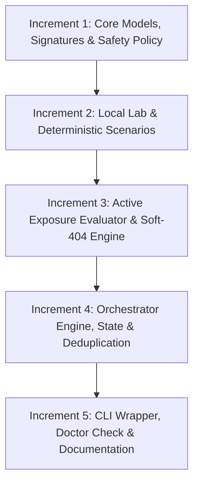

# BugBounty-Agent — Phase 19 Implementation Plan
## Infrastructure & Configuration Exposure

**Accepted Baseline**: `ca27208de5bd5789230f5c736f497c10a726748f`  
**Reference Document**: `docs/ROADMAP-24-PHASES-TEMP.md` (Phase 19)  
**Status**: Planned — Not Started (Planning Gate & Technical Design)  
**Architecture Model**: Single primary OpenCode agent (`Bug-Bounty`) with 18 modular skills (`subagent_depth: 1`)

---

## 1. Executive Summary & Objectives

### Primary Objective
Deliver **Phase 19: Infrastructure & Configuration Exposure** as a focused, conservative, and hypothesis-driven intelligence subsystem. Phase 19 correlates multi-source infrastructure, service, and web application observations to safely detect, evaluate, and verify exposed administrative interfaces, accidental configuration/backup file disclosures, sensitive deployment artifacts, unsafe server defaults, and diagnostic endpoints.

Phase 19 bridges the gap between passive reconnaissance/surface mapping (Phases 1–3) and active vulnerability validation (Phases 4–18) by identifying unintentional asset exposures before targeted vulnerability testing begins.

### Key Goals
1. **Multi-Source Passive Ingestion**: Ingest confirmed host, service, port, and route observations from `state/assets.json`, `state/recon.json`, `state/webapps.json`, and `state/api.json`.
2. **Deterministic Exposure Classification**: Formulate explicit exposure hypotheses across 8 high-value exposure classes:
   - Exposed administrative and management interfaces
   - Exposed version control repositories (`.git/HEAD`, `.svn/`)
   - Accidental environment and configuration files (`.env`, `web.config`, `config.json`)
   - Backup and archive artifacts (`.bak`, `.old`, `.tar.gz`, `~`)
   - Build, dependency, and deployment manifests (`composer.json`, `package.json`, `Dockerfile`)
   - Exposed frontend source maps (`.js.map`)
   - Open directory listings (`Index of /`)
   - Unsafe server defaults and diagnostic handlers (enabled `TRACE`, debug stack traces, unauthenticated setup wizards)
3. **Safe, Bounded Verification**:
   - Zero brute-force crawling or indiscriminate wordlist spraying.
   - Strict content-type and magic-byte signature validation to eliminate custom 404 / Single Page Application (SPA) soft-404 false positives.
   - Bounded streaming byte budgets (8 KB–32 KB max per response) and immediate stream truncation upon signature match.
4. **Strict Sensitive Data Minimization**:
   - Zero plaintext storage of passwords, API keys, private keys, or tokens.
   - Cryptographic SHA-256 fingerprinting and automated redaction (`[REDACTED_BY_BB_AGENT]`) before disk persistence or report generation.
   - Zero credential utilization or authentication attempts.
5. **Single-Agent Architecture Invariant**:
   - Implemented as Python engine `framework/infrastructure/` and CLI tool `scripts/bb-infra` (`bb-infra.cmd`).
   - Integrated into the single `Bug-Bounty` agent via `skills/web-security/SKILL.md` (surface mapping & exposure) and `skills/reconnaissance/SKILL.md` without introducing a 19th skill or separate subagent.

---

## 2. Mandatory Architectural & Safety Invariants

Phase 19 strictly enforces all project-wide security and architectural invariants:

1. **Single Orchestrator Agent**: Exactly one global OpenCode primary agent: `Bug-Bounty`. Subagents remain denied (`subagent_depth: 1`).
2. **18 Modular Skills Catalog**: No new skills added; exposure capabilities are documented within `skills/web-security/` and `skills/reconnaissance/`.
3. **Fail-Closed Scope Enforcement**: Every target URL/host must pass offline scope verification via `ScopeEngine.check()` prior to any network interaction. Explicit scope exclusions override all inclusions.
4. **Anti-SSRF Destination Protection**: Prohibits requests resolving to loopback (`127.0.0.0/8`, `::1`), RFC1918 private, link-local, carrier-grade NAT, or cloud metadata IP addresses (`169.254.169.254`, `metadata.google.internal`), including alternate hex, octal, or dword IP encodings.
5. **Non-Destructive Testing**: Only safe HTTP methods (`GET`, `HEAD`, `OPTIONS`). Zero `POST`, `PUT`, `DELETE` with arbitrary payloads, zero data modification, zero denial-of-service, and zero automated file uploads or deletions.
6. **No Automated Exploitation or Logins**: Discovery of an administrative portal or credential artifact never triggers automated login attempts, password spraying, or session hijacking.
7. **No Automated Report Submission**: Findings are generated as Markdown/JSON artifacts for human researcher review; zero automatic platform disclosure.
8. **Runtime Data Separation**: Target metadata, scan logs, and state files remain in local program workspaces (`~/BugBounty-Workspace/<program>/`) and are never committed to version control.

---

## 3. Current Repository Baseline & Capability Evidence

A detailed inspection of the repository at baseline `ca27208de5bd5789230f5c736f497c10a726748f` identified the following concrete foundations and gaps:

| Subsystem / Directory | Relevant Source Files | Verified Capabilities | Gaps for Phase 19 |
| :--- | :--- | :--- | :--- |
| **Asset Intelligence** | `framework/assets/model.py`<br>`framework/assets/graph.py` | `AssetType` (including `INFRASTRUCTURE_REF`, `SERVICE_ENDPOINT`), relationship graph, CDN attribution (`CDNAttribution`), arbitrary recursion depth tracking. | Does not model server misconfigurations, administrative interfaces, or accidental file exposures. |
| **Reconnaissance** | `framework/recon/model.py`<br>`framework/recon/engine.py` | `HttpObservation` (captures `server_header`, `security_headers`, `technologies`, `status_code`, `title`), `PortServiceObservation`, `DnsRecordObservation`. | Strictly passive discovery; no active, safe probe verification for configuration files or management paths. |
| **Web Applications** | `framework/webapp/model.py`<br>`framework/webapp/engine.py` | HTML parsing, form extraction (`FormObservation`), cookie tracking, route crawling (`WebEndpoint`), robots.txt/sitemap extraction. | Maps standard navigation links; does not test unlinked administrative surfaces, `.env` files, `.git` metadata, or backup extensions. |
| **Cloud Security** | `framework/cloud_security/discovery.py`<br>`framework/cloud_security/exposure.py` | Cloud provider classification (AWS, Azure, GCP), public S3/Blob/GCS bucket read/listing checks, dangling CNAME takeover detection. | Domain-restricted to 3rd-party cloud object storage; does not evaluate web server configuration or local deployment mistakes. |
| **HTTP Trust** | `framework/http_trust/model.py`<br>`framework/http_trust/engine.py` | Host header injection, basic CORS origin reflection, HTTP parameter pollution (HPP). | Focused on HTTP header parsing; does not audit server method permissions (`TRACE`), directory listing, or stack traces. |
| **Validation Foundation** | `framework/validation/engine.py`<br>`framework/validation/policy.py` | Centralized `SecurityTestPolicy`, streaming byte bounding (`_read_bounded`), anti-SSRF IP verification, rate limits, `ControlledRequest`/`ControlledResponse`. | `VulnerabilityFamily` enum lacks explicit `INFRASTRUCTURE_EXPOSURE` and `CONFIGURATION_EXPOSURE` members. |
| **Data Sanitization** | `framework/common/evidence.py` | `sanitize_sensitive_data()` with comprehensive regexes for authorization headers, cookies, API keys, JWTs, query params, and private keys. | Ready for reuse, but needs integration with streaming response readers to truncate before reading massive backup archives. |
| **Findings & Lifecycle** | `framework/findings/schema.py`<br>`framework/findings/lifecycle.py` | Structured `Finding` schema, state machine (`OBSERVATION`, `HYPOTHESIS`, `CANDIDATE`, `VALIDATED`, `REJECTED`, `INFORMATIONAL`, `SIMULATED`). | Fully supports exposure findings without schema modification. |
| **State Management** | `framework/state/manager.py`<br>`framework/state/dedup.py` | Manages `assets.json`, `recon.json`, `webapps.json`, `api.json`, `findings.json`. SHA-256 test fingerprinting and duplicate clustering. | Needs state file integration for `infrastructure.json`. |

---

## 4. Gap-Analysis Matrix

Every candidate capability for Phase 19 is evaluated and classified below:

| Proposed Capability | Classification | Current State in Repository | Implementation Plan in Phase 19 |
| :--- | :--- | :--- | :--- |
| **Infrastructure & Service Inventory** | **Partially implemented** | Passive assets and HTTP observations exist in `framework/assets/` and `framework/recon/`. | Ingest and correlate existing `HttpObservation` and `TechnologyObservation` into candidate exposure hypotheses without re-running recon. |
| **Exposed Administrative Surfaces** | **Missing** | Discovered pages/forms in `framework/webapp/` only record crawled HTML links. | Create heuristic matcher and bounded probe engine for common administrative endpoints (`/actuator`, `/admin`, phpMyAdmin, cPanel, Solr, Kubernetes, Grafana). |
| **Soft-404 / SPA Rejection** | **Missing** | No baseline differential comparison for non-existent paths; SPA index pages returning HTTP 200 trigger false alarms. | Implement random-path baseline comparison (`__bb_probe_404_<hash>__`) to detect and reject wildcard 200 / SPA soft-404 responses. |
| **Exposed Version Control (`.git`, `.svn`)** | **Missing** | None. | Implement safe verification: check `.git/HEAD` for `ref: refs/` signature; verify `.git/config` format with immediate 4 KB truncation. |
| **Exposed Config & Env Files (`.env`, `web.config`)** | **Missing** | None. | Implement content-type and key-value signature matcher (`KEY=value`, `<configuration>`), verify non-HTML body, redact all secrets, truncate at 8 KB. |
| **Exposed Backup & Archive Files (`.bak`, `.zip`)** | **Missing** | None. | Implement targeted candidate generation from known endpoints; verify binary magic bytes (e.g. `PK\x03\x04` for zip, `\x1f\x8b` for gzip); truncate at 1 KB; never download full archive. |
| **Deployment Manifests (`composer.json`, `Dockerfile`)** | **Missing** | None. | Implement JSON/manifest schema validation; confirm structural markers; record software/dependency exposure as Informational or Low. |
| **Exposed Frontend Source Maps (`.js.map`)** | **Missing** | `framework/javascript/` inspects `.js` files but does not probe for unbundled `.map` files. | Test corresponding `.map` URLs for bundled scripts; verify JSON format containing `"sources": [...]` and `"mappings": "..."`. |
| **Open Directory Listing** | **Missing** | None. | Detect web server directory index signatures (`Index of /`, `Directory Listing For /`, `[To Parent Directory]`) and verify text/html content. |
| **Unsafe HTTP Methods (`TRACE`, `PUT`, `DELETE`)** | **Missing** | `framework/api/` checks REST methods, but does not test web server `TRACE` reflection or unauthenticated `PUT`. | Safe `OPTIONS` check followed by bounded `TRACE` probe checking for echoed request headers without side effects. |
| **Exposed Debug Error Handlers** | **Missing** | None. | Formulate passive and active observations for verbose stack traces disclosing environment variables (Django `DEBUG=True`, Laravel Ignition, Rails backtraces). |
| **Cross-Engine Provenance & Attack-Path Prep** | **Partially implemented** | Stable UUIDs in `Asset`, `Finding`, and `WebEndpoint`. | Standardize `EXP-<uuid>` correlation identifiers and reference `affected_asset` and `endpoint` to ensure seamless Phase 22 integration. |
| **Live Credential Brute-Forcing** | **Out of scope** | Prohibited by project safety rules. | Explicitly excluded. Zero credential brute-forcing, dictionary spraying, or automated authentication attempts. |
| **Destructive File Modification / Upload** | **Out of scope** | Prohibited by project safety rules. | Explicitly excluded. No `PUT` with file bodies, no `DELETE` requests, no file overwrites. |

---

## 5. Architectural Design Decision

### Architecture Evaluation

1. **Option 1: Extend `framework/webapp/`**
   - *Pros*: Reuses existing web application state and crawling models.
   - *Cons*: Violates single responsibility principle. `framework/webapp/` is an attack surface crawler for HTML elements (pages, forms, links). Muddled boundaries between passive surface mapping and targeted exposure verification.
2. **Option 2: Extend `framework/cloud_security/`**
   - *Pros*: Both deal with "misconfiguration" and "exposure".
   - *Cons*: `cloud_security` is strictly organized around 3rd-party cloud providers (AWS, Azure, GCP) and object storage buckets. Web server backup files, `.git` folders, and Spring Boot Actuators are not cloud infrastructure resources.
3. **Option 3: Dedicated Module `framework/infrastructure/` with Shared Transport (Recommended)**
   - *Pros*:
     * **Clean Separation of Concerns**: Clear ownership of infrastructure and configuration exposure logic.
     * **Direct Reuse of Shared Foundations**: Reuses `SecurityValidationEngine`, `SecurityTestPolicy`, `sanitize_sensitive_data()`, `FindingLifecycle`, and `FindingDeduplicator`.
     * **Safe & Testable**: Allows comprehensive unit and local lab testing (`LocalInfrastructureLab`) without modifying existing webapp or cloud tests.
     * **Consistent with Repository Design**: Mirrors the architecture of `framework/authz/`, `framework/ssrf/`, `framework/xxe/`, and `framework/cloud_security/`.
     * **Maintains 18-Skill Invariant**: Integrated into `skills/web-security/` and orchestrator `Bug-Bounty` as the authoritative CLI tool `bb-infra`.

### Engine Component Architecture (`framework/infrastructure/`)

```
framework/infrastructure/
├── __init__.py               # Package exports
├── model.py                  # ExposureCategory, ExposureCandidate, ExposureHypothesis, ExposureFinding
├── signatures.py             # Deterministic signature matchers for .git, .env, backups, manifests, admin panels
├── policy.py                 # InfrastructureExposurePolicy (streaming budgets, timeouts, rate limits)
├── exposure.py               # Active exposure evaluator, soft-404 differential tester, content validators
├── engine.py                 # InfrastructureIntelligenceEngine (orchestrator, candidate discovery, validation pipeline)
├── state.py                  # InfrastructureStateManager (manages state/infrastructure.json)
└── lab.py                    # LocalInfrastructureLab (deterministic offline test fixture with 16 mock scenarios)
```

---

## 6. Proposed Interfaces, Data Contracts & Finding Semantics

### 6.1 Data Contracts (`framework/infrastructure/model.py`)

#### Exposure Categories
```python
class ExposureCategory(str, Enum):
    ADMIN_INTERFACE = "ADMIN_INTERFACE"         # Exposed administrative consoles, management dashboards
    VERSION_CONTROL = "VERSION_CONTROL"         # Exposed .git, .svn repositories
    CONFIG_FILE = "CONFIG_FILE"                 # Exposed .env, web.config, settings, credentials
    BACKUP_ARCHIVE = "BACKUP_ARCHIVE"           # Backup and archive files (.bak, .tar.gz, .zip)
    DEPLOYMENT_MANIFEST = "DEPLOYMENT_MANIFEST" # Exposed composer.json, package.json, Dockerfile
    SOURCE_MAP = "SOURCE_MAP"                   # Exposed frontend JavaScript source maps (.js.map)
    DIRECTORY_LISTING = "DIRECTORY_LISTING"     # Open web server directory indices (Index of /)
    DEBUG_INTERFACE = "DEBUG_INTERFACE"         # Exposed Spring Boot Actuators, phpinfo, debug stack traces
    UNSAFE_METHOD = "UNSAFE_METHOD"             # Enabled TRACE or misconfigured HTTP methods
```

#### Exposure Candidate & Hypothesis
```python
@dataclass
class ExposureCandidate:
    candidate_id: str                          # EXP-UUID
    application: str                          # Canonical root asset / app
    endpoint: str                             # Target URL being evaluated
    category: ExposureCategory                # Exposure classification
    confidence: str = "LOW"                   # LOW, MEDIUM, HIGH, CONFIRMED
    lifecycle_state: str = "CANDIDATE"        # CANDIDATE, APPROVED, TESTING, VALIDATED, REJECTED
    approval_status: str = "PENDING"          # PENDING, APPROVED, REJECTED
    evidence_fingerprint: Optional[str] = None # SHA-256 hash of signature evidence
    notes: Optional[str] = None
    created_at: str = ...
```

### 6.2 Finding Semantics & Lifecycle Mapping

Phase 19 adheres strictly to `FindingLifecycle` (`framework/findings/lifecycle.py`):

1. **`OBSERVATION`**:
   - An administrative login page (e.g. `/admin`, `/login`, `wp-login.php`) returns HTTP 200 with a standard login form.
   - Severity: `INFORMATIONAL`, Confidence: `HIGH`.
   - Explanation: Login interfaces are designed to be accessible; exposure is noted for asset modeling without asserting a security vulnerability.
2. **`CANDIDATE`**:
   - Passive reconnaissance or URL crawling reveals references to potential backup files or diagnostic endpoints.
   - Severity: `MEDIUM`, Confidence: `MEDIUM`.
   - Requires safe active verification or operator approval before classification.
3. **`VALIDATED`**:
   - Bounded active probe demonstrates unauthenticated access to sensitive configuration files (`.env` with valid key-value pairs), exposed source code (`.git/HEAD` containing `ref: refs/`), sensitive diagnostic data (Spring Boot `/actuator/env`), or open directory listing.
   - Severity: `HIGH` (e.g. `.env`, `.git`, `/actuator/env`) or `MEDIUM` (e.g. directory listing, source maps). Confidence: `CONFIRMED`.
   - Evidence includes redacted excerpt, SHA-256 fingerprint, status code, and content-type header.
4. **`REJECTED`**:
   - Server returns HTTP 404/403, or the differential soft-404 tester proves the server returns HTTP 200 for any random path (SPA catch-all).
   - Candidate state updated to `REJECTED`; zero finding generated.
5. **`NEEDS_MANUAL_REVIEW`**:
   - Response returns HTTP 401/403 Basic Auth or custom authorization challenge requiring human credentials.
   - Agent records candidate as requiring manual researcher review; dispatches zero credential probes.
6. **`SIMULATED`**:
   - Probes executed against local mock test harness (`LocalInfrastructureLab`).
   - Strictly emitted as `SIMULATED` finding (`INFORMATIONAL`), never promoted to live validated finding.

### 6.3 Stable Correlation Identifiers
- Every candidate receives a canonical ID: `EXP-<program_id>-<sha256(url+category)[:12]>`.
- Every finding cross-references:
  * `affected_asset`: Root domain / hostname from `state/assets.json`.
  * `affected_endpoint`: Canonical URL from `state/webapps.json` or `state/recon.json`.
  * `provenance`: Ingestion source (e.g. `recon_state`, `webapp_state`, or `heuristic_probe`).
  * Compatible with future Phase 22 attack-path correlation models.

---

## 7. Explicit Safety Policies & Sensitive Data Minimization Strategy

### 7.1 Quantitative Ceilings (`InfrastructureExposurePolicy`)

```python
class InfrastructureExposurePolicy:
    allowed_methods: Set[str] = {"GET", "HEAD", "OPTIONS"}
    max_requests_per_endpoint: int = 10         # Strict request bound
    max_requests_per_program: int = 150         # Global program ceiling
    timeout_seconds: float = 4.0                # Short timeout to avoid hanging
    max_response_bytes: int = 32_768            # 32 KB response ceiling
    max_manifest_bytes: int = 8_192             # 8 KB for JSON/text manifests
    max_binary_magic_bytes: int = 1_024         # 1 KB for backup/archive headers
    max_evidence_excerpt_bytes: int = 2_048     # 2 KB sanitized excerpt
    concurrency: int = 1                        # Sequential requests only
    rate_limit_delay_seconds: float = 0.5       # Rate-limiting between probes
    block_destructive_actions: bool = True      # Hard block on state changes
```

### 7.2 Data Minimization & Secret Redaction Strategy

1. **Never Download Complete Archives or Files**:
   - For archive probes (`.zip`, `.tar.gz`, `.sql.gz`), read only the first 512 bytes (`_read_bounded`). Verify file signature magic bytes (e.g. `\x1f\x8b` for gzip, `PK\x03\x04` for zip), record the content-length and content-type, and immediately abort connection.
   - For configuration files (`.env`, `config.json`), read a maximum of 8 KB. Verify key patterns.
2. **Immediate Redaction**:
   - All response content passing into evidence storage is processed through `sanitize_sensitive_data()`.
   - Passwords, access tokens, API keys, and private keys are replaced with `[REDACTED_BY_BB_AGENT]` before saving to `state/infrastructure.json` or `reports/`.
3. **Cryptographic Integrity**:
   - Compute `SHA-256` digest of the sanitized payload excerpt to provide cryptographic proof of observation without retaining raw credentials.
4. **Zero Credential Reuse**:
   - If a database password or API token is partially observed, the framework strictly prohibits using it to authenticate to databases, cloud providers, or APIs.

---

## 8. Detailed Exposure Classes & Verification Heuristics

### 1. Version Control Exposure (`.git`, `.svn`)
* **Target URLs**: `/.git/HEAD`, `/.git/config`, `/.svn/entries`, `/.svn/wc.db`.
* **Verification Heuristic**:
  - `/.git/HEAD` must return HTTP 200, Content-Type `text/plain` or `application/octet-stream` (not `text/html`), and the body must start with `ref: refs/` or match a 40-character hex commit SHA.
  - Soft-404 check: Random path `/.git/HEAD_<random>` must not return HTTP 200 with identical body.
* **Sensitive Data Policy**: Record the branch ref or commit hash; do not recursively dump git repository objects.

### 2. Accidental Environment & Config Files (`.env`, `config.json`)
* **Target URLs**: `/.env`, `/.env.local`, `/.env.production`, `/config.json`, `/web.config`, `/settings.py`.
* **Verification Heuristic**:
  - `/.env`: Must return HTTP 200, Content-Type `text/plain` or `application/octet-stream`, matching regex `^[A-Z0-9_]{3,}\s*=` across multiple lines.
  - Reject if body contains HTML tags (`<!DOCTYPE`, `<html`, `<body`).
  - Soft-404 comparison against `/__bb_random_<hash>__.env`.
* **Sensitive Data Policy**: Redact all values (`SECRET_KEY=[REDACTED]`); store only key names, line count, and sanitized excerpt.

### 3. Backup and Archive Files
* **Target URLs**: Generated by appending extensions to known endpoints or root: `index.php.bak`, `app.zip`, `backup.tar.gz`, `dump.sql`.
* **Verification Heuristic**:
  - Read first 512 bytes. Validate binary magic bytes:
    * Zip: `PK\x03\x04`
    * Gzip: `\x1f\x8b`
    * Tar: POSIX tar header at offset 257 (`ustar`)
    * SQL dump: Initial comment headers (`-- MySQL dump` or `CREATE TABLE`).
  - Content-Type must match binary/octet-stream, not HTML.
* **Sensitive Data Policy**: Immediately close stream after magic byte detection; record file size and hash; never download file body.

### 4. Administrative & Management Interfaces
* **Target URLs**: `/actuator`, `/actuator/env`, `/actuator/health`, `/admin/`, `/phpmyadmin/`, `/cpanel`, `/grafana/`, `/prometheus/metrics`.
* **Verification Heuristic**:
  - Distinguish open management vs. protected login:
    * Protected login form returning 200 $\to$ `OBSERVATION` (`INFORMATIONAL`).
    * Unauthenticated diagnostic dump (e.g. `/actuator/env` returning JSON with environment details) $\to$ `VALIDATED` (`HIGH`).
    * Prometheus `/metrics` returning plaintext metrics $\to$ `VALIDATED` (`MEDIUM`).

### 5. Frontend Source Maps (`.js.map`)
* **Target URLs**: Identified by reading `//# sourceMappingURL=` comments in JavaScript files from `state/webapps.json`, or appending `.map` to script paths.
* **Verification Heuristic**:
  - Must return HTTP 200, Content-Type `application/json`, and parse as valid JSON containing keys `"version"`, `"sources"`, and `"mappings"`.
* **Sensitive Data Policy**: Record list of original source file paths; do not reconstruct or save complete frontend repository code.

### 6. Open Directory Listings
* **Target URLs**: Discovered directories and asset roots (`/images/`, `/static/`, `/uploads/`, `/backup/`).
* **Verification Heuristic**:
  - HTTP 200, Content-Type `text/html`.
  - Body contains directory index signatures: `Index of /`, `Directory Listing For`, `[To Parent Directory]`, `<title>Index of`.
  - Must contain hyperlink table or list of filenames with modified dates/sizes.

### 7. Unsafe HTTP Methods
* **Target URLs**: Discovered application root and API endpoints.
* **Verification Heuristic**:
  - Send `OPTIONS` request. Inspect `Allow` header for `TRACE`.
  - If `TRACE` is listed, send bounded `TRACE` probe with custom header `X-BB-Trace-Canary: <token>`.
  - If response returns HTTP 200 with Content-Type `message/http` reflecting the canary header $\to$ `VALIDATED` (`MEDIUM`).

---

## 9. Comprehensive Test Strategy & Local Test Lab

Testing Phase 19 requires 100% deterministic, offline verification without touching external live targets.

### 9.1 Local Test Lab (`LocalInfrastructureLab`)
Create `framework/infrastructure/lab.py` running an ephemeral in-process `http.server.HTTPServer` supporting 16 deterministic scenarios:
1. `SCENARIO_GIT_HEAD_EXPOSED`: Returns valid `.git/HEAD` (`ref: refs/heads/main`).
2. `SCENARIO_GIT_HEAD_SOFT404`: SPA catch-all returning HTTP 200 HTML for `.git/HEAD` and random paths.
3. `SCENARIO_ENV_EXPOSED`: Returns valid `.env` with DB credentials and API keys.
4. `SCENARIO_ENV_HTML_404`: Custom 404 page returning HTTP 200 HTML with "Page Not Found".
5. `SCENARIO_BACKUP_ZIP_EXPOSED`: Returns `PK\x03\x04` magic bytes with octet-stream header.
6. `SCENARIO_ACTUATOR_ENV_OPEN`: Returns unauthenticated Spring Boot actuator JSON.
7. `SCENARIO_ADMIN_LOGIN_PROTECTED`: Returns standard admin login page with HTML form.
8. `SCENARIO_PROMETHEUS_METRICS`: Returns valid Prometheus metric lines.
9. `SCENARIO_DIRECTORY_LISTING`: Returns Apache `Index of /uploads` HTML.
10. `SCENARIO_SOURCE_MAP_EXPOSED`: Returns valid `.js.map` JSON structure.
11. `SCENARIO_TRACE_METHOD_ENABLED`: Reflects `TRACE` request and headers.
12. `SCENARIO_DEPLOYMENT_MANIFEST`: Returns valid `composer.json` with dependencies.
13. `SCENARIO_SECRET_REDACTION`: Verifies that returned secrets are redacted before saving.
14. `SCENARIO_STREAMING_BYTE_LIMIT`: Serves oversized 10 MB file; verifies engine truncates at 32 KB.
15. `SCENARIO_OUT_OF_SCOPE_REJECTION`: Tests target rejected by scope engine before connection.
16. `SCENARIO_SSRF_LOOPBACK_REJECTION`: Tests destination IP resolving to loopback/private blocked.

### 9.2 Test Suite Matrix (`tests/test_infrastructure_engine.py`)

| Test Group | Test Cases | Objective & Assertions |
| :--- | :--- | :--- |
| **Unit Tests** | `test_signatures_git`<br>`test_signatures_env`<br>`test_signatures_backups`<br>`test_soft404_differential` | Verify signature regexes and magic byte validators accept valid markers and reject HTML/soft-404 false positives. |
| **Safety Tests** | `test_scope_fail_closed`<br>`test_ssrf_prohibited_ip`<br>`test_streaming_byte_cap`<br>`test_sensitive_data_redaction` | Assert that out-of-scope targets fail closed, private IPs are rejected, responses over 32 KB are truncated, and passwords are never saved in plaintext. |
| **Finding Semantics** | `test_finding_observation_vs_validated`<br>`test_finding_deduplication`<br>`test_simulated_finding_classification` | Verify that admin logins emit `OBSERVATION`, .env emits `VALIDATED`, and lab tests emit `SIMULATED`. Assert duplicate probes merge cleanly. |
| **State Persistence** | `test_state_initialization`<br>`test_state_candidate_save_list`<br>`test_state_atomic_write` | Verify `state/infrastructure.json` is created atomically and recovers cleanly across engine re-instantiations. |
| **Integration Tests** | `test_recon_and_webapp_ingestion`<br>`test_cli_dry_run_and_tree`<br>`test_doctor_integration` | Verify `bb-infra` CLI processes existing `recon.json` / `webapps.json`, and `bb-doctor` Category 24 / tool check passes. |

---

## 10. Work Breakdown & Implementation Increments

The implementation of Phase 19 is organized into 5 cohesive increments designed for forward-only milestone commits:



### Increment 1: Core Models, Signatures & Safety Policy
- Files:
  * `framework/infrastructure/model.py`: `ExposureCategory`, `ExposureCandidate`, `ExposureHypothesis`.
  * `framework/infrastructure/signatures.py`: Deterministic content validators and magic byte extractors.
  * `framework/infrastructure/policy.py`: `InfrastructureExposurePolicy` (32 KB limit, safe methods).
  * `framework/validation/model.py`: Add `INFRASTRUCTURE_EXPOSURE` and `CONFIGURATION_EXPOSURE` to `VulnerabilityFamily`.

### Increment 2: Deterministic Local Lab Harness
- Files:
  * `framework/infrastructure/lab.py`: `LocalInfrastructureLab` implementing all 16 mock test scenarios on loopback fixture port.

### Increment 3: Active Exposure Evaluator & Soft-404 Engine
- Files:
  * `framework/infrastructure/exposure.py`: Implements differential soft-404 baseline testing, bounded streaming reader, and category-specific evaluators. Integrates `SecurityValidationEngine` and `sanitize_sensitive_data()`.

### Increment 4: Orchestrator Engine, State & Deduplication
- Files:
  * `framework/infrastructure/state.py`: `InfrastructureStateManager` managing `state/infrastructure.json`.
  * `framework/infrastructure/engine.py`: `InfrastructureIntelligenceEngine` implementing candidate discovery from prior states (`recon.json`, `webapps.json`, `api.json`), approval gating, testing pipeline, and finding emission.

### Increment 5: CLI Wrapper, Doctor Check & Documentation
- Files:
  * `scripts/bb-infra` & `scripts/bb-infra.cmd`: CLI entry point supporting `--passive-only`, `--dry-run`, `--approve`, `--tree`, `--json`.
  * `opencode.jsonc`: Add permission rule for `*bb-infra*`.
  * `framework/tools/doctor.py`: Add Category 24 check for Infrastructure Intelligence Engine.
  * `skills/web-security/SKILL.md`: Document infrastructure & configuration exposure methodology and `bb-infra` CLI usage.
  * `README.md` & `docs/ROADMAP-24-PHASES-TEMP.md`: Update subsystem overview and record Phase 19 delivery.

---

## 11. Acceptance Criteria & Quality Gates

Phase 19 will be accepted only when all of the following measurable conditions are satisfied:

1. **Exact Capability Delivery**:
   - All 8 exposure classes implemented and covered by unit/functional tests.
   - Deterministic differential soft-404 verification eliminates SPA false positives.
   - All secret-bearing responses are redacted via `sanitize_sensitive_data()`.
2. **Safety & Boundary Invariants**:
   - 100% fail-closed scope enforcement: zero network dispatch to out-of-scope targets.
   - Anti-SSRF verification: loopback, private, and cloud metadata targets rejected before dispatch.
   - Streaming response budget strictly enforced: no response read exceeds 32 KB.
   - Safe HTTP methods only: `GET`, `HEAD`, `OPTIONS` (and bounded `TRACE` where enabled). Zero destructive `POST`/`PUT`/`DELETE` calls.
   - Zero automated login attempts or credential usage.
3. **Data & Finding Semantics**:
   - Finding lifecycle strictly obeys `FindingLifecycle` (`OBSERVATION`, `CANDIDATE`, `SIMULATED`, `VALIDATED`, `REJECTED`).
   - Deduplication prevents repetitive probes or duplicate findings for the same asset/category.
   - Offline test harness findings are strictly classified as `SIMULATED`.
4. **Cross-Platform Test Execution**:
   - 100% pass across all new Phase 19 tests on Windows 11.
   - Full regression suite on Windows 11 passes without regressions.
   - Full verification on Kali Linux executed and documented when Kali VM is booted.
5. **Architectural Purity**:
   - Single OpenCode primary agent `Bug-Bounty` preserved; subagents denied.
   - 18 modular skills catalog preserved.

---

## 12. Documentation Checklist for Implementation

During implementation, the following documentation files will be updated:

- [ ] `docs/ROADMAP-24-PHASES-TEMP.md`: Update Phase 19 status from Planned to Complete/Accepted, documenting delivery notes, commit hash, and verified test metrics. Set Phase 20 as Current Active Phase.
- [ ] `README.md`: Add `framework/infrastructure/` to repository architecture tree; add `bb-infra` to CLI tools catalog; update `bb-doctor` category count to 24.
- [ ] `docs/architecture.md`: Document `framework/infrastructure/` within Core Intelligence layer.
- [ ] `docs/security.md`: Document Phase 19 streaming response caps, secret redaction, and non-destructive exposure testing principles.
- [ ] `skills/web-security/SKILL.md`: Add Section on Infrastructure & Configuration Exposure (`bb-infra` usage and methodology).
- [ ] `CHANGELOG.md`: Record Phase 19 release notes.

---

## 13. Future Phase Compatibility (Phases 20–24)

Phase 19 is designed with explicit interfaces supporting future roadmap phases:

* **Phase 20 (Race Conditions & Distributed Workflows)**: Administrative and diagnostic state endpoints discovered in Phase 19 provide valid targets for concurrency testing without requiring rediscovery.
* **Phase 21 (Authentication & Authorization Correlation)**: Management surfaces discovered in Phase 19 feed directly into the dual-principal access-control comparator to test vertical privilege escalation.
* **Phase 22 (Cross-Engine Attack-Path Correlation)**: Every Phase 19 finding retains canonical asset, endpoint, and exposure correlation identifiers (`EXP-<uuid>`) with clear provenance, enabling graph correlation into multi-step attack chains.
* **Phase 23 (Autonomous Research Planning)**: Exposure findings provide high-confidence signals to prioritize subsequent targeted authorization or injection testing.
* **Phase 24 (Production Readiness)**: Consistent data schemas, atomic state persistence, and reproducible offline labs ensure robust production deployment.

---

## 14. Open Questions & Design Alignment

* **Question 1: CLI Tool Naming**: We propose `bb-infra` as the CLI wrapper (matching `bb-auth`, `bb-recon`, `bb-cloud`, `bb-api`). Is `bb-infra` preferred over `bb-exposure`? *(Recommendation: `bb-infra` is concise, clear, and consistent with existing CLI tools).*
* **Question 2: Response Budget Ceiling**: We recommend a maximum response size of 32 KB for exposure checks (and 1 KB for binary archives). Does this meet your bandwidth and security expectations? *(Recommendation: 32 KB is optimal for capturing `.env` and manifest headers while preventing large archive downloads).*
