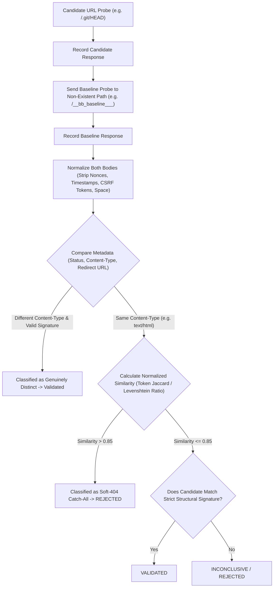
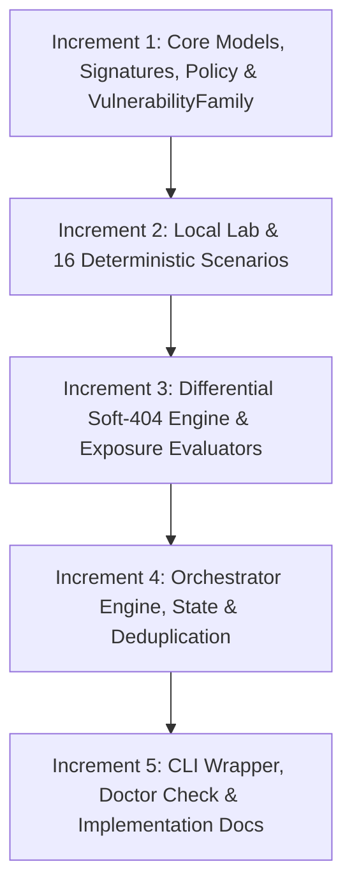

# BugBounty-Agent — Phase 19 Implementation Plan
## Infrastructure & Configuration Exposure

**Accepted Baseline**: `ca27208de5bd5789230f5c736f497c10a726748f`  
**Reference Document**: `docs/ROADMAP-24-PHASES-TEMP.md` (Phase 19)  
**Status**: Planned — Not Started (Planning Gate & Technical Design)  
**Architecture Model**: Single primary OpenCode agent (`Bug-Bounty`) with 18 modular skills (`subagent_depth: 1`)

---

## 1. Executive Summary & Objectives

### Primary Objective
Deliver **Phase 19: Infrastructure & Configuration Exposure** as a focused, conservative, and hypothesis-driven intelligence subsystem. Phase 19 correlates multi-source infrastructure, service, and web application observations to safely detect, evaluate, and verify exposed administrative interfaces, accidental configuration/backup file disclosures, sensitive deployment artifacts, and diagnostic endpoints.

Phase 19 bridges the gap between passive reconnaissance/surface mapping (Phases 1–3) and active vulnerability validation (Phases 4–18) by identifying unintentional asset exposures before targeted vulnerability testing begins.

### Key Goals & Core Principles
1. **Multi-Source Passive Ingestion**: Ingest confirmed host, service, port, and route observations from `state/assets.json`, `state/recon.json`, `state/webapps.json`, and `state/api.json` to formulate targeted exposure hypotheses without redundant recon scans.
2. **Deterministic Exposure Classification**: Formulate explicit exposure hypotheses across exactly **8 well-defined exposure classes**:
   - Exposed administrative and management interfaces (`ADMIN_INTERFACE`)
   - Exposed version control repositories and metadata (`VERSION_CONTROL`)
   - Accidental environment and configuration files (`CONFIG_FILE`)
   - Backup and archive artifacts (`BACKUP_ARCHIVE`)
   - Build, dependency, and deployment manifests (`DEPLOYMENT_MANIFEST`)
   - Exposed frontend source maps (`SOURCE_MAP`)
   - Open directory listings (`DIRECTORY_LISTING`)
   - Diagnostic and debug endpoints (`DEBUG_INTERFACE`)
3. **Strict HTTP Method Restrictions**:
   - HTTP testing is strictly restricted to safe, read-only methods: `{"GET", "HEAD", "OPTIONS"}`.
   - Active `TRACE` testing is **explicitly excluded from Phase 19**. Passively observed method headers (`Allow`) are recorded as configuration metadata, but zero active `TRACE` probes are dispatched.
4. **Differential Soft-404 & Metadata-Aware Verification**:
   - Evaluates target responses against a normalized baseline non-existent path probe using status codes, Content-Type, redirect targets, and token-based body similarity.
   - Handles Single Page Application (SPA) catch-alls, custom error pages, and dynamic tokens (nonces, timestamps) without naive 200-rejections.
   - Replaces blanket zero-false-positive claims with measurable, fixture-based acceptance criteria.
5. **Strict Sensitive Data Minimization & Stopping Rules**:
   - Implements an explicit **evidence-sufficiency stopping rule**: network stream consumption halts immediately once an exposure is safely established.
   - Avoids reading sensitive environment dumps such as `/actuator/env`; probes only safe discovery endpoints (`/actuator`, `/actuator/health`).
   - Zero raw configuration or secret-bearing content persisted to disk. All retained evidence is sanitized through `sanitize_sensitive_data()`.
   - Fingerprints cryptographically authenticate the identity of the sanitized evidence representation, not the raw sensitive server transmission.
6. **Single-Agent Architecture Invariant**:
   - Implemented as Python engine `framework/infrastructure/` and CLI tool `scripts/bb-infra` (`bb-infra.cmd`).
   - Integrated into the single `Bug-Bounty` agent via `skills/web-security/SKILL.md` (surface mapping & exposure) and `skills/reconnaissance/SKILL.md` without introducing a 19th skill or separate subagent.

---

## 2. Mandatory Architectural & Safety Invariants

Phase 19 strictly enforces all project-wide security and architectural invariants:

1. **Single Orchestrator Agent**: Exactly one global OpenCode primary agent: `Bug-Bounty`. Subagents remain denied (`subagent_depth: 1`).
2. **18 Modular Skills Catalog**: No new skills added; exposure capabilities are documented within `skills/web-security/` and `skills/reconnaissance/`.
3. **Fail-Closed Scope Enforcement**: Every target URL/host must pass offline scope verification via `ScopeEngine.check()` prior to any network interaction. Explicit scope exclusions override all inclusions.
4. **Anti-SSRF Destination Protection**: Prohibits requests resolving to loopback (`127.0.0.0/8`, `::1`), RFC1918 private, link-local, carrier-grade NAT, or cloud metadata IP addresses (`169.254.169.254`, `metadata.google.internal`), including alternate hex, octal, or dword IP encodings.
5. **Non-Destructive Testing**: Only safe HTTP methods (`GET`, `HEAD`, `OPTIONS`). Zero `POST`, `PUT`, `DELETE` with arbitrary payloads, zero data modification, zero denial-of-service, and zero automated file uploads or deletions.
6. **Shared Endpoint-Safety & State-Changing Protections**: Enforces `SecurityTestPolicy` checks (`block_state_changing_get`, `is_state_changing_path`) against all candidate paths to prevent inadvertent state mutations.
7. **No Parallel Transport Bypasses**: Uses `SecurityTestPolicy` and `SecurityValidationEngine` directly; never introduces unvetted transport adapters.
8. **No Automated Exploitation or Logins**: Discovery of an administrative portal or credential artifact never triggers automated login attempts, password spraying, or session hijacking.
9. **No Automated Report Submission**: Findings are generated as Markdown/JSON artifacts for human researcher review; zero automatic platform disclosure.
10. **Runtime Data Separation**: Target metadata, scan logs, and state files remain in local program workspaces (`~/BugBounty-Workspace/<program>/`) and are never committed to version control.

---

## 3. Current Repository Baseline & Capability Evidence

A detailed inspection of the repository at baseline `ca27208de5bd5789230f5c736f497c10a726748f` identified the following concrete foundations and gaps:

| Subsystem / Directory | Relevant Source Files | Verified Capabilities | Gaps for Phase 19 |
| :--- | :--- | :--- | :--- |
| **Asset Intelligence** | `framework/assets/model.py`<br>`framework/assets/graph.py` | `AssetType` (including `INFRASTRUCTURE_REF`, `SERVICE_ENDPOINT`), relationship graph, CDN attribution (`CDNAttribution`), arbitrary recursion depth tracking. | Does not model server misconfigurations, administrative interfaces, or accidental file exposures. |
| **Reconnaissance** | `framework/recon/model.py`<br>`framework/recon/engine.py` | `HttpObservation` (captures `server_header`, `security_headers`, `technologies`, `status_code`, `title`), `PortServiceObservation`, `DnsRecordObservation`. | Strictly passive discovery; no active, safe probe verification for configuration files or management paths. |
| **Web Applications** | `framework/webapp/model.py`<br>`framework/webapp/engine.py` | HTML parsing, form extraction (`FormObservation`), cookie tracking, route crawling (`WebEndpoint`), robots.txt/sitemap extraction. | Maps standard navigation links; does not test unlinked administrative surfaces, `.env` files, `.git` metadata, or backup extensions. |
| **Cloud Security** | `framework/cloud_security/discovery.py`<br>`framework/cloud_security/exposure.py` | Cloud provider classification (AWS, Azure, GCP), public S3/Blob/GCS bucket read/listing checks, dangling CNAME takeover detection. | Domain-restricted to 3rd-party cloud object storage; does not evaluate web server configuration or local deployment mistakes. |
| **HTTP Trust** | `framework/http_trust/model.py`<br>`framework/http_trust/engine.py` | Host header injection, basic CORS origin reflection, HTTP parameter pollution (HPP). | Focused on HTTP header parsing; does not audit server method permissions, directory listing, or stack traces. |
| **Validation Foundation** | `framework/validation/engine.py`<br>`framework/validation/policy.py` | Centralized `SecurityTestPolicy`, streaming byte bounding (`_read_bounded`), anti-SSRF IP verification, rate limits, `ControlledRequest`/`ControlledResponse`. | `VulnerabilityFamily` enum lacks explicit `INFRASTRUCTURE_EXPOSURE` and `CONFIGURATION_EXPOSURE` members. |
| **Data Sanitization** | `framework/common/evidence.py` | `sanitize_sensitive_data()` with regexes for authorization headers, cookies, API keys, JWTs, query params, and private keys. | Needs integration with response stream stopping rules and leak prevention tests across logs/state. |
| **Findings & Lifecycle** | `framework/findings/schema.py`<br>`framework/findings/lifecycle.py` | Structured `Finding` schema, state machine (`OBSERVATION`, `HYPOTHESIS`, `CANDIDATE`, `VALIDATED`, `REJECTED`, `INFORMATIONAL`, `SIMULATED`). | Fully supports exposure findings without schema modification. |
| **State Management** | `framework/state/manager.py`<br>`framework/state/dedup.py` | Manages `assets.json`, `recon.json`, `webapps.json`, `api.json`, `findings.json`. SHA-256 test fingerprinting and duplicate clustering. | Needs state integration for `infrastructure.json`. |

---

## 4. Gap-Analysis Matrix

Every candidate capability for Phase 19 is evaluated and classified below:

| Proposed Capability | Classification | Current State in Repository | Implementation Plan in Phase 19 |
| :--- | :--- | :--- | :--- |
| **Infrastructure & Service Inventory** | **Partially implemented** | Passive assets and HTTP observations exist in `framework/assets/` and `framework/recon/`. | Ingest and correlate existing `HttpObservation` and `TechnologyObservation` into candidate exposure hypotheses without re-running recon. |
| **Exposed Administrative Surfaces** | **Missing** | Discovered pages/forms in `framework/webapp/` only record crawled HTML links. | Create heuristic matcher and bounded probe engine for common administrative endpoints (`/actuator`, `/actuator/health`, `/admin`, phpMyAdmin, cPanel, Solr, Grafana). Login forms remain `OBSERVATION`. |
| **Differential Soft-404 / SPA Evaluation** | **Missing** | No baseline differential comparison for non-existent paths. | Implement normalized differential baseline comparison (`__bb_differential_baseline_<hash>__`) evaluating status codes, Content-Type, redirect targets, and token similarity. |
| **Exposed Version Control (`.git`, `.svn`)** | **Missing** | None. | Implement safe verification: check `/.git/HEAD` for `ref: refs/` signature; truncate at 4 KB; classify as `MEDIUM` (not automatic `HIGH`); verify distinct from baseline. |
| **Exposed Config & Env Files (`.env`, `web.config`)** | **Missing** | None. | Implement content-type and key-value signature matcher (`KEY=value`, `<configuration>`), verify non-HTML body, stop at 2-3 keys (max 8 KB), redact all secrets. |
| **Exposed Backup & Archive Files (`.bak`, `.zip`)** | **Missing** | None. | Implement targeted candidate generation from known endpoints; verify binary magic bytes (`PK\x03\x04`, `\x1f\x8b`); truncate at 1 KB; never download full archive. |
| **Deployment Manifests (`composer.json`, `Dockerfile`)** | **Missing** | None. | Implement JSON/manifest schema validation; confirm structural markers; record software/dependency exposure as Informational or Low. |
| **Exposed Frontend Source Maps (`.js.map`)** | **Missing** | `framework/javascript/` inspects `.js` files but does not probe for unbundled `.map` files. | Test corresponding `.map` URLs for bundled scripts; verify JSON format containing `"sources": [...]` and `"mappings": "..."`; truncate at 8 KB; never download full source trees. |
| **Open Directory Listing** | **Missing** | None. | Detect web server directory index signatures (`Index of /`, `Directory Listing For /`, `[To Parent Directory]`) and verify text/html content distinct from soft-404 baseline. |
| **Diagnostic & Debug Endpoints** | **Missing** | None. | Safely probe unauthenticated health/metric endpoints (`/actuator`, `/actuator/health`, `/metrics`); avoid dumping full environment variables (`/actuator/env`). |
| **Cross-Engine Provenance & Attack-Path Prep** | **Partially implemented** | Stable UUIDs in `Asset`, `Finding`, and `WebEndpoint`. | Standardize `EXP-<uuid>` correlation identifiers and reference `affected_asset` and `endpoint` to ensure seamless Phase 22 integration. |
| **Active HTTP TRACE Probing** | **Out of scope** | Proposed in draft plan but inconsistent with safe-method policy. | Explicitly excluded from Phase 19 scope. Passive observation of `Allow` header preserved; zero active TRACE requests sent. |
| **Live Credential Brute-Forcing** | **Out of scope** | Prohibited by project safety rules. | Explicitly excluded. Zero credential brute-forcing, dictionary spraying, or automated authentication attempts. |
| **Destructive File Modification / Upload** | **Out of scope** | Prohibited by project safety rules. | Explicitly excluded. No `PUT` with file bodies, no `DELETE` requests, no file overwrites. |

---

## 5. Architectural Design Decision

### Architecture Evaluation

1. **Option 1: Extend `framework/webapp/`**
   - *Pros*: Reuses existing web application state and crawling models.
   - *Cons*: Violates single responsibility principle. `framework/webapp/` is an attack surface crawler for HTML elements (pages, forms, links). Muddled boundaries between passive surface mapping and targeted exposure verification.
2. **Option 2: Extend `framework/cloud_security/`**
   - *Pros*: Both deal with "misconfiguration" and "exposure".
   - *Cons*: `cloud_security` is strictly organized around 3rd-party cloud providers (AWS, Azure, GCP) and object storage buckets. Web server backup files, `.git` folders, and Spring Boot Actuators are not cloud infrastructure resources.
3. **Option 3: Dedicated Module `framework/infrastructure/` with Shared Transport (Recommended & Chosen)**
   - *Pros*:
     * **Clean Separation of Concerns**: Clear ownership of infrastructure and configuration exposure logic.
     * **Direct Reuse of Shared Foundations**: Reuses `SecurityValidationEngine`, `SecurityTestPolicy`, `sanitize_sensitive_data()`, `FindingLifecycle`, and `FindingDeduplicator`.
     * **Safe & Testable**: Allows comprehensive unit and local lab testing (`LocalInfrastructureLab`) without modifying existing webapp or cloud tests.
     * **Consistent with Repository Design**: Mirrors the architecture of `framework/authz/`, `framework/ssrf/`, `framework/xxe/`, and `framework/cloud_security/`.
     * **Maintains 18-Skill Invariant**: Integrated into `skills/web-security/` and orchestrator `Bug-Bounty` as the authoritative CLI tool `bb-infra`.

### Engine Component Architecture (`framework/infrastructure/`)

```
framework/infrastructure/
├── __init__.py               # Package exports
├── model.py                  # ExposureCategory, ExposureCandidate, ExposureHypothesis, ExposureFinding
├── signatures.py             # Deterministic signature matchers for .git, .env, backups, manifests, admin panels
├── policy.py                 # InfrastructureExposurePolicy (subclass or wrapper of SecurityTestPolicy)
├── differential.py           # Differential soft-404 tester, dynamic token stripper, similarity metrics
├── exposure.py               # Active exposure evaluator, bounded streaming reader, content validators
├── engine.py                 # InfrastructureIntelligenceEngine (orchestrator, candidate discovery, validation pipeline)
├── state.py                  # InfrastructureStateManager (manages state/infrastructure.json)
└── lab.py                    # LocalInfrastructureLab (deterministic offline test fixture with 16 mock scenarios)
```

---

## 6. Proposed Interfaces, Data Contracts & Finding Semantics

### 6.1 Data Contracts (`framework/infrastructure/model.py`)

#### Exposure Categories
Exactly 8 exposure classes:
```python
class ExposureCategory(str, Enum):
    ADMIN_INTERFACE = "ADMIN_INTERFACE"         # Administrative consoles, management dashboards, discovery endpoints
    VERSION_CONTROL = "VERSION_CONTROL"         # Exposed .git, .svn repositories and metadata
    CONFIG_FILE = "CONFIG_FILE"                 # Exposed .env, web.config, settings, configuration files
    BACKUP_ARCHIVE = "BACKUP_ARCHIVE"           # Backup and archive files (.bak, .tar.gz, .zip, .sql)
    DEPLOYMENT_MANIFEST = "DEPLOYMENT_MANIFEST" # Build and dependency manifests (composer.json, package.json, Dockerfile)
    SOURCE_MAP = "SOURCE_MAP"                   # Frontend JavaScript source maps (.js.map)
    DIRECTORY_LISTING = "DIRECTORY_LISTING"     # Open web server directory indices (Index of /)
    DEBUG_INTERFACE = "DEBUG_INTERFACE"         # Diagnostic endpoints (/actuator/health, /metrics, verbose stack traces)
```

#### Exposure Candidate
```python
@dataclass
class ExposureCandidate:
    candidate_id: str                           # EXP-<program_id>-<sha256(endpoint+category)[:12]>
    application: str                           # Canonical root asset / app
    endpoint: str                              # Target URL being evaluated
    category: ExposureCategory                 # Exposure classification
    confidence: str = "LOW"                    # LOW, MEDIUM, HIGH, CONFIRMED
    lifecycle_state: FindingLifecycle = FindingLifecycle.CANDIDATE
    approval_status: str = "PENDING"           # PENDING, APPROVED, REJECTED
    evidence_fingerprint: Optional[str] = None  # SHA-256 hash of sanitized excerpt
    notes: Optional[str] = None
    created_at: str = ...
```

### 6.2 Finding Semantics & Lifecycle Mapping

Phase 19 adheres strictly to `FindingLifecycle` (`framework/findings/lifecycle.py`):

1. **`OBSERVATION`**:
   - An administrative login page (e.g. `/admin`, `/login`, `wp-login.php`) returns HTTP 200 with an HTML form.
   - Severity: `INFORMATIONAL`, Confidence: `HIGH`.
   - Login interfaces are standard functionality. Exposure is noted for asset modeling without asserting a vulnerability.
2. **`CANDIDATE`**:
   - Passive reconnaissance or URL crawling suggests a potential configuration or backup path.
   - Severity: `LOW` or `MEDIUM`, Confidence: `MEDIUM`.
   - Requires safe active verification or operator approval before promotion.
3. **`VALIDATED`**:
   - Bounded active probe demonstrates unauthenticated access to configuration files, version control metadata, or open directory listings.
   - Must meet the explicit **Minimum Evidence Requirement** (see table below).
4. **`REJECTED`**:
   - Target returns HTTP 404, or differential analysis demonstrates the response is a soft-404 / SPA catch-all matching the baseline non-existent path.
   - Candidate marked `REJECTED`; zero finding generated.
5. **`ACCESS_RESTRICTED` / `OBSERVED`**:
   - Target returns HTTP 403 Forbidden.
   - **Crucial Rule**: HTTP 403 must NOT be reported as `REJECTED` (not found). A 403 confirms the resource exists but enforces access control. Classified as `OBSERVED` or `INFORMATIONAL` to preserve inventory knowledge without claiming an unauthenticated exposure.
6. **`NEEDS_MANUAL_REVIEW`**:
   - Response returns HTTP 401 Basic Auth or custom authorization challenges.
   - Recorded for manual researcher review; dispatches zero credential probes.
7. **`SIMULATED`**:
   - Probes executed against local mock test harness (`LocalInfrastructureLab`).
   - Strictly emitted as `SIMULATED` finding (`INFORMATIONAL`), never promoted to live validated finding.

### 6.3 Minimum Evidence Required per Validated Class

An HTTP 200 alone or a superficial regex match never establishes a validated vulnerability. The table below defines the strict minimum evidence required for promotion to `VALIDATED`:

| Exposure Class | Minimum Required Evidence for Promotion to `VALIDATED` | Default Severity & Justification |
| :--- | :--- | :--- |
| **`VERSION_CONTROL`** | 1. Status 200 with Content-Type `text/plain` or `application/octet-stream` (not `text/html`).<br>2. Body starts with `ref: refs/` or 40-char hex commit SHA.<br>3. Differential comparison confirms distinctness from baseline soft-404 response. | **`MEDIUM`** (or `LOW`).<br>`/.git/HEAD` exposes commit/branch pointers but does NOT prove full repository or object database access. Never automatic `HIGH`. |
| **`CONFIG_FILE`** | 1. Status 200 with non-HTML body.<br>2. Minimum 2 valid key-value configuration lines matching syntax (`KEY=value` or XML/JSON config root).<br>3. Distinct from soft-404 baseline.<br>4. Sanitized excerpt stored. | **`LOW`/`MEDIUM`** for general non-sensitive parameters (`APP_NAME=test`).<br>**`HIGH`** ONLY if verified credential keys (`DB_PASSWORD`, `SECRET_KEY`) exist in sanitized excerpt. Credentials stated as untested. |
| **`BACKUP_ARCHIVE`** | 1. Status 200 with binary/octet-stream Content-Type.<br>2. First 512–1,024 bytes match binary magic bytes (`PK\x03\x04`, `\x1f\x8b`, `ustar`).<br>3. Stream truncated immediately after magic byte confirmation. | **`MEDIUM`**.<br>Confirms archive presence without full download. Impact reflects potential offline inspection. |
| **`ADMIN_INTERFACE`** | 1. Status 200 unauthenticated access to functional administrative dashboards or metric handlers.<br>2. Distinct from public landing page.<br>*(Note: Standard login forms are classified as `OBSERVATION`, not `VALIDATED`).* | **`MEDIUM`** to **`HIGH`** depending on exposed administrative capabilities. Login forms remain **`INFORMATIONAL`**. |
| **`DEPLOYMENT_MANIFEST`** | 1. Status 200 with valid JSON/YAML Content-Type.<br>2. Parses as valid manifest containing `"require"`, `"dependencies"`, or package metadata.<br>3. Distinct from soft-404 baseline. | **`LOW`** (or `INFORMATIONAL`).<br>Dependency manifests disclose software component versions; low direct exploitability. |
| **`SOURCE_MAP`** | 1. Status 200 with JSON Content-Type.<br>2. Parses as valid JSON containing `"version"`, `"sources"`, and `"mappings"`.<br>3. Stream truncated at 8 KB (minimal file list extracted). | **`LOW`**.<br>Source maps aid client-side reverse engineering; informational/low security impact. |
| **`DIRECTORY_LISTING`** | 1. Status 200 with `text/html` Content-Type.<br>2. HTML body contains directory index signatures (`Index of /`, `Directory Listing For`) AND table/list of filename links with sizes/dates.<br>3. Distinct from soft-404 baseline. | **`LOW`** (or `MEDIUM` if sensitive subdirectories like `/backup/` are listed). |
| **`DEBUG_INTERFACE`** | 1. Status 200 unauthenticated access to health/metrics (`/actuator/health`, `/metrics`) or verbose stack trace exposing internal file paths and framework versions.<br>2. Distinct from soft-404 baseline.<br>*(Avoids querying `/actuator/env`).* | **`LOW`** for standard health/metrics.<br>**`MEDIUM`** for verbose framework stack traces. |

### 6.4 Stable Correlation Identifiers
- Every candidate receives a deterministic ID: `EXP-<program_id>-<sha256(endpoint + category)[:12]>`.
- The hash input contains **strictly the endpoint URL and category string**; zero sensitive data, passwords, or tokens are ever hashed into identifiers.
- Findings cross-reference:
  * `affected_asset`: Root domain / hostname from `state/assets.json`.
  * `affected_endpoint`: Canonical URL from `state/webapps.json` or `state/recon.json`.
  * `provenance`: Ingestion source (e.g. `recon_state`, `webapp_state`, or `heuristic_probe`).
  * Compatible with future Phase 22 attack-path correlation models.

### 6.5 VulnerabilityFamily Enum Integration
In `framework/validation/model.py`, the `VulnerabilityFamily` enum will be extended with:
```python
    INFRASTRUCTURE_EXPOSURE = "INFRASTRUCTURE_EXPOSURE"
    CONFIGURATION_EXPOSURE = "CONFIGURATION_EXPOSURE"
```
Planned unit tests and regression tests will verify serialization, lifecycle transitions, and report generation for these new families.

---

## 7. Explicit Safety Policies & Sensitive Data Minimization Strategy

### 7.1 Quantitative Ceilings & Transport Policy Integration
Phase 19 integrates directly with `SecurityTestPolicy` (`framework/validation/policy.py`) without introducing a parallel or bypass transport layer:

```python
class InfrastructureExposurePolicy(SecurityTestPolicy):
    """
    Infrastructure exposure policy enforcing strict read-only methods and conservative byte limits.
    """
    def __init__(self, ...):
        super().__init__(
            allowed_methods={"GET", "HEAD", "OPTIONS"}, # TRACE explicitly excluded
            max_requests_per_test=3,
            max_requests_per_endpoint=10,
            max_requests_per_program=150,
            timeout=4.0,
            max_response_bytes=32_768,                  # 32 KB global ceiling
            max_evidence_size=2048,                     # 2 KB sanitized excerpt
            concurrency=1,                              # Sequential probes only
            delay_seconds=0.5,                          # Rate limiting delay
            block_destructive_actions=True,
            block_state_changing_get=True,              # Block state-changing GET paths
        )
        self.max_manifest_bytes: int = 8_192           # 8 KB for manifests/config
        self.max_binary_magic_bytes: int = 1_024       # 1 KB for archive magic bytes
```

### 7.2 Evidence-Sufficiency Stopping Rule
To prevent unnecessary bandwidth consumption and data acquisition:
1. **Immediate Truncation on Proof**: Network socket reading halts immediately as soon as the minimal evidence threshold is reached.
2. **Backup Archives**: Read only the first 512–1,024 bytes. Once `PK\x03\x04` or `\x1f\x8b` is validated, the TCP stream is immediately aborted. Zero full archives (`.zip`, `.tar.gz`) are downloaded.
3. **Configuration Files (`.env`)**: Read stops upon matching 2–3 valid key-value lines and verifying non-HTML content, bounded by an absolute 8 KB ceiling.
4. **Source Maps (`.js.map`)**: Read stops once JSON root keys (`version`, `sources`) are parsed; maximum 8 KB read. Never downloads complete source map payloads.

### 7.3 Diagnostic Probing Safety (No `/actuator/env` Dumps)
- Probing Spring Boot Actuator endpoints must **never** query or dump secret-bearing endpoints like `/actuator/env` merely to prove actuator presence.
- Exposure of Spring Boot Actuators is established safely by querying safe discovery endpoints: `/actuator`, `/actuator/health`, or `/actuator/info`.
- If `/actuator/env` is audited, only test for reachability via `HEAD` or inspect status codes without saving or dumping environment JSON.

### 7.4 Sensitive Data Redaction & Fingerprint Definition
1. **Zero Raw Secret Persistence**: Raw configuration bodies, raw source maps, and secret-bearing payloads are **never persisted** to disk, state files, or reports.
2. **Automated Redaction**: All response excerpts pass through `sanitize_sensitive_data()` before any storage. Tokens, passwords, and private keys are replaced with `[REDACTED_BY_BB_AGENT]`.
3. **Accurate Fingerprint Definition**:
   - `evidence_fingerprint = sha256(sanitized_excerpt.encode()).hexdigest()`
   - **Crucial Clarification**: The SHA-256 fingerprint authenticates the cryptographic identity and non-repudiation of the **sanitized evidence record**, NOT the bit-for-bit integrity of the original sensitive server transmission.
4. **Zero Credential Utilization**: Discovered keys, database credentials, or API tokens are never used to authenticate against any target or third-party service.
5. **Leakage Prevention Testing**: The test suite must explicitly assert zero credential leakage across:
   - `test_no_secret_in_logs`: Log outputs scrubbed.
   - `test_no_secret_in_exceptions`: Exception strings scrubbed.
   - `test_no_secret_in_state_json`: `state/infrastructure.json` contains only redacted placeholders.
   - `test_no_secret_in_reports`: Markdown reports contain only redacted placeholders.

---

## 8. Differential Soft-404 & Heuristic Evaluation Engine

### 8.1 Multi-Factor Differential Analysis Algorithm

Single Page Applications (SPAs) and custom error handlers routinely return HTTP 200 with an HTML page for any requested path. A naive check for HTTP 200 produces catastrophic false positive rates.

The `DifferentialSoft404Engine` executes a structured multi-factor comparison:



#### Detailed Differential Rules
1. **Baseline Generation**:
   - Generates a deterministic non-existent path: `/__bb_differential_baseline_<sha256(origin)[:10]>__`.
2. **Normalization & Dynamic Token Stripping**:
   - Strips variable dynamic tokens: ISO timestamps, date headers, CSRF tokens, session IDs, request IDs, nonces, and cache-busting hashes.
   - Collapses whitespace and strips dynamic HTML comments.
3. **Multi-Factor Comparison Metrics**:
   - **Status Code Delta**: If baseline is 404 and candidate is 200 $\to$ strong candidate signal.
   - **Content-Type Delta**: If baseline is `text/html` (SPA catch-all) but candidate is `text/plain` or `application/octet-stream` $\to$ strong candidate signal.
   - **Redirect Location Delta**: If baseline redirects to `/login` or `/error` and candidate redirects to the same location $\to$ redirect catch-all (`REJECTED`).
   - **Body Similarity Ratio**: For responses sharing the same Content-Type, compute token Jaccard similarity. If similarity $> 0.85$, classify as soft-404 catch-all.
4. **The Non-Rejection Invariant**:
   - **Never reject a candidate solely because the baseline random path returned HTTP 200.**
   - If an SPA returns HTTP 200 HTML for random paths, but `/.git/HEAD` returns HTTP 200 `text/plain` containing `ref: refs/heads/main` (low similarity to baseline, distinct Content-Type, matching strict signature), the candidate is genuinely exposed and must NOT be rejected.
5. **Inconclusive Handling**:
   - If differential comparison is ambiguous (e.g. rate-limiting, transient network failure, or fluctuating dynamic templates), the candidate is marked `INCONCLUSIVE_SOFT_404` or `NEEDS_MANUAL_REVIEW`, never silently recorded as a confirmed negative.

---

## 9. Comprehensive Test Strategy & Local Test Lab

Testing Phase 19 requires 100% deterministic, offline verification without touching external live targets.

### 9.1 Local Test Lab (`LocalInfrastructureLab`)
Create `framework/infrastructure/lab.py` running an ephemeral in-process `http.server.HTTPServer` supporting 16 deterministic scenarios:

1. `SCENARIO_GIT_HEAD_EXPOSED`: Returns valid `.git/HEAD` (`ref: refs/heads/main`, `text/plain`).
2. `SCENARIO_GIT_HEAD_SPA_CATCHALL`: SPA returning HTTP 200 HTML (`index.html`) for both `.git/HEAD` and baseline random path. Asserts engine detects soft-404 and rejects candidate.
3. `SCENARIO_GIT_HEAD_SPA_DISTINCT`: SPA returning HTTP 200 HTML for baseline, but valid `.git/HEAD` `text/plain` for candidate. Asserts engine does NOT reject candidate.
4. `SCENARIO_ENV_EXPOSED_SENSITIVE`: Returns `.env` with `DB_PASSWORD=secret`. Asserts secret redaction, stopping rule, and `HIGH` severity.
5. `SCENARIO_ENV_NON_SENSITIVE`: Returns `.env` with only `APP_NAME=test`. Asserts `LOW`/`MEDIUM` severity.
6. `SCENARIO_ENV_HTML_DYNAMIC_404`: Custom 200 error page with dynamic nonces/timestamps. Asserts soft-404 detection strips nonces and rejects.
7. `SCENARIO_BACKUP_ZIP_EXPOSED`: Returns `PK\x03\x04` magic bytes. Asserts immediate stream truncation <= 1 KB.
8. `SCENARIO_ACTUATOR_HEALTH_SAFE`: Returns `/actuator/health` JSON. Asserts safe validation; asserts `/actuator/env` is NOT probed.
9. `SCENARIO_ADMIN_LOGIN_FORM`: Returns standard login form. Asserts finding classified as `OBSERVATION` (`INFORMATIONAL`), not a vulnerability.
10. `SCENARIO_HTTP_403_ACCESS_RESTRICTED`: Returns HTTP 403 Forbidden. Asserts candidate is classified as `OBSERVED`/`ACCESS_RESTRICTED`, NOT `REJECTED`.
11. `SCENARIO_DIRECTORY_LISTING`: Returns Apache `Index of /uploads` HTML with file table. Asserts `VALIDATED` (`LOW`).
12. `SCENARIO_SOURCE_MAP_EXPOSED`: Returns valid `.js.map` JSON. Asserts `VALIDATED` (`LOW`) and truncation <= 8 KB.
13. `SCENARIO_SECRET_LEAKAGE_PREVENTION`: Verifies that secrets never appear in logs, exceptions, state JSON, or reports.
14. `SCENARIO_STREAMING_STOPPING_RULE`: Serves oversized 10 MB payload; asserts stream truncation <= 32 KB.
15. `SCENARIO_SCOPE_FAIL_CLOSED`: Target out of scope; asserts scope engine blocks dispatch before network connection.
16. `SCENARIO_SSRF_PROHIBITED_IP`: Target resolves to loopback/metadata; asserts anti-SSRF blocks dispatch.

### 9.2 Test Suite Matrix (`tests/test_infrastructure_engine.py`)

| Test Group | Test Cases | Objective & Assertions |
| :--- | :--- | :--- |
| **Unit Tests** | `test_signatures_git`<br>`test_signatures_env`<br>`test_signatures_backups`<br>`test_soft404_normalization` | Verify signature regexes and magic byte validators accept valid markers and reject HTML/soft-404 false positives. |
| **Differential Soft-404 Tests** | `test_differential_spa_catchall`<br>`test_differential_spa_distinct_file`<br>`test_differential_dynamic_nonces`<br>`test_differential_redirect_catchall` | Verify differential engine correctly separates true exposures from SPA/custom 200 error pages under all 4 scenarios. |
| **Safety & Bounding Tests** | `test_scope_fail_closed`<br>`test_ssrf_prohibited_ip`<br>`test_streaming_stopping_rule`<br>`test_trace_method_blocked` | Assert that out-of-scope targets fail closed, private IPs are rejected, responses over 32 KB are truncated, and TRACE is rejected. |
| **Sensitive Data Leakage Tests** | `test_no_secret_in_logs`<br>`test_no_secret_in_exceptions`<br>`test_no_secret_in_state_json`<br>`test_no_secret_in_reports` | Assert zero plaintext passwords, tokens, or private keys appear in logs, error traces, state files, or rendered reports. |
| **Finding Semantics Tests** | `test_finding_login_as_observation`<br>`test_finding_git_head_not_high`<br>`test_finding_403_not_rejected`<br>`test_simulated_finding_classification` | Verify login forms emit `OBSERVATION`, .git/HEAD emits `MEDIUM`, 403 emits `OBSERVED`, and lab tests emit `SIMULATED`. |
| **State & Deduplication Tests** | `test_state_initialization`<br>`test_state_atomic_write`<br>`test_candidate_deduplication` | Verify `state/infrastructure.json` is created atomically, recovers cleanly, and duplicate candidate fingerprints merge. |
| **Integration Tests** | `test_recon_and_webapp_ingestion`<br>`test_cli_dry_run_and_tree`<br>`test_doctor_integration` | Verify `bb-infra` CLI processes existing `recon.json` / `webapps.json`, and `bb-doctor` check passes cleanly. |

---

## 10. Work Breakdown & Implementation Increments

The implementation of Phase 19 is organized into 5 cohesive increments designed for forward-only milestone commits:



### Increment 1: Core Models, Signatures, Policy & Enum Extension
- Files:
  * `framework/infrastructure/model.py`: `ExposureCategory` (8 classes), `ExposureCandidate`, `ExposureHypothesis`.
  * `framework/infrastructure/signatures.py`: Content validators, stopping rules, and magic byte matchers.
  * `framework/infrastructure/policy.py`: `InfrastructureExposurePolicy` (safe methods, 32 KB limit, state-changing GET blocked).
  * `framework/validation/model.py`: Add `INFRASTRUCTURE_EXPOSURE` and `CONFIGURATION_EXPOSURE` to `VulnerabilityFamily`.

### Increment 2: Deterministic Local Lab Harness
- Files:
  * `framework/infrastructure/lab.py`: `LocalInfrastructureLab` implementing all 16 mock test scenarios on loopback fixture port.

### Increment 3: Differential Soft-404 Engine & Exposure Evaluators
- Files:
  * `framework/infrastructure/differential.py`: `DifferentialSoft404Engine` implementing dynamic token stripping and token similarity.
  * `framework/infrastructure/exposure.py`: Bounded streaming reader, stopping rules, and category-specific evaluators integrating `sanitize_sensitive_data()`.

### Increment 4: Orchestrator Engine, State & Deduplication
- Files:
  * `framework/infrastructure/state.py`: `InfrastructureStateManager` managing `state/infrastructure.json`.
  * `framework/infrastructure/engine.py`: `InfrastructureIntelligenceEngine` implementing candidate discovery from prior states (`recon.json`, `webapps.json`, `api.json`), approval gating, testing pipeline, and finding emission.

### Increment 5: CLI Wrapper, Doctor Check & Implementation-Stage Docs
- Files:
  * `scripts/bb-infra` & `scripts/bb-infra.cmd`: CLI entry point supporting `--passive-only`, `--dry-run`, `--approve`, `--tree`, `--json`.
  * `opencode.jsonc`: Add permission rule for `*bb-infra*`.
  * `framework/tools/doctor.py`: Add Category check for Infrastructure Intelligence Engine.
  * Implementation-stage documentation updates in `skills/web-security/`, `README.md`, `ROADMAP`, `CHANGELOG.md`.

---

## 11. Measurable Acceptance Criteria & Quality Gates

Phase 19 will be accepted only when all of the following measurable conditions are satisfied:

1. **Exact Capability Delivery**:
   - All 8 exposure classes implemented and covered by explicit positive, negative, and boundary tests.
   - Deterministic differential soft-404 verification passes all 4 soft-404 fixture scenarios (SPA catch-all, distinct static file, dynamic error page, redirect catch-all).
   - Evidence-sufficiency stopping rule verified: stream reading truncates immediately upon proof; binary archives <= 1 KB; config <= 8 KB; global max <= 32 KB.
2. **Safety & Boundary Invariants**:
   - 100% fail-closed scope enforcement: zero network dispatch to out-of-scope targets.
   - Anti-SSRF verification: loopback, private, and cloud metadata targets rejected before connection.
   - Safe HTTP methods only: `GET`, `HEAD`, `OPTIONS`. Active `TRACE` requests strictly blocked.
   - Zero automated login attempts or credential utilization.
3. **Sensitive Data Minimization**:
   - Tests assert zero secrets in logs, exceptions, state JSON, or rendered Markdown reports.
   - SHA-256 fingerprints documented as authenticating the sanitized representation, not the raw sensitive server transmission.
4. **Data & Finding Semantics**:
   - Finding lifecycle strictly obeys `FindingLifecycle` (`OBSERVATION`, `CANDIDATE`, `SIMULATED`, `VALIDATED`, `REJECTED`, `OBSERVED`).
   - `.git/HEAD` alone defaults to `MEDIUM` (not `HIGH`).
   - `.env` files default to `LOW`/`MEDIUM` unless sensitive credential keys are present in the sanitized excerpt.
   - HTTP 403 responses classified as `OBSERVED`/`ACCESS_RESTRICTED`, never reported as absent/`REJECTED`.
   - Inconclusive or rate-limited checks are not reported as negative findings.
5. **Cross-Platform Test Execution**:
   - 100% pass across all new Phase 19 tests on Windows 11.
   - Full regression suite on Windows 11 (729+ tests) passes without regressions.
   - Full verification on Kali Linux executed via clean fast-forward pull when VM is online.
6. **Architectural Purity**:
   - Single OpenCode primary agent `Bug-Bounty` preserved; subagents denied.
   - 18 modular skills catalog preserved.

---

## 12. Implementation-Stage Documentation Checklist

The following documentation updates are explicitly designated as **deliverables during Phase 19 implementation**, and will NOT be modified until implementation code is built and tested:

- [ ] `docs/ROADMAP-24-PHASES-TEMP.md`: Update Phase 19 status from Planned to Complete/Accepted, documenting delivery notes, commit hash, and verified test metrics. Set Phase 20 as Current Active Phase.
- [ ] `README.md`: Add `framework/infrastructure/` to repository architecture tree; add `bb-infra` to CLI tools catalog; update `bb-doctor` category count.
- [ ] `docs/architecture.md`: Document `framework/infrastructure/` within Core Intelligence layer.
- [ ] `docs/security.md`: Document Phase 19 streaming response caps, secret redaction, and non-destructive exposure testing principles.
- [ ] `skills/web-security/SKILL.md`: Add Section on Infrastructure & Configuration Exposure (`bb-infra` usage and methodology).
- [ ] `CHANGELOG.md`: Record Phase 19 release notes.

---

## 13. Future Phase Compatibility (Phases 20–24)

Phase 19 is designed with explicit interfaces supporting future roadmap phases:

* **Phase 20 (Race Conditions & Distributed Workflows)**: Administrative and diagnostic state endpoints discovered in Phase 19 provide valid targets for concurrency testing without requiring rediscovery.
* **Phase 21 (Authentication & Authorization Correlation)**: Management surfaces discovered in Phase 19 feed directly into the dual-principal access-control comparator to test vertical privilege escalation.
* **Phase 22 (Cross-Engine Attack-Path Correlation)**: Every Phase 19 finding retains canonical asset, endpoint, and exposure correlation identifiers (`EXP-<uuid>`) with clear provenance, enabling graph correlation into multi-step attack chains.
* **Phase 23 (Autonomous Research Planning)**: Exposure findings provide high-confidence signals to prioritize subsequent targeted authorization or injection testing.
* **Phase 24 (Production Readiness)**: Consistent data schemas, atomic state persistence, and reproducible offline labs ensure robust production deployment.

---

## 14. Design Alignment & Operator Alignment Summary

1. **CLI Tool Naming**: Confirmed as `scripts/bb-infra` (`bb-infra.cmd`), consistent with `bb-auth`, `bb-recon`, `bb-cloud`, and `bb-api`.
2. **HTTP Method Scope**: Confirmed that active `TRACE` is excluded from Phase 19. Probing is strictly limited to safe `GET`, `HEAD`, and `OPTIONS`.
3. **Response Ceilings & Stopping Rule**: Confirmed 32 KB global ceiling, 8 KB config/manifest limit, 1 KB archive magic byte limit, with immediate socket truncation upon signature validation.
4. **Differential Soft-404 Algorithm**: Confirmed multi-factor evaluation (Content-Type, status code, dynamic token stripping, token similarity) with the invariant that candidates are never rejected solely because a baseline random path returned HTTP 200.
5. **Zero Credential Testing**: Confirmed that discovering credentials in `.env` or config files never triggers automated login attempts or credential testing.
