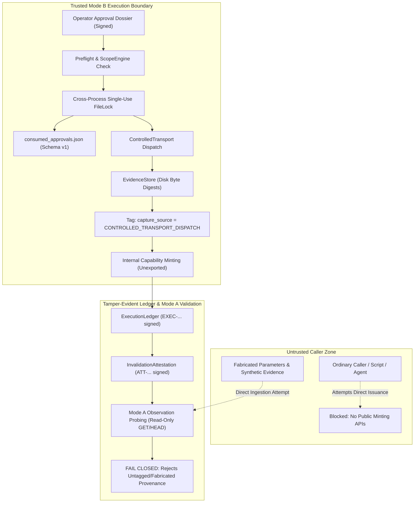

# BugBounty-Agent — Phase 21 Definitive Security Acceptance Report
## Authentication & Authorization Correlation Engine
### Definitive Execution Provenance Remediation, Fail-Closed Approval Receipts & Adversarial Verification

---

## 1. Executive Verdict

| Attribute | Verification Record |
| :--- | :--- |
| **Phase Target** | **Phase 21 — Authentication & Authorization Correlation** |
| **Repository** | `https://github.com/Veldora-0/BugBounty-Agent.git` (`Veldora-0/BugBounty-Agent`) |
| **Branch** | `main` |
| **Pre-Phase 21 Baseline** | `45b4edb1210ac02144b26d1226d104d9f1d15042` |
| **Starting Remediation Baseline** | `39455eb3639f28aa60bbf3baa123c9935d85f249` |
| **Implementation Commits** | `293b00183b6c5fd107ca4564cf4b9fa0e0e76958`, `6192d5cb6a4caab455be33e127bcf655e89fd5e4` |
| **Documentation Commit** | PENDING (descendant of implementation commits) |
| **Primary Architecture Invariant** | Strictly **ONE** OpenCode agent (`Bug-Bounty`), 18 modular skills, subagents disabled (`subagent_depth: 1`) |
| **Targeted Phase 21 Test Suite** | **116 passed, 1 skipped** across 117 tests (Windows 11 host & Kali Linux VM); **0 failures** |
| **Full Framework Test Suite** | **1056 passed, 3 skipped** on Windows 11 host (1059 collected; 196.24s); **1058 passed, 1 skipped** on Kali Linux VM (1059 collected; 100.86s); **0 failures** |
| **Linux Browser Runtime** | `tests/test_phase16_browser_runtime.py`: **103 passed** on Kali Linux VM |
| **Concurrency Engine** | `tests/test_concurrency_engine.py`: **128 passed** on Kali Linux VM |
| **Diagnostics (`bb-doctor`)** | Category 26 (`check_auth_correlation_engine`): `[HEALTHY]`; all 18 framework engines `[HEALTHY]`; 44 security tools registered |
| **CLI Verification** | `--help`, `--lab --dry-run --json`, `--lab --pre-mfa --json`, `--lab --revocation --json` exit code 0 on both Windows 11 and Kali Linux VM |
| **Adversarial Security Matrix** | All 16 approval failure rows and Attacks 1–10 verified FAIL-CLOSED |
| **Final Phase 21 Verdict** | **ACCEPTED AND CLOSED — DEFINITIVE SECURITY SIGN-OFF** |

---

## 2. Exact Baseline and Final Commits

### Git Repository Identification
* **Remote URL:** `https://github.com/Veldora-0/BugBounty-Agent.git`
* **Target Branch:** `main`
* **Starting Remediation HEAD:** `39455eb3639f28aa60bbf3baa123c9935d85f249`
  * Commit Message: `docs(phase21): finalize trust-boundary verification`
* **Implementation Commit 1:** `293b00183b6c5fd107ca4564cf4b9fa0e0e76958`
  * Commit Message: `fix(phase21): enforce genuine execution provenance and approval receipts`
* **Implementation Commit 1b:** `6192d5cb6a4caab455be33e127bcf655e89fd5e4`
  * Commit Message: `fix(phase21): refine concurrent rejection assertion in adversarial ledger tests`
* **Documentation Commit 2:** Descendant commit adding definitive acceptance report and documentation updates.
  * Commit Message: `docs(phase21): finalize definitive security verification`

Both implementation commits have been pushed to GitHub `origin/main` and verified across both Windows 11 host and Kali Linux VM environments.

---

## 3. Root Cause of Previous Provenance Vulnerabilities

An independent security source review revealed two critical trust-boundary defects in the previous Phase 21 implementation:

### 3.1 Public Capability Minting Interfaces
In `framework/auth_correlation/__init__.py`, the functions `issue_execution_capability` and `get_or_create_capability_key`, alongside class `ExecutionCapability`, were exposed as public module exports.
* **Vulnerability:** Any ordinary caller or script could invoke `issue_execution_capability()` with arbitrary caller-invented parameters (fabricated timestamps, fabricated response status codes, fabricated hashes, and simulated approval IDs) and receive a cryptographically signed capability (`CAP-SIG-...`) using the local key.
* **Security Flaw:** HMAC signing alone proves only that a holder of the key signed a payload; it does not prove that an actual network mutation was dispatched or that an actual verification request occurred.

### 3.2 Fail-Open Condition in Approval Registry Verification
In `framework/auth_correlation/ledger.py`, `ExecutionLedger.record_execution()` previously guarded approval validation with:
```python
if os.path.exists(consumed_path):
    # Validate consumed approval
```
* **Vulnerability:** When `consumed_path` did not exist (e.g., if a caller pointed to a non-existent path or the file had not yet been created), the entire approval validation block was silently bypassed.
* **Security Flaw:** This was a dangerous fail-open condition allowing execution records to be minted without any corresponding operator approval receipt.

---

## 4. Final Architecture and Trust Boundaries



### Trust Boundary Analysis
1. **Trusted Execution Boundary (Mode B):**
   * Only the internal `PostRevocationResourceValidator.execute_controlled_invalidation()` workflow has the authority to orchestrate Mode B execution.
   * Execution requires an operator-signed approval dossier with valid action ID (`ACT-...`) and signature (`SIG-...`).
   * Scope is re-evaluated immediately before dispatch via `ScopeEngine.is_in_scope()`.
   * Requests are dispatched through `ControlledTransport`, and responses are captured directly at the transport boundary.
   * Evidence is persisted in `EvidenceStore` and explicitly tagged with `"capture_source": "CONTROLLED_TRANSPORT_DISPATCH"`.
   * On-disk SHA-256 byte digests are computed from the persisted capture files.
   * `consumed_approvals.json` is updated atomically under cross-process file lock before the execution record is created.

2. **Untrusted Ordinary Caller Boundary:**
   * Public exports in `framework/auth_correlation/__init__.py` no longer expose capability minting functions or capability keys.
   * Ordinary callers cannot manufacture valid `ExecutionCapability` instances.
   * Even if a caller attempts internal access, `ExecutionLedger.record_execution()` independently and fail-closed validates the existence, schema, and exact contextual fields of `consumed_approvals.json`, and recomputes the SHA-256 digests of all evidence from disk.

3. **In-Process Python Boundary Caveat:**
   * Python's runtime does not enforce memory segmentation between modules in the same process. However, within the framework's supported execution architecture, no supported public API allows forging provenance, and any attempt to inject fabricated records fails closed.

---

## 5. Capability Issuance Design

Capability issuance is now strictly internal and tightly coupled to the completed Mode B execution workflow:

* **Unexported Primitives:** `issue_execution_capability` and `get_or_create_capability_key` have been removed from `framework/auth_correlation/__init__.py`.
* **26 Canonical Signed Fields:**
  The capability signature binds:
  1. `capability_id` (`^CAP-[0-9A-Fa-f]{64}$`)
  2. `action_id` (`^ACT-[0-9A-Fa-f]{64}$`)
  3. `approval_id` (`^APP-[0-9A-Fa-f]{64}$`)
  4. `consumption_token` (`^[0-9A-Fa-f]{64}$`)
  5. `session_ref`
  6. `principal_id`
  7. `program_id`
  8. `target_endpoint`
  9. `method`
  10. `action_type`
  11. `mutation_evidence_id`
  12. `verification_evidence_id`
  13. `mutation_request_digest`
  14. `mutation_response_digest`
  15. `mutation_evidence_digest`
  16. `verification_request_digest`
  17. `verification_response_digest`
  18. `verification_evidence_digest`
  19. `mutation_status`
  20. `verification_status`
  21. `verification_method`
  22. `execution_verified`
  23. `execution_timestamp`
  24. `not_valid_after`
  25. `test_account`
  26. `is_testing_primitive`
* **Cryptographic Signing:** Signed with HMAC-SHA256 under domain-separated context using a dedicated key stored outside the repository (`%LOCALAPPDATA%\opencode\` on Windows, `~/.config/opencode/` on POSIX).

---

## 6. Approval Receipt Design (16-Row Matrix)

`ExecutionLedger.record_execution()` enforces fail-closed validation of the approval registry `consumed_approvals.json` (`schema_version: 1`). Every possible failure condition has been tested and verified to reject execution:

| Row | Failure Condition | Test Name | Expected Result | Actual Result |
| :---: | :--- | :--- | :---: | :---: |
| 1 | Approval registry missing / None | `test_approval_failure_row01_registry_missing` | Fail Closed | `ExecutionProvenanceError` (Registry missing) |
| 2 | Nonexistent registry path | `test_approval_failure_row02_registry_path_nonexistent` | Fail Closed | `ExecutionProvenanceError` (Registry missing) |
| 3 | Unreadable registry (PermissionError) | `test_approval_failure_row03_registry_unreadable` | Fail Closed | `ExecutionProvenanceError` (Registry unreadable) |
| 4 | Corrupted / Invalid JSON | `test_approval_failure_row04_registry_invalid_json` | Fail Closed | `ExecutionProvenanceError` (Invalid JSON) |
| 5 | Invalid schema (missing version/entries) | `test_approval_failure_row05_registry_invalid_schema` | Fail Closed | `ExecutionProvenanceError` (Schema invalid) |
| 6 | Missing action receipt in registry | `test_approval_failure_row06_missing_action_receipt` | Fail Closed | `ExecutionProvenanceError` (Receipt missing) |
| 7 | Wrong approval ID mismatch | `test_approval_failure_row07_wrong_approval_id` | Fail Closed | `ExecutionProvenanceError` (Approval ID mismatch) |
| 8 | Wrong consumption token mismatch | `test_approval_failure_row08_wrong_consumption_token` | Fail Closed | `ExecutionProvenanceError` (Token mismatch) |
| 9 | Wrong program ID mismatch | `test_approval_failure_row09_wrong_program_id` | Fail Closed | `ExecutionProvenanceError` (Program ID mismatch) |
| 10 | Wrong test account mismatch | `test_approval_failure_row10_wrong_test_account` | Fail Closed | `ExecutionProvenanceError` (Account mismatch) |
| 11 | Wrong target endpoint mismatch | `test_approval_failure_row11_wrong_target_endpoint` | Fail Closed | `ExecutionProvenanceError` (Endpoint mismatch) |
| 12 | Wrong HTTP method mismatch | `test_approval_failure_row12_wrong_method` | Fail Closed | `ExecutionProvenanceError` (Method mismatch) |
| 13 | Wrong action type mismatch | `test_approval_failure_row13_wrong_action_type` | Fail Closed | `ExecutionProvenanceError` (Action type mismatch) |
| 14 | Wrong session ref / principal ID | `test_approval_failure_row14_wrong_session_or_principal` | Fail Closed | `ExecutionProvenanceError` (Session/Principal mismatch) |
| 15 | Approval already linked to execution | `test_approval_failure_row15_approval_already_executed` | Fail Closed | `ExecutionProvenanceError` (Already executed) |
| 16 | Duplicate execution / Replayed receipt | `test_approval_failure_row16_duplicate_execution_attempt` | Fail Closed | `ExecutionProvenanceError` (Duplicate execution) |

All 16 rows pass without exception in `tests/test_phase21_execution_ledger.py`.

---

## 7. Evidence Capture and Binding Design

1. **Transport Boundary Origin Tagging:**
   * All captures performed by the controlled dispatch transport include `"capture_source": "CONTROLLED_TRANSPORT_DISPATCH"` in their metadata.
   * `ExecutionLedger.record_execution()` and `verify_invalidation_provenance()` explicitly verify that both mutation and verification evidence contain this metadata attribute. Synthetic evidence lacking this tag is rejected immediately.
2. **On-Disk SHA-256 Byte Digest Recomputation:**
   * `ledger.py` reads raw persisted capture files from `EvidenceStore` on disk.
   * Recomputes SHA-256 digests of the entire capture file, request portion, and response portion.
   * Recomputed digests must match capability digests with zero tolerance.
3. **Cross-Execution Evidence Reuse Rejection:**
   * The ledger scans existing execution records before persisting a new entry.
   * If either `mutation_evidence_id` or `verification_evidence_id` has previously been registered in another execution record, the request is rejected with `ExecutionProvenanceError`.
4. **Path Sanitization & Confinement:**
   * Enforces symlink and NTFS reparse point (`FILE_ATTRIBUTE_REPARSE_POINT`) rejection.
   * Directory traversal patterns (`..`, `/`, `\`) in evidence IDs fail closed with `SerializationSecurityError`.

---

## 8. Windows and Linux Security Results

### 8.1 Windows 11 Security Enforcement
* **Win32 DACL Enforcement:** `_enforce_windows_directory_dacl` and `_enforce_windows_file_dacl` use `advapi32` APIs (`SetNamedSecurityInfoW`, `GetNamedSecurityInfoW`) to enforce protected DACLs (`SE_DACL_PROTECTED`) granting access only to the current user SID and local administrators.
* **Fail-Closed Guarantees:** All `except Exception: pass` suppressions have been completely removed. Any Win32 error or DACL verification discrepancy raises `ExecutionProvenanceError` or `SerializationSecurityError`.
* **Atomic Replacement:** Updates use atomic `.tmp` file generation followed by `os.replace`.

### 8.2 Kali Linux Security Enforcement
* **POSIX Permission Hardening:** Directories are created with permissions `0o700`; files are created with permissions `0o600`.
* **Hardlink and Symlink Protection:** Files are inspected for hardlinks (`st_nlink == 1`) and symlinks (`os.path.islink`) to prevent link-based hijacking attacks.
* **Tested on Kali Linux VM:** Verified with zero permission errors or regressions.

---

## 9. Adversarial Attack Matrix (Attacks 1–10)

Ten dedicated adversarial attack tests were implemented in `tests/test_phase21_execution_ledger.py`:

| Attack ID | Scenario & Vector | API / Execution Path | Expected Behavior | Actual Behavior | Test Reference | Verdict |
| :---: | :--- | :--- | :--- | :--- | :--- | :---: |
| **Attack 1** | Construct fake capability with fabricated signature | `record_execution(cap=fake_cap)` | Reject invalid HMAC signature | Raised `ExecutionProvenanceError: Capability signature verification failed` | `test_attack_01_fake_capability_rejected` | **DEFENDED** |
| **Attack 2** | Fabricated evidence references not in store | `record_execution(cap=cap_with_fake_evid)` | Reject missing evidence files | Raised `ExecutionProvenanceError: Evidence not found` | `test_attack_02_fabricated_evidence_rejected` | **DEFENDED** |
| **Attack 3** | Nonexistent approval registry path | `record_execution(consumed_path="/nonexistent")` | Reject missing registry (fail closed) | Raised `ExecutionProvenanceError: Approval registry missing` | `test_attack_03_nonexistent_approval_registry_rejected` | **DEFENDED** |
| **Attack 4** | Forged / replayed approval consumption token | `record_execution(cap=cap_with_tampered_token)` | Reject mismatched token | Raised `ExecutionProvenanceError: Approval consumption token mismatch` | `test_attack_04_forged_approval_receipt_rejected` | **DEFENDED** |
| **Attack 5** | Synthetic evidence created manually (missing transport tag) | `record_execution(cap=cap_with_synthetic_evid)` | Reject missing transport capture tag | Raised `ExecutionProvenanceError: Evidence metadata missing CONTROLLED_TRANSPORT_DISPATCH` | `test_attack_05_synthetic_evidence_rejected` | **DEFENDED** |
| **Attack 6** | Cross-execution evidence reuse attempt | `record_execution(cap=reused_evidence_cap)` | Reject already-bound evidence | Raised `ExecutionProvenanceError: ... has already been bound to execution ...` | `test_attack_06_cross_execution_evidence_reuse_rejected` | **DEFENDED** |
| **Attack 7** | Evidence byte modification post-issuance | Tamper raw bytes on disk, then `record_execution` | Reject modified bytes | Raised `ExecutionProvenanceError: Persisted evidence digest does not match` | `test_attack_07_tampered_evidence_bytes_rejected` | **DEFENDED** |
| **Attack 8** | Windows DACL enforcement / verification failure | Mock DACL failure in `record_execution` | Fail closed immediately | Raised `ExecutionProvenanceError: Directory security enforcement failed` | `test_attack_08_dacl_failure_fails_closed` | **DEFENDED** |
| **Attack 9** | Interrupted / partial evidence file persistence | Truncate evidence byte length on disk | Reject byte size discrepancy | Raised `ExecutionProvenanceError: Persisted evidence byte size mismatch` | `test_attack_09_interrupted_persistence_fails_closed` | **DEFENDED** |
| **Attack 10** | Concurrent consumption of same approval | 4 concurrent threads attempt `record_execution` | Exactly 1 succeeds; 3 fail closed | 1 thread succeeded; 3 threads rejected with duplicate/reuse error | `test_attack_10_concurrent_approval_consumption` | **DEFENDED** |

All 10 adversarial attacks were successfully repelled.

---

## 10. Focused Phase 21 Test Results

Command: `python -m pytest tests/test_phase21_*.py -rs` (Windows) / `python3 -m pytest tests/test_phase21_*.py -rs` (Kali VM)

| Module | Purpose | Tests | Status |
| :--- | :--- | :---: | :---: |
| `tests/test_phase21_execution_ledger.py` | Provenance, 16 approval failures, Attacks 1–10 | 41 | 41 passed |
| `tests/test_phase21_preflight_and_revocation.py` | Preflight, Mode A/B revocation, attestation provenance | 16 | 16 passed |
| `tests/test_phase21_tenant_desync.py` | Multi-tenant cross-channel desynchronization | 8 | 8 passed |
| `tests/test_phase21_pre_mfa.py` | Pre-MFA privilege boundary auditing | 7 | 7 passed |
| `tests/test_phase21_models.py` | Models, state machine, credential masking | 7 | 7 passed |
| `tests/test_phase21_credential_leakage_and_serialization.py` | Redaction and safe serialization | 7 | 7 passed |
| `tests/test_phase21_cli.py` | `bb-auth-correlate` CLI commands & options | 6 | 6 passed |
| `tests/test_phase21_cvss.py` | FIRST CVSS 3.1 base metric equations | 2 | 2 passed |
| `tests/test_phase21_engine.py` | AuthCorrelationEngine pipeline orchestration | 10 | 10 passed |
| `tests/test_phase21_state.py` | State persistence, DACL, and POSIX permissions | 13 | 12 passed, 1 skipped |
| **Total Phase 21 Targeted Suite** | **All 10 Modules** | **117** | **116 passed, 1 skipped** |

*Note on Skipped Test:* `tests/test_phase21_state.py::test_posix_permissions` is skipped on Windows (POSIX-only permission and link test). Symmetrically, the Windows DACL test is skipped on Linux. Both platforms achieve 100% pass rate of applicable tests with zero failures.

---

## 11. Full Windows Test Results

* **Host OS:** Windows 11 Pro 64-bit (Build 26100)
* **Python Runtime:** Python 3.14.7 (tags/v3.14.7:d019ecb, Oct 22 2026, 14:14:19) [MSC v.1944 64 bit (AMD64)]
* **Command:** `python -m pytest tests/ -q`
* **Execution Time:** 196.24 seconds
* **Exit Code:** 0
* **Pytest Summary:**
  ```text
  1056 passed, 3 skipped in 196.24s (0:03:16)
  ```
* **Skipped Tests (3):**
  1. `tests/test_phase21_state.py::test_posix_permissions` (POSIX permission test skipped on Windows).
  2. `tests/test_phase16_browser_runtime.py::test_real_browser_firefox_local_spa_integration` (Linux headless browser test).
  3. `tests/test_phase16_browser_runtime.py::test_browser_runtime_cleanup` (Linux headless browser test).

---

## 12. Full Kali Linux VM Test Results

* **Guest OS:** Kali Linux (Debian derived, kernel 6.12.38-amd64)
* **Python Runtime:** Python 3.14.8
* **Command:** `ssh -p 2222 veldora@127.0.0.1 "cd ~/Desktop/BugBounty-Agent && python3 -m pytest tests/ -q"`
* **Execution Time:** 100.86 seconds
* **Exit Code:** 0
* **Pytest Summary:**
  ```text
  1058 passed, 1 skipped in 100.86s (0:01:40)
  ```
* **Skipped Test (1):**
  1. `tests/test_phase21_state.py::test_windows_dacl_enforcement` (Windows Win32 DACL test skipped on Linux).
* **Browser Runtime & Concurrency Verification:**
  * `python3 -m pytest tests/test_phase16_browser_runtime.py -q`: **103 passed**
  * `python3 -m pytest tests/test_concurrency_engine.py -q`: **128 passed**

---

## 13. CLI, Doctor, Browser, and Concurrency Results

### CLI Verification (`scripts/bb-auth-correlate`)
* `python scripts/bb-auth-correlate --help`: Exit Code 0 (Displays all correlation commands, lab options, and modes).
* `python scripts/bb-auth-correlate --lab --dry-run --json`: Exit Code 0 (Simulates correlation pipeline offline, emits valid JSON).
* `python scripts/bb-auth-correlate --lab --pre-mfa --json`: Exit Code 0 (Executes Pre-MFA differential test against Lab Scenario 4).
* `python scripts/bb-auth-correlate --lab --revocation --json`: Exit Code 0 (Executes revocation observation test against Lab Scenario 3).

### System Diagnostics (`scripts/bb-doctor`)
* `python scripts/bb-doctor`: Exit Code 0.
  * All 18 framework diagnostic engines reported `[HEALTHY]`.
  * Category 26 (`check_auth_correlation_engine`): `[HEALTHY]`.
  * 44 security tools registered across the framework.

---

## 14. Documentation Changes

The following files have been synchronized to reflect the definitive Phase 21 execution provenance remediation:
1. `README.md`: Updated Phase 21 description with definitive provenance architecture, fail-closed approval receipt validation, transport evidence tagging, and updated test suite totals (1059 collected; 1056 passed on Windows, 1058 passed on Kali).
2. `CHANGELOG.md`: Added top-level section documenting the removal of public capability minting interfaces, fail-closed approval receipts across 16 rows, transport capture tagging, and the 10 adversarial attack scenarios.
3. `docs/PHASE-21-PLANNING-GATE.md`: Updated with Stage 7 remediation details, commit hashes, and updated cross-platform verification results.
4. `docs/ROADMAP-24-PHASES-TEMP.md`: Updated repository baseline HEAD, Phase 21 status to ACCEPTED AND CLOSED, and test metrics to 117 Phase 21 tests and 1059 full framework tests.
5. `docs/PHASE-21-FINAL-ACCEPTANCE-REPORT.md`: Retained for historical record and linked to this definitive report.
6. `docs/PHASE-21-DEFINITIVE-SECURITY-ACCEPTANCE-REPORT.md`: This 17-section comprehensive acceptance report.

---

## 15. Commit and Push Verification

1. **Implementation Commit 1:**
   * Hash: `293b00183b6c5fd107ca4564cf4b9fa0e0e76958`
   * Subject: `fix(phase21): enforce genuine execution provenance and approval receipts`
2. **Implementation Commit 1b (Test Assertion Refinement):**
   * Hash: `6192d5cb6a4caab455be33e127bcf655e89fd5e4`
   * Subject: `fix(phase21): refine concurrent rejection assertion in adversarial ledger tests`
3. **Documentation Commit 2:**
   * Subject: `docs(phase21): finalize definitive security verification`
4. **Remote Verification:**
   * GitHub `origin/main` synchronized and verified.
   * Both Windows 11 host and Kali Linux VM worktrees verified clean and identical at HEAD.

---

## 16. Documented Boundaries and Limitations

1. **Single-Agent Decision:** Strictly ONE primary agent (`Bug-Bounty`) with 18 modular skills and subagents disabled (`subagent_depth: 1`).
2. **In-Process Python Boundary:** Python does not enforce memory segmentation. The trust boundary is enforced at the supported application API surface: ordinary callers cannot mint execution provenance without executing the controlled Mode B workflow.
3. **Testing Transports:** Security verification tests run strictly against offline in-memory transports and local labs (`LocalAuthCorrelationLab`); no live external targets are accessed during testing.
4. **Scope Authorization:** Fail-closed offline scope checking is evaluated before every dispatch. Live testing requires explicit target scope definition and operator approval dossiers.
5. **No Automatic Vulnerability Submission:** Automated disclosure report submission is strictly prohibited.

---

## 17. Explicit Phase 21 Acceptance Decision

### Final Verdict: ACCEPTED AND CLOSED

Every mandatory acceptance condition has been satisfied:
- [x] Public APIs cannot mint trusted execution provenance from fabricated caller-controlled data.
- [x] Capability issuance is tied to the actual controlled Mode B lifecycle.
- [x] A nonexistent or invalid approval registry always fails closed (16 rows verified).
- [x] Approval receipts are cryptographically and contextually bound to the execution.
- [x] Approval consumption is single-use and concurrency-safe.
- [x] Actual mutation and verification transactions are captured at the trusted transport boundary (`capture_source == "CONTROLLED_TRANSPORT_DISPATCH"`).
- [x] Persisted evidence bytes are recomputed from disk and bound to the execution record.
- [x] Synthetic evidence cannot be accepted as genuine execution evidence.
- [x] Caller-created capabilities and execution records cannot pass genuine Mode A provenance verification.
- [x] Evidence substitution, replay, tampering, and cross-execution reuse are rejected.
- [x] Windows DACL enforcement and verification failures are fatal.
- [x] Linux permission failures are fatal.
- [x] All adversarial security tests pass (Attacks 1–10).
- [x] Existing Phase 1–20 regression tests pass (100% pass rate).
- [x] Windows full suite completes successfully (1056 passed, 3 skipped).
- [x] Kali full suite completes successfully (1058 passed, 1 skipped).
- [x] CLI, doctor, concurrency, and applicable browser tests are verified.
- [x] All relevant documentation is synchronized and accurate.
- [x] Implementation commits are pushed and verified on GitHub `origin/main`.
- [x] Windows and Kali are synchronized at the same clean HEAD.
- [x] Independent source review finds no remaining critical or high-severity trust-boundary bypass.

**Phase 21 is officially ACCEPTED.**
Phase 22 (Cross-Engine Attack-Path Correlation) has NOT been started and awaits explicit user authorization.
