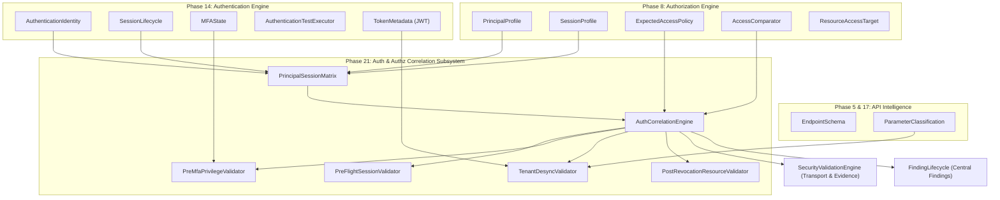
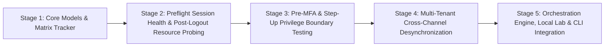
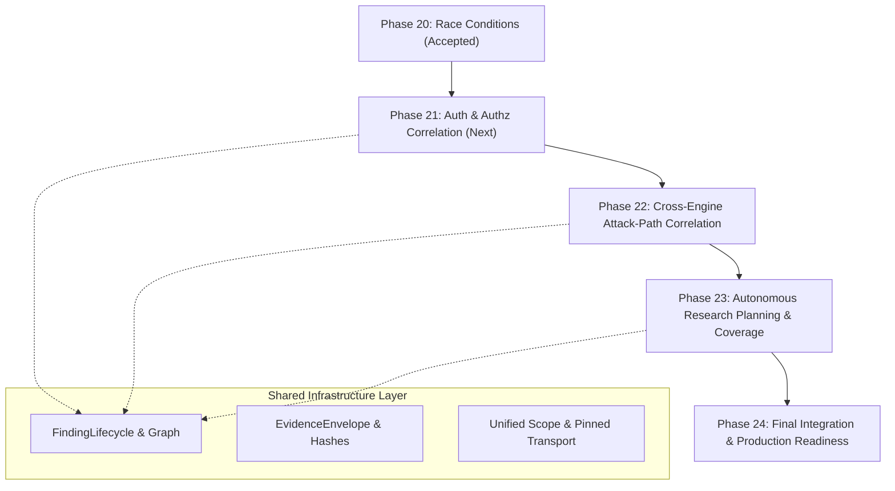

# BugBounty-Agent — Phase 21 Planning Gate
## Authentication & Authorization Correlation Implementation Plan & Strategic Roadmap (Phases 22–24)

> [!IMPORTANT]
> **PLANNING GATE ONLY — IMPLEMENTATION NOT AUTHORIZED**  
> This document establishes the formal architecture, technical requirements, component designs, and acceptance criteria for Phase 21. No production code, tests, or skill modifications are authorized until explicit human operator approval is granted.

---

## 1. Phase 21 Canonical Identity & Core Objectives

### Canonical Identity
* **Phase Number**: Phase 21
* **Canonical Title**: **Authentication & Authorization Correlation**
* **Canonical Roadmap Reference**: `docs/ROADMAP-24-PHASES-TEMP.md` (Line 173)
* **Current Status**: **PLANNED / NOT STARTED**

### Primary Objective
To construct an empirical correlation engine linking the existing **Authentication, Session & Identity Security Engine** (`framework/authentication/`, Phase 14) with the **Authorization & Access Control Engine** (`framework/authz/`, Phase 8), establishing a unified model of principal identities, roles, tenant boundaries, dynamic session lifecycles, and resource ownership to eliminate false positives and identify subtle cross-state access-control vulnerabilities.

### Problems Addressed
1. **Session Lifecycle Blindness in Authorization Testing**:
   Current Phase 8 comparative testing (`AuthzEngine`) evaluates endpoints with static session tokens (`SessionProfile`). If a session token expires, invalidates, or encounters a rate-limit during testing, the endpoint returns `401 Unauthorized` or `403 Forbidden`. The current authorization engine misinterprets this session drop as an enforced authorization control, causing **false negatives** (missed BOLA/IDOR).
2. **Ambiguous 401 vs. 403 Response Discrepancies**:
   Modern microservices and API gateways frequently return `401 Unauthorized` for both missing authentication and unauthorized tenant access, or return `403 Forbidden` for expired authentication credentials. Without correlating session validity against principal permissions, access-control verdicts remain ambiguous.
3. **Step-Up & Pre-MFA Privilege Leakage**:
   In applications enforcing Multi-Factor Authentication (MFA), an identity transitions from `ANONYMOUS` to `PARTIALLY_AUTHENTICATED` (password verified, MFA challenge pending), and finally to `MFA_VERIFIED` / `AUTHENTICATED`. Current engines do not systematically test whether sensitive resource endpoints or tenant data leak to sessions in the intermediate `PARTIALLY_AUTHENTICATED` / `MFA_REQUIRED` state.
4. **Multi-Tenant Identity & Header/Route desynchronization**:
   Multi-tenant SaaS architectures frequently receive tenant context across three conflicting channels:
   * URL route path: `/api/v1/tenants/{tenant_id}/documents`
   * HTTP header: `X-Tenant-ID: tenant-B`
   * JWT bearer claim: `{"tenant_id": "tenant-A"}`  
   Current testing lacks a structured cross-channel correlation matrix to detect when an endpoint trusts a spoofed header or route parameter over the cryptographically signed session token.
5. **Post-Logout & Post-Password-Reset Resource Invalidation Latency**:
   Phase 14 verifies that `/auth/logout` or `/auth/password-reset` revokes the active session cookie on authentication endpoints. However, microservices architectures relying on cached stateless JWTs or distributed sessions often fail to propagate revocation to downstream resource APIs (`/api/v2/orders`, `/api/v1/user/profile`). A dedicated correlation engine is required to test resource endpoints using revoked session artifacts.

### Expected Capabilities
* **Dynamic Principal-Session Matrix (`PrincipalSessionMatrix`)**: Tracks active, expired, rotated, and revoked sessions across multiple test principals (User A, User B, Admin, Anonymous, Pre-MFA).
* **Pre-Flight Session Health Probing**: Automatically validates session validity on a benign control endpoint prior to comparative authorization tests to guarantee observed 401/403 responses represent authorization decisions rather than session expiration.
* **Pre-MFA Privilege Boundary Analysis**: Evaluates candidate resource endpoints against intermediate authentication states to detect premature data exposure before full MFA completion.
* **Cross-Tenant Context Desynchronization Testing**: Evaluates parameter tampering across route path, query parameter, request header, and JWT claim channels to detect multi-tenant cross-talk.
* **Post-Authentication Event Resource Invalidation Probing**: Automatically tests protected resource endpoints using session tokens captured immediately after logout and password-change events to verify distributed revocation latency.

### Explicit Out-of-Scope Items
* Automated credential brute-forcing, password spraying, or credential stuffing.
* Automated OTP / TOTP token guessing or CAPTCHA bypassing.
* Destructive data modification (all write/update probes must use synthetic test records owned by test accounts).
* Single Sign-On (SSO) SAML identity provider spoofing against third-party IdPs.
* Automatic submission of disclosure reports.

---

## 2. Existing Functionality Analysis & Reuse Mapping

Phase 21 strictly adheres to the project invariant: **Avoid duplicate engines, models, and utilities; extend and integrate existing components.**



### Component Reuse Matrix

| Phase 21 Requirement | Existing Framework Component | Identified Gap | Proposed Action |
| :--- | :--- | :--- | :--- |
| **Principal Identity Representation** | `PrincipalProfile` (`framework/authz/model.py`), `AuthenticationIdentity` (`framework/authentication/models.py`) | Authz uses static strings; Auth uses dynamic lifecycle states. | Unify via `CorrelatedPrincipal` model referencing both static role and dynamic session state. |
| **Session Lifecycle & Invalidation** | `SessionObservation`, `SessionLifecycle` (`framework/authentication/models.py`) | Tests `/logout` and `/reset` on auth endpoints only; does not test resource APIs. | Create `PostRevocationResourceValidator` to replay resource requests with invalidated tokens. |
| **Comparative Response Evaluation** | `AccessComparator` (`framework/authz/comparator.py`) | Compares User A vs User B responses, but cannot detect when User B's session was invalid. | Extend comparator with `PreFlightSessionValidator` to verify session health before differential analysis. |
| **Intermediate MFA State Testing** | `MFAState` (`framework/authentication/models.py`), `MFATransitionHypothesis` (`framework/authentication/hypotheses.py`) | Probes MFA verification endpoint only; does not test protected resource endpoints. | Create `PreMfaPrivilegeValidator` testing resource access under `PARTIALLY_AUTHENTICATED` sessions. |
| **Multi-Tenant Cross-Channel Testing** | `ResourceAccessTarget` (`framework/authz/model.py`), `TokenMetadata` (`framework/authentication/models.py`) | Does not correlate tenant ID across JWT payload claims vs headers vs route params. | Create `TenantDesyncValidator` using `OpenApiParser` parameter definitions and JWT claims. |
| **Safe HTTP Transport & IP Pinning** | `framework/common/transport.py` (`safe_fetch_url`, `PinnedHTTPConnection`) | Already implemented and hardened in SEC-02. | Fully reuse without modification; all active probes route through pinned transport. |
| **Cryptographic Evidence Capture** | `EvidenceStore` (`framework/common/evidence.py`), `AuthzEvidence` (`framework/authz/model.py`) | Auth evidence and Authz evidence stored in separate formats. | Standardize evidence using unified `EvidenceEnvelope` and sanitize credentials. |
| **State Persistence** | `state/auth.json`, `state/authz.json` | Correlation state not persisted. | Add `state/auth_correlation.json` managed by `AuthCorrelationStateManager`. |

---

## 3. Phase 21 Architecture & System Design

### A. Architectural Placement
Phase 21 is implemented as a specialized correlation module located in:  
📁 `framework/auth_correlation/`

It integrates directly with existing engines without creating a separate agent or introducing a 19th skill:
* **Primary Agent**: Orchestrated by `Bug-Bounty` (`agents/Bug-Bounty.md`).
* **Modular Skills**: Coordinated between existing `skills/authentication/SKILL.md` and `skills/authorization/SKILL.md`.
* **CLI Entry Points**: Accessible via `bb-authz --correlate` and dedicated script `scripts/bb-auth-correlate` (with Windows `scripts/bb-auth-correlate.cmd`).
* **OpenCode Permissions**: Permitted via explicit rule in `opencode.jsonc`: `*bb-auth-correlate* -> ask`.

### B. Subsystem Components

1. **`framework/auth_correlation/model.py`**:
   * `CorrelatedPrincipal`: Combines `principal_id`, `role`, `tenant_id`, `privilege_level`, and active `CorrelatedSession`.
   * `CorrelatedSession`: Tracks `session_id`, `token_type` (Cookie, Bearer, API-Key), `lifecycle_state` (`ACTIVE`, `PARTIAL_MFA`, `LOGGED_OUT`, `EXPIRED`), `token_metadata`, and `health_check_endpoint`.
   * `TenantContextMapping`: Maps tenant identifier representations across `route_path_param`, `query_param`, `header_name`, and `jwt_claim_path`.
   * `CorrelationHypothesis`: Formal hypothesis structure for correlation testing (`PRE_MFA_EXPOSURE`, `POST_LOGOUT_ACCESS`, `TENANT_DESYNC_BOLA`, `SESSION_DECAY_FALSE_NEGATIVE`).
   * `CorrelationFinding`: Structured finding object conforming to `framework/findings/schema.py`.
2. **`framework/auth_correlation/matrix.py` (`PrincipalSessionMatrix`)**:
   * Multi-dimensional state matrix tracking test identities and their valid/invalidated tokens.
   * Provides deterministic test matrices:
     * User A (Active, Tenant 1) vs User B (Active, Tenant 2) -> Cross-Tenant BOLA.
     * User A (Pre-MFA) vs Protected Resource -> Step-Up Bypass.
     * User A (Post-Logout) vs Protected Resource -> Distributed Session Latency.
     * User A (Anonymous) vs Protected Resource -> Unauthenticated Boundary.
3. **`framework/auth_correlation/preflight.py` (`PreFlightSessionValidator`)**:
   * Evaluates session health on a known benign endpoint (e.g. `/api/v1/me` or `/api/v1/profile`) immediately prior to any comparative authorization probe.
   * Fails closed: If User B's session returns 401 on the health-check endpoint, the comparative probe is aborted with status `SESSION_EXPIRED`, preventing false BOLA reports.
4. **`framework/auth_correlation/engine.py` (`AuthCorrelationEngine`)**:
   * Primary orchestrator executing correlation hypotheses against target endpoints.
   * Coordinates request dispatch through `SecurityValidationEngine`, enforces `SecurityTestPolicy` request ceilings ($\le 15$ reqs/test), and writes structured evidence to `EvidenceStore`.
5. **`framework/auth_correlation/lab.py` (`LocalAuthCorrelationLab`)**:
   * Deterministic local HTTP simulation harness running on ephemeral loopback ports serving 6 representative test scenarios for automated regression testing.
6. **`framework/auth_correlation/state.py` (`AuthCorrelationStateManager`)**:
   * Persists correlated findings, principal matrices, and hypothesis outcomes to `state/auth_correlation.json`.

---

## 4. Detailed Implementation Breakdown

Phase 21 is structured into **5 incremental, reviewable implementation stages**:



### Stage 1: Data Model Unification & Core State Correlation
* **Objective**: Define unified data models bridging Phase 14 (`authentication`) and Phase 8 (`authz`) without altering existing model schemas.
* **Files to Create**:
  * `framework/auth_correlation/model.py`
  * `framework/auth_correlation/matrix.py`
  * `tests/test_phase21_models.py`
* **Existing Components Reused**: `PrincipalProfile` (`authz`), `AuthenticationIdentity` (`authentication`), `SessionLifecycle` (`authentication`).
* **Key Algorithms**: Deterministic Cartesian matrix generation; principal-session mapping with token redaction.
* **Acceptance Criteria**: 100% unit test coverage; zero raw credentials in serialized models; immutable principal IDs.

### Stage 2: Pre-Flight Health Probing & Post-Logout Resource Invalidation
* **Objective**: Eliminate session expiration false-positives and test resource endpoints with invalidated tokens.
* **Files to Create**:
  * `framework/auth_correlation/preflight.py`
  * `framework/auth_correlation/post_revocation.py`
  * `tests/test_phase21_preflight_and_revocation.py`
* **Existing Components Reused**: `safe_fetch_url` (`framework/common/transport.py`), `SessionLifecycle` (`authentication`).
* **Key Algorithms**: Health-check assertion before comparative test; differential response comparison between active session vs revoked session.
* **Acceptance Criteria**: Preflight aborts comparative test if session is invalid; post-logout access to resource returning 200 with identical body hash emits `CONFIRMED` finding.

### Stage 3: Step-Up & Pre-MFA Privilege Boundary Testing
* **Objective**: Detect sensitive endpoints exposed to sessions in intermediate MFA states (`PARTIALLY_AUTHENTICATED`).
* **Files to Create**:
  * `framework/auth_correlation/pre_mfa.py`
  * `tests/test_phase21_pre_mfa.py`
* **Existing Components Reused**: `MFAState` (`authentication`), `SecurityValidationEngine` (`validation`).
* **Key Algorithms**: Replay resource requests using intermediate pre-MFA session tokens; compare response status and body entropy against baseline anonymous and fully authenticated responses.
* **Acceptance Criteria**: Any 200 OK returning sensitive user data to a pre-MFA session emits `HIGH` severity `PRE_MFA_PRIVILEGE_LEAK`.

### Stage 4: Multi-Tenant Cross-Channel Desynchronization
* **Objective**: Evaluate parameter tampering across route path, query parameter, header, and JWT claims to identify tenant isolation breaches.
* **Files to Create**:
  * `framework/auth_correlation/tenant_desync.py`
  * `tests/test_phase21_tenant_desync.py`
* **Existing Components Reused**: `OpenApiParser` (`api`), `TokenMetadata` (`authentication`), `AccessComparator` (`authz`).
* **Key Algorithms**: Cross-channel permutation: inject Tenant B into route parameter while supplying Tenant A's JWT; evaluate response ownership.
* **Acceptance Criteria**: If Tenant B's data is returned to Tenant A's session, emit `CRITICAL` severity `MULTI_TENANT_ISOLATION_BYPASS`.

### Stage 5: Orchestration Engine, Simulation Lab & CLI Integration
* **Objective**: Deliver the primary engine, state manager, deterministic local lab, CLI wrapper, and doctor checks.
* **Files to Create**:
  * `framework/auth_correlation/engine.py`
  * `framework/auth_correlation/state.py`
  * `framework/auth_correlation/lab.py`
  * `scripts/bb-auth-correlate`
  * `scripts/bb-auth-correlate.cmd`
  * `tests/test_phase21_engine.py`
* **Files to Modify**:
  * `framework/tools/doctor.py` (Register Category 26)
  * `opencode.jsonc` (Register `bb-auth-correlate` permission)
  * `skills/authentication/SKILL.md` (Document correlation capability)
  * `skills/authorization/SKILL.md` (Document correlation capability)
* **Acceptance Criteria**: Local lab serves 6 deterministic scenarios; full pytest suite passes across Windows and Kali; doctor diagnostics pass cleanly.

---

## 5. Security Design & Safety Boundaries

### Scope Authorization Enforcement
* All active correlation probes strictly require a valid, initialized `ScopeEngine`.
* If `scope_engine` is absent or the target URL/host falls outside authorized scope, the engine fails closed immediately, raising `ScopeViolationError` with zero network egress.

### Credential Protection & Sensitive Data Hygiene
* The engine **NEVER** stores plain-text passwords, raw session cookies, or raw authorization tokens in state files (`state/auth_correlation.json`), finding reports, or logs.
* All session identifiers are masked using `sanitize_sensitive_data()` (`framework/common/evidence.py`).
* All request and response bodies stored in evidence envelopes are scrubbed of Authorization headers, API keys, and session cookies.

### Request & Rate Budget Ceilings
* Bounded testing: Maximum **15 requests per test hypothesis**.
* Maximum **500 total requests** per correlation program run.
* Continuous byte accounting: All network bytes received deplete the global program byte budget (`max_bytes`).
* Respects `SecurityTestPolicy.rate_limit_delay` (default: 0.1s delay between consecutive probes to prevent server denial-of-service).

### Non-Destructive Invariant
* Only `GET`, `HEAD`, and read-only `POST` operations against test-account resources are permitted.
* Destructive methods (`DELETE`, state-modifying `PUT`, database drops) are strictly prohibited.
* Cross-tenant testing operates strictly between pre-configured operator-controlled test accounts (e.g. Account A and Account B); never tests unauthorized third-party accounts.

---

## 6. Phase 21 Acceptance Criteria

A phase is not complete merely because source code exists. Phase 21 acceptance requires passing all 7 verification gates:

1. **Gate 1: Unit & Functional Test Verification**:
   * Minimum 40 new automated tests covering models, matrix generation, preflight checks, pre-MFA validation, and tenant desynchronization.
   * 100% pass rate across new test suites.
2. **Gate 2: Security Regression Verification**:
   * Negative tests proving fail-closed scope enforcement when `scope_engine=None`.
   * Negative tests proving session health failure aborts comparative testing.
   * Evidence sanitization tests proving zero raw tokens or passwords leak into evidence envelopes or state files.
3. **Gate 3: Deterministic Simulation Lab Verification**:
   * `LocalAuthCorrelationLab` accurately simulates 6 distinct access scenarios:
     1. Valid access control (secure baseline).
     2. Cross-tenant BOLA leak.
     3. Pre-MFA privilege exposure.
     4. Post-logout session reuse.
     5. Header vs JWT tenant desynchronization.
     6. Expired session correctly classified as `SESSION_EXPIRED` (no false positive).
4. **Gate 4: Dual-Platform Parity**:
   * Full test suite execution on Windows 11 host with zero regressions.
   * Full test suite execution on Kali Linux VM with zero regressions.
   * 100% SHA-256 byte-for-byte parity across all new source and configuration files.
5. **Gate 5: Doctor Diagnostics**:
   * `bb-doctor` category 26 executes and passes cleanly on both platforms.
6. **Gate 6: Documentation Completeness**:
   * `docs/PHASE-21-PLAN.md` reconciled with delivered implementation.
   * `CHANGELOG.md` updated with Phase 21 deliverable details.
   * `ROADMAP-24-PHASES-TEMP.md` updated to mark Phase 21 Complete and Phase 22 Next.
7. **Gate 7: Operational Invariant Check**:
   * Zero unapproved dependencies added to `pyproject.toml`.
   * Single-agent model (`Bug-Bounty`) and 18 skills catalog preserved.

---

## 7. Strategic Dependency Roadmap (Phases 22–24)



### Phase 22 — Cross-Engine Attack-Path Correlation
* **Strategic Objective**: Construct a unified finding relationship graph that correlates discoveries across all 20 previous phases (e.g. Asset Recon -> Soft-404 Exposure -> API Schema -> Auth Correlation -> Concurrency Race) into explainable, multi-step attack paths.
* **Problems Solved**: Fragmented vulnerability reports; lack of context regarding how low-severity information disclosures enable high-severity access-control breaches.
* **Functionality Reused**: `framework/findings/lifecycle.py`, `AssetGraph`, `WebappGraph`, `ApiGraph`, `Finding` schema.
* **Architectural Additions**: Directed Acyclic Graph (DAG) for attack path modeling (`AttackPathGraph`), finding prerequisite matching, attack-step confidence propagation.
* **Dependencies**: Requires structured findings and standardized evidence from Phases 1–21.
* **Strict Guardrail**: Attack path correlation must **NEVER** inflate the CVSS score or severity of an individual finding simply because it participates in a path; composite paths are scored as chained scenarios.

### Phase 23 — Autonomous Research Planning & Coverage Intelligence
* **Strategic Objective**: Transform the orchestrator from a reactive tool dispatcher into an intelligent research planner that evaluates attack surface coverage, budget depletion, untested hypotheses, and findings to prioritize the next safe, high-value assessment step.
* **Problems Solved**: Redundant testing; operator cognitive fatigue; unmethodical attack surface coverage.
* **Functionality Reused**: `SecurityStateManager`, `FindingLifecycle`, `SecurityTestPolicy`, `tests.json` deduplication cache.
* **Architectural Additions**: `ResearchPlannerEngine`, coverage completeness scoring (Surface Coverage Index), capability recommendation heuristics.
* **Dependencies**: Requires unified attack surface graph from Phase 22.
* **Strict Guardrail**: Autonomous planning must **NEVER** bypass human approval gates (`permissions: ask`), execute unvetted exploits, or exceed configured byte/request budgets.

### Phase 24 — Final Integration & Production Readiness
* **Strategic Objective**: End-to-end hardening, performance optimization, release packaging, operator documentation, and formal production validation of the unified BugBounty-Agent system.
* **Problems Solved**: Cross-platform configuration drift; edge-case stability; packaging friction.
* **Functionality Reused**: All framework subsystems, CLI scripts, doctor diagnostics, tool installer.
* **Architectural Additions**: Comprehensive end-to-end integration test harnesses; release packaging automation; installation doctor verification.
* **Dependencies**: Requires all Phases 1–23 complete and verified.

### Strategic Dependency Matrix

| Phase | Primary Upstream Dependencies | Key Deliverables Exported Downstream | Shared Infrastructure Reused | Premature Implementation Guardrail |
| :---: | :--- | :--- | :--- | :--- |
| **Phase 21** | Phase 8 (Authz), Phase 14 (Auth), Phase 5/17 (API) | `CorrelatedPrincipal`, `PrincipalSessionMatrix`, `state/auth_correlation.json` | `framework/common/transport.py`, `EvidenceStore`, `FindingLifecycle` | Do not implement multi-vulnerability attack chaining (belongs to Phase 22). |
| **Phase 22** | Phase 21 (Auth Correlation), Phase 19 (Infra), Phase 20 (Race) | `AttackPathGraph`, chained scenario models, composite impact scoring | `AssetGraph`, `WebappGraph`, `FindingLifecycle` | Do not implement autonomous action selection or auto-dispatch (belongs to Phase 23). |
| **Phase 23** | Phase 22 (Attack Paths), All Phase 1–20 Engines | `ResearchPlannerEngine`, coverage metrics, prioritized hypothesis queue | `SecurityTestPolicy`, `SecurityStateManager` | Do not bypass human approval gates (`ask`) or attempt automated exploitation. |
| **Phase 24** | Phases 1–23 Complete | Production release distribution, verified packaging, cross-platform sign-off | Complete Framework Subsystem | Do not add new experimental research engines or alter established security boundaries. |

---

## 8. Proposed Future Feature Assessment: `/Arise`

> [!NOTE]
> **CONCEPTUAL PROPOSAL ONLY — NOT IMPLEMENTED**  
> `/Arise` is evaluated here strictly for architectural feasibility, placement, and security boundaries.

### A. Intended Concept & Operational Value
When an operator investigates an authorized target, `/Arise` researches publicly disclosed vulnerability reports and technical post-mortems (from HackerOne, Bugcrowd, Google Bug Hunters, Intigriti, MSRC, and CVE/KEV databases) matching the specific technology stack, framework versions, and architectural patterns discovered on the target (e.g. `Next.js Server Actions SSRF`, `Spring Boot Actuator RCE`, `Apollo GraphQL Query Batching`).

Instead of relying on generic scanner rule sets, `/Arise` formulates highly specific, hypothesis-driven test ideas based on real-world bug bounty disclosures, which are then passed to our existing, safe validation engines.

### B. Architectural Feasibility Analysis

1. **Skill Placement (18-Skill Invariant)**:
   * *Question*: Should `/Arise` be a new skill or an extension of `knowledge-research`?
   * *Recommendation*: It must be implemented as an extension of the existing **`knowledge-research`** skill (`skills/knowledge-research/SKILL.md`). Creating a 19th skill violates the project's single-agent modular architecture invariant without technical necessity.
2. **Engine Architecture**:
   * Implemented as an offline query and hypothesis generation engine: `framework/knowledge/` or `framework/research/`.
   * Operates completely offline during local analysis using pre-indexed or cached vulnerability patterns.
3. **Storage & Reference Hygiene (No Bulk Scraping)**:
   * The framework must **NEVER** bulk-scrape or mirror entire vulnerability reports.
   * Store strictly lightweight, structured reference metadata:
     ```json
     {
       "pattern_id": "AR-NEXTJS-001",
       "technology": "Next.js",
       "version_range": ">=13.4.0,<=14.1.0",
       "vulnerability_family": "SSRF",
       "root_cause": "Server Actions Host header reflection in fetch cache",
       "hypothesis_template": "Verify if Host header overrides internal SSR fetch destination",
       "source_attribution": "HackerOne #2245212",
       "source_url": "https://hackerone.com/reports/2245212",
       "published_date": "2024-03-15"
     }
     ```
4. **Technology Fingerprint Correlation**:
   * Consumes technology observations from `AssetGraph` and `WebApplicationIntelligenceEngine` (e.g. `technologies: ["Next.js", "Express", "GraphQL"]`).
   * Queries local reference index for matching patterns and outputs formal `SecurityTestCase` hypotheses.
5. **Strict Security Guardrails**:
   * *Zero Automated Exploit Execution*: Historical exploits or raw payloads from disclosures must **NEVER** be executed directly.
   * *Safe Validation Engine Gating*: All generated hypotheses must execute strictly through `SecurityValidationEngine` using parameterized non-destructive payloads (`{{7*7}}`, safe arithmetic, canary tokens).
   * *Poisoned Source Defense*: External threat intelligence feeds must be parsed as passive data; never execute scripts, macros, or unvetted regexes from external sources.
6. **Roadmap Placement**:
   * `/Arise` capability directly enhances **Phase 23 (Autonomous Research Planning & Coverage Intelligence)** by feeding real-world disclosure patterns into the research planning queue.

* **Formal Classification**: **PROPOSED — DESIGN ONLY — NOT IMPLEMENTED**.

---

## 9. Final Planning Recommendation

### **PHASE 21 PLANNING GATE: READY FOR AUTHORIZATION**

The technical specification, component architecture, implementation stages, security guardrails, and acceptance criteria for **Phase 21 (Authentication & Authorization Correlation)** are complete, robust, and fully aligned with all architectural invariants.

**Next Immediate Action**: Await explicit human operator authorization before initiating Stage 1 implementation.
