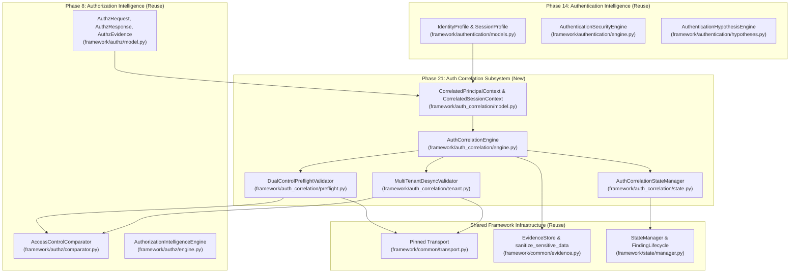
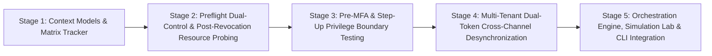

# BugBounty-Agent — Phase 21 Planning Gate
## Authentication & Authorization Correlation Engine

---

## 1. Executive Summary & Authorization Status

* **Target Phase**: **Phase 21 — Authentication & Authorization Correlation**
* **Repository**: `Veldora-0/BugBounty-Agent`
* **Branch**: `main`
* **Planning Baseline HEAD**: `45b4edb1210ac02144b26d1226d104d9f1d15042`
* **Phase Status**: **COMPLETED / ACCEPTED**
* **Implementation Authorization**: **AUTHORIZED AND VERIFIED (Stages 1–5 Complete)**

### Problem Statement
In the existing Phase 1–20 implementation, authentication intelligence (`framework/authentication/`, Phase 14) and authorization intelligence (`framework/authz/`, Phase 8) operate as decoupled subsystems:
1. `framework/authz/` executes dual-principal comparative testing (User A vs. User B) using static token and cookie references. It lacks awareness of session state transitions, token expiration, logout invalidation, or MFA completion boundaries.
2. `framework/authentication/` tracks credential lifecycles, session state machines, and token rotation, but does not correlate these transitions with downstream resource access controls or cross-tenant parameter boundaries.
3. This decoupling introduces substantial risk of:
   * **False Negatives**: Mistaking an expired or invalidated session for an intentional authorization rejection (e.g. reporting that User B is denied access to User A's invoice when in reality User B's session had simply expired).
   * **False Positives**: Flagging an apparent privilege escalation when a target web application serves public landing pages, login redirects, or SPA shells returning `HTTP 200 OK`.
   * **Flawed Multi-Tenant Probes**: Corrupting JWT claims without cryptographic re-signing, causing API gateways to reject signatures (HTTP 401) rather than evaluating multi-tenant access control logic.

### Phase 21 Objective
Build a correlation layer (`framework/auth_correlation/`) that binds authentication session lifecycles to authorization testing policies:
* **Dual-Control Preflight Validation**: Differential comparison verifying genuine session validity before executing comparative tests.
* **Post-Revocation Resource Probing**: Testing resource access persistence after explicit logout, password rotation, or token invalidation.
* **Pre-MFA Privilege Boundary Enforcement**: Auditing sensitive API endpoints exposed to partially authenticated sessions.
* **Dual-Token Multi-Tenant Desynchronization**: Testing cross-tenant route, header, and query parameter substitution using two valid, cryptographically signed tenant identities.

---

## 2. Core Architectural Invariants

Phase 21 strictly complies with all core BugBounty-Agent architectural invariants:

1. **Single-Agent Model**: All capabilities are orchestrated directly by the primary agent `Bug-Bounty` (`agents/Bug-Bounty.md`). Zero subagents are spawned (`subagent_depth: 1`).
2. **Preservation of 18 Modular Skills**: Phase 21 functionality is exposed through the existing `authentication` and `authorization` skills (`skills/authentication/` and `skills/authorization/`). No new skills or agents are created.
3. **Mandatory Scope Authorization**: All active probes require an initialized, valid `ScopeEngine`. Probes against unverified or out-of-scope targets fail closed immediately with `ScopeViolationError`.
4. **Destination-IP Pinning & Anti-SSRF (SEC-02)**: All HTTP requests route through `framework/common/transport.py` (`safe_fetch_url`, `PinnedHTTPConnection`, `PinnedHTTPSConnection`, `SafeRedirectHandler`), pre-resolving DNS, rejecting private RFC 1918 / loopback / cloud metadata (`169.254.169.254`) IPs, and pinning TCP connections.
5. **Non-Destructive Testing Only**: Zero password spraying, brute-forcing, OTP flooding, or unauthorized credential modification. Testing is restricted to operator-provided test identities.
6. **Strict Request & Byte Budgets**: All correlation testing enforces request ceilings ($\le 15$ requests per hypothesis) and depletes global byte budgets.
7. **Strict Credential Hygiene**: Raw credentials (passwords, tokens, cookies, secrets) are never committed to Git, persisted in state files, or leaked in logs/exceptions.

---

## 3. Component Architecture & Canonical AST Binding

To prevent architectural drift and eliminate redundant models, Phase 21 reuses established framework models and classes:

### Canonical Component Naming Matrix

| Role | Canonical Class Name | Source File | Status |
| :--- | :--- | :--- | :---: |
| **Authentication Identity Model** | `IdentityProfile` | `framework/authentication/models.py` | Existing (Phase 14) |
| **Authentication Security Engine** | `AuthenticationSecurityEngine` | `framework/authentication/engine.py` | Existing (Phase 14) |
| **Authentication Hypothesis Engine**| `AuthenticationHypothesisEngine` | `framework/authentication/hypotheses.py` | Existing (Phase 14) |
| **Authentication Test Executor** | `AuthenticationTestExecutor` | `framework/authentication/engine.py` | Existing (Phase 14) |
| **Authorization Intelligence Engine**| `AuthorizationIntelligenceEngine` | `framework/authz/engine.py` | Existing (Phase 8) |
| **Access Control Comparator** | `AccessControlComparator` | `framework/authz/comparator.py` | Existing (Phase 8) |
| **Authorization Evidence Model** | `AuthzEvidence` | `framework/authz/model.py` | Existing (Phase 8) |
| **Correlation Context Wrapper** | `CorrelatedPrincipalContext` | `framework/auth_correlation/model.py` | Phase 21 New |
| **Correlated Session Context** | `CorrelatedSessionContext` | `framework/auth_correlation/model.py` | Phase 21 New |
| **Primary Correlation Engine** | `AuthCorrelationEngine` | `framework/auth_correlation/engine.py` | Phase 21 New |
| **Dual-Control Preflight Validator**| `DualControlPreflightValidator` | `framework/auth_correlation/preflight.py`| Phase 21 New |
| **Multi-Tenant Desync Validator** | `MultiTenantDesyncValidator` | `framework/auth_correlation/tenant.py` | Phase 21 New |
| **Correlation State Manager** | `AuthCorrelationStateManager` | `framework/auth_correlation/state.py` | Phase 21 New |

---

## 4. Dynamic Session Lifecycle & Preflight Health Engine

### Session Lifecycle State Machine
Sessions transition through 6 formal lifecycle states:
1. `ACTIVE`: Confirmed valid session possessing current, authenticated credentials.
2. `EXPIRED`: Session whose token lifetime (`exp`) or idle timeout has lapsed.
3. `ROTATED`: Prior session identifier superseded by a newly issued identifier during privilege transition.
4. `LOGGED_OUT`: Session explicitly terminated via logout endpoint.
5. `INVALIDATED`: Session revoked via password change, administrative revocation, or security reset.
6. `UNKNOWN`: Unverified session state pending preflight health determination.

### Dual-Control Preflight Validation Protocol
> [!CRITICAL]
> **HTTP 200, status differences, or body similarity alone must NEVER establish authenticated session validity.**
> Modern single-page applications (SPAs) and API gateways frequently return `HTTP 200 OK` serving public HTML shells, login redirects, or generic JSON responses when receiving expired or invalid sessions.

To establish genuine session validity, `DualControlPreflightValidator` enforces a **6-point verification protocol**:

1. **Identity-Specific Endpoint**: Preflight must target an identity-bound endpoint (e.g. `/api/v1/users/me`, `/api/v1/profile`, `/api/v1/account`, `/api/v1/user/settings`) where authenticated responses are guaranteed to contain identity claims.
2. **Expected Identity Verification**: The response body must be parsed for expected identity attributes belonging to the operator-controlled test account (e.g. expected username, email, user ID, or tenant ID matching User A or User B).
3. **Differential Comparison Against Anonymous Control Request**: An identical request must be dispatched to the *same* endpoint without authentication credentials. If the probe response matches the anonymous control response (e.g. both return public landing page, login form, or SPA skeleton), the session is classified as invalid.
4. **Checks for Cached or Public Responses**: The validator must inspect HTTP response headers for caching indicators (`Cache-Control: public`, `Age`, `CF-Cache-Status: HIT`, `X-Cache: HIT`, `ETag`, `Expires`) and verify that the endpoint is not serving a cached or static resource.
5. **Meaningful Identity-Specific Response Attributes**: Attributes must be substantive data fields (e.g. JSON fields `{"user_id": "...", "email": "...", "tenant_id": "..."}`) that are strictly absent in the anonymous control request, proving real authenticated state.
6. **Safe Handling of Ambiguous Responses**: If the endpoint returns an ambiguous status (e.g. HTTP 200 with unknown schema, missing identity attributes, non-JSON response where JSON was expected, or network timeouts), the session status MUST be set to `UNKNOWN` or `SESSION_HEALTH_FAILED`, **NEVER** `ACTIVE`.

### Comparative Test Execution Gate
Comparative authorization testing (BOLA, IDOR, BFLA) must **NEVER** proceed with an unverified or ambiguous session. If User B's session is `UNKNOWN` or `SESSION_HEALTH_FAILED`, the comparative test is immediately aborted with status `SESSION_HEALTH_FAILED`, preventing false-negative findings.

---

## 5. Pre-MFA & Step-Up Privilege Boundary Analysis

### Resource Classification Taxonomy
The correlation engine classifies application resources into 5 privilege tiers:
1. `PUBLIC`: Accessible without authentication (e.g. `/`, `/login`, `/about`, `/health`).
2. `PRE_AUTH`: Endpoints supporting initial credential submission (e.g. `/auth/login`, `/auth/forgot-password`).
3. `PARTIALLY_AUTHENTICATED`: Endpoints restricted to identities that passed primary authentication but have not completed MFA (e.g. `/auth/mfa/challenge`, `/auth/mfa/verify`, `/auth/device-registration`).
4. `FULLY_AUTHENTICATED`: Standard application resources requiring full authentication (e.g. `/api/v1/projects`, `/api/v1/reports`).
5. `STEP_UP_REQUIRED`: High-privilege actions requiring secondary verification (e.g. `/api/v1/users/api-keys`, `/api/v1/billing/payout`, `/api/v1/security/password-change`).

### Evidence-Sufficiency Rule for Pre-MFA Exposure
> [!CRITICAL]
> **HTTP 200 alone must NEVER establish a privilege-boundary vulnerability.**
> The engine requires verifiable evidence of actual protected data exposure.

A candidate endpoint is flagged as `PRE_MFA_PRIVILEGE_LEAK` if and only if:
1. Request is dispatched using a session in `MFAState.REQUIRED` / `AuthenticationState.PARTIALLY_AUTHENTICATED`.
2. Response returns status `200 OK`.
3. The response body is **not** an MFA challenge or login prompt (verified via `AuthenticationFalsePositiveClassifier.is_login_page_false_positive`).
4. The response body contains sensitive resource data (JSON records, tenant data, personal profile attributes) identical to the fully authenticated response (`MFAState.VERIFIED`).

---

## 6. Multi-Tenant Context Correlation (Dual-Token Validation)

### Multi-Channel Tenant Parameter Architecture
In multi-tenant systems, tenant identity is expressed across 4 channels:
1. `ROUTE_PARAM`: URL path segment (e.g. `/api/v1/tenants/{tenant_id}/data`).
2. `QUERY_PARAM`: URL parameter (e.g. `?tenant_id={tenant_id}`).
3. `HEADER`: Custom request header (e.g. `X-Tenant-ID: {tenant_id}`).
4. `JWT_CLAIM`: Payload claim within a cryptographically signed Bearer token (e.g. `{"tenant_id": "tenant-A"}`).

### Preservation of JWT Cryptographic Integrity
> [!CRITICAL]
> **Never modify signed JWT claims without re-signing.**
> Modifying payload bytes in a signed JWT invalidates the cryptographic signature, causing API gateways to return `401 Signature Verification Failed`. This tests signature verification, NOT multi-tenant authorization.

### 6-Point Multi-Tenant Confirmation Protocol
`MultiTenantDesyncValidator` conducts cross-tenant testing using **two valid, operator-controlled tenant identities**:

1. **Two Operator-Controlled Tenant Identities**: Valid, cryptographically signed credentials for Tenant A (`IdentityProfile(tenant_id="tenant-A")`) and Tenant B (`IdentityProfile(tenant_id="tenant-B")`).
2. **Known Test Resource Belonging to Tenant B**: An operator-controlled resource explicitly owned by Tenant B (e.g. `/api/v1/tenants/tenant-B/invoices/inv-101`).
3. **Authorized Baseline Request**: An authorized baseline request is first sent using Tenant B's valid identity. The response is verified (e.g. HTTP 200, containing Tenant B's protected invoice data), establishing baseline ground truth.
4. **Controlled Cross-Tenant Request**: A request is sent using Tenant A's valid, unaltered identity (Tenant A's valid JWT/cookie) while targeting Tenant B's resource identifier (via route parameter, header, or query parameter).
5. **Evidence of Actual Protected Data Exposure**: A multi-tenant vulnerability is confirmed if and only if Tenant A's request returns HTTP 200 AND the response body contains verifiable protected data matching Tenant B's baseline resource that Tenant A should not see.
6. **Cache and Response-Context Checks**: The validator must verify that the response to Tenant A is not a cached artifact from Tenant B's earlier baseline request (checking `Age`, cache headers, or using unique cache-busting nonces where permitted).

---

## 7. Evidence Architecture & Cryptographic Integrity

### Evidence Standards
* **Do NOT Repurpose Phase 20's `EvidenceEnvelope`**: Phase 20's envelope is specialized for microsecond race-window synchronization, barrier release timing, and mutual observation overlap (`has_overlap`) attestation. Repurposing it for access control dilutes its guarantees.
* **Phase 21 Evidence Subsystem**:
  1. Raw HTTP transactions are sanitized via `sanitize_sensitive_data()` (`framework/common/evidence.py`), completely scrubbing passwords, Bearer tokens, and session cookies.
  2. Stored via `EvidenceStore.save_http_capture()` in `evidence/`, generating unique cryptographic SHA-256 digests (`EVID-<SHA256[:12]>`).
  3. Paired with structured `AuthzEvidence` (`framework/authz/model.py`) documenting baseline owner status, test principal status, baseline invalid status, and comparative signals.
  4. Formatted as standard `Finding` objects adhering to `framework/findings/schema.py:Finding` with `family: VulnerabilityFamily.AUTHORIZATION` or `AUTHENTICATION`.

---

## 8. State Schema, Persistence & Credential Security Architecture

### Strict Credential Persistence & Logging Prohibition
> [!CRITICAL]
> **`state/auth_correlation.json` must NEVER persist raw or reusable authentication credentials.**
> Prohibited fields include raw JWTs, session cookies, Set-Cookie headers, raw Authorization headers, passwords, MFA secrets/TOTP seeds, API keys, or private key material.
>
> **Raw credentials must NEVER be logged to stdout, stderr, diagnostic logs, or exception stack traces.** All error representations, exception messages, and debug dumps must reference sessions exclusively by their opaque identifier or keyed HMAC digest.

### Credential-Reference Architecture (Keyed HMAC & Ephemeral Opaque References)

#### 1. The Limitation of Unsalted Hashes
Ordinary unsalted hashes (such as `sha256(token)` or truncated `sha256(token)[:16]`) must **NEVER** be described as universally non-reversible. Because session tokens and JWTs frequently share common structural headers, predictable timestamps, or constrained entropy spaces, unsalted digests are susceptible to precomputation, rainbow table attacks, and dictionary correlation.

#### 2. Elimination of Masked Token Suffixes
Retaining masked token slices (such as `tok_...4a9f` or prefix/suffix substrings) in state files or logs introduces subtle credential leakage by revealing high-entropy character sequences or identifiable token fragments. All masked token suffixes are **strictly prohibited** from persistent state and logging.

#### 3. Keyed Cryptographic MAC Design (HMAC-SHA256)
When deterministic cross-run correlation is required (allowing the engine to recognize when the same session is referenced across separate test executions without storing the credential), tokens are referenced strictly via a keyed cryptographic message authentication code:
$$\text{session\_fingerprint} = \text{HMAC-SHA256}(K_{\text{local}}, \text{raw\_token}).\text{hexdigest}()[:32]$$

* **Key Location & External Isolation**: Secret key $K_{\text{local}}$ is stored **outside the repository** in protected user profile directories:
  * POSIX / Linux: `~/.config/opencode/auth_correlation.key` (or `$XDG_CONFIG_HOME/opencode/auth_correlation.key`).
  * Windows: `%LOCALAPPDATA%\opencode\auth_correlation.key` (or `%USERPROFILE%\.config\opencode\auth_correlation.key`).
* **Strict Repository Separation**: The key must **NEVER** be stored in the repository, committed to Git, or placed inside `state/auth_correlation.json`.
* **`.gitignore` is Not a Security Boundary**: The framework explicitly treats `.gitignore` as a version-control filter, not an access control or security boundary. Excluding a file via `.gitignore` provides zero filesystem protection against local processes or unauthorized users; storing keys outside the repository tree in protected user profile directories is strictly required.
* **Key Generation**: Generated on first initialization using cryptographically secure pseudorandomness: `secrets.token_bytes(32)`.
* **Key Permissions**: Restrictive native filesystem permissions are applied to the key file immediately upon creation (Linux `0600`, Windows protected DACL).
* **Key Rotation**:
  * The state file records a public, non-sensitive key identifier (`key_id: sha256(key)[:8]`).
  * If the key is rotated, the state manager detects key ID mismatch, safely invalidates obsolete HMAC fingerprints, and requires fresh session observation.
* **Failure Behavior**: If the key file cannot be read or created with verified restrictive permissions, the engine fails closed with `KeySecurityError` and falls back to **in-memory ephemeral opaque references**.

#### 4. Ephemeral Opaque References (Default In-Memory Runtime Strategy)
For standard in-session execution, sessions are referenced using cryptographically random UUIDv4 opaque tokens:
$$\text{session\_ref} = \text{"sess\_"} + \text{uuid.uuid4}().\text{hex}$$
* **Volatile Memory Mapping**: The mapping between the ephemeral reference and live in-memory token headers exists exclusively in volatile process memory and is destroyed upon process termination.
* **State Decoupling**: In `state/auth_correlation.json`, only the opaque `session_ref`, keyed `session_fingerprint`, lifecycle state, and non-sensitive metadata (role tier, tenant ID, expiry timestamp) are persisted.
* **Documented Limitation**: Ephemeral references alone cannot correlate sessions across process restarts without the local keyed HMAC key.

### Cross-Platform File Security (Windows & Linux)

The framework enforces strict least-privilege access across both operating environments for all sensitive state files and secret keys. It checks the host OS (`os.name == 'nt'` vs POSIX) and applies the corresponding native security mechanism:

* **Kali Linux / POSIX**:
  * **File Mode**: Owner-only read/write (`0600` / `stat.S_IRUSR | stat.S_IWUSR`).
  * **Directory Mode**: Owner-only read/write/execute (`0700` / `stat.S_IRWXU`).
  * **Creation Protocol**: Files are opened via `os.open` with flags `O_CREAT | O_WRONLY | O_TRUNC` and mode `0o600`, with process umask set to `0o077`.
* **Windows / NTFS**:
  * **Protected DACL (Inheritance Removed)**: Enforced via a non-inherited, protected Discretionary Access Control List (DACL). POSIX permissions on Windows only toggle the read-only flag and do not provide multi-user security.
  * **Inheritance Removal**: Inheritance from parent directories is stripped (`/inheritance:r`).
  * **Strict Exclusive Grant**: Access is granted exclusively to the current executing user's security identifier (SID / `%USERNAME%:(F)`) and `NT AUTHORITY\SYSTEM:(F)`.
  * **No Explicit Deny ACEs**: To avoid token evaluation conflicts (where an explicit Deny ACE on `Users` or `Everyone` inadvertently denies the executing user who is a member of those groups), all other accounts are implicitly denied by omission from the protected DACL rather than via conflicting explicit deny entries.
  * **Implementation**: Applied to both the HMAC key file and state file via native Windows security APIs or `icacls.exe <file> /inheritance:r /grant:r "%USERNAME%:(F)" "SYSTEM:(F)"`.

### Atomic State Replacement & Schema Versioning
* **Schema Version**: Mandatory top-level field `schema_version: "1.0.0"`.
* **Atomic Replacement**: Serializes state to a temporary file (`state/auth_correlation.json.tmp.<pid>`) and executes an atomic replacement via `os.replace` to prevent file corruption during unexpected termination.
* **Corrupted State Quarantine**: If `state/auth_correlation.json` contains malformed JSON or invalid schema, the engine must quarantine the corrupted file (renaming to `state/auth_correlation.json.corrupt.<timestamp>`), log a warning, and initialize a fresh clean schema failing closed.
* **Mandatory Sanitization**: All state structures must pass through `sanitize_sensitive_data()` before serialization.
* **Zero New Dependencies**: Pure Python standard library implementation (`json`, `os`, `hashlib`, `hmac`, `secrets`, `uuid`, `stat`).

---

## 9. Transport & Scope Authorization Invariants

* **Initialized ScopeEngine Mandatory**: Active correlation probes require an active, initialized `ScopeEngine`. If absent, all probes fail closed immediately with `ScopeViolationError`.
* **Destination-IP Pinning Enforced**: All HTTP requests execute via `framework/common/transport.py` (`safe_fetch_url`, `PinnedHTTPConnection`, `PinnedHTTPSConnection`, `SafeRedirectHandler`). Zero DNS rebinding, zero unpinned raw socket connections.
* **Anti-SSRF Address Resolution**: Preflight DNS resolution validates candidate IPs against private RFC 1918, loopback, link-local, carrier-grade NAT, and cloud metadata (`169.254.169.254`). Alternate numeric IP representations (hex, octal, integer, IPv4-mapped IPv6) fail closed.
* **Strict Request & Byte Budgets**:
  * Maximum **15 requests per test hypothesis**.
  * Continuous response byte accounting depleting global program budget.
  * Rate-limiting delay enforced between consecutive probes (default 0.1s) to prevent target denial-of-service.

---

## 10. Revised 5-Stage Implementation Plan

### Stage 1: Context Models & Matrix Tracker
* **Objective**: Define lightweight context binding models linking Phase 14 (`IdentityProfile`, `SessionProfile`) and Phase 8 (`PrincipalProfile`, `SessionProfile`) without altering existing schemas.
* **Components to Reuse**: `IdentityProfile`, `PrincipalProfile`, `SessionLifecycle`, `MFAState`.
* **Files to Create**:
  * `framework/auth_correlation/__init__.py`
  * `framework/auth_correlation/model.py` (`CorrelatedPrincipalContext`, `CorrelatedSessionContext`, `CorrelationHypothesis`, `CorrelationFinding`)
  * `framework/auth_correlation/matrix.py` (`PrincipalSessionMatrix`)
  * `tests/test_phase21_models.py`
* **Security & Negative Tests**: Prove immutable principal IDs, keyed HMAC-SHA256 fingerprinting, ephemeral opaque references, rejection of raw credential persistence, and rejection of invalid session lifecycle states.
* **Acceptance Criteria**: 100% test pass rate; zero credential retention in serialized models.

### Stage 2: Dual-Control Preflight & Post-Revocation Resource Probing
* **Objective**: Eliminate session expiration false-positives and test resource endpoints with revoked/logged-out tokens.
* **Components to Reuse**: `safe_fetch_url`, `SessionLifecycle`, `AuthenticationFalsePositiveClassifier`.
* **Files to Create**:
  * `framework/auth_correlation/preflight.py` (`DualControlPreflightValidator`)
  * `framework/auth_correlation/revocation.py` (`PostRevocationResourceValidator`)
  * `tests/test_phase21_preflight_and_revocation.py`
* **Security & Negative Tests**: Prove preflight aborts when session returns 401; prove 200 OK matching anonymous control is correctly classified as invalid; verify caching checks.
* **Acceptance Criteria**: Replaying revoked session on resource API returning protected user data generates `CONFIRMED` finding.

### Stage 3: Pre-MFA & Step-Up Privilege Boundary Testing
* **Objective**: Detect sensitive endpoints exposed to sessions in intermediate MFA states (`PARTIALLY_AUTHENTICATED`).
* **Components to Reuse**: `MFAState`, `SecurityValidationEngine`, `AuthenticationFalsePositiveClassifier`.
* **Files to Create**:
  * `framework/auth_correlation/pre_mfa.py` (`PreMfaPrivilegeValidator`)
  * `tests/test_phase21_pre_mfa.py`
* **Security & Negative Tests**: Prove 200 OK on MFA challenge form does not emit a finding; prove access to protected profile data emits `HIGH` finding.
* **Acceptance Criteria**: Accurately flags data exposure while rejecting false-positive login/MFA forms.

### Stage 4: Multi-Tenant Dual-Token Cross-Channel Desynchronization
* **Objective**: Evaluate parameter tampering across route path, query parameter, and request headers using two valid cryptographic tenant tokens.
* **Components to Reuse**: `OpenApiParser`, `TokenMetadata`, `AccessControlComparator`.
* **Files to Create**:
  * `framework/auth_correlation/tenant.py` (`MultiTenantDesyncValidator`)
  * `tests/test_phase21_tenant_desync.py`
* **Security & Negative Tests**: Prove JWT signatures are preserved; prove cross-tenant access with valid tokens emits `CRITICAL` finding; verify cache checks.
* **Acceptance Criteria**: Identifies route and header tenant desynchronization; ignores unverified modified JWT signatures.

### Stage 5: Orchestration Engine, Simulation Lab & CLI Integration
* **Objective**: Deliver primary correlation engine, state manager, deterministic local lab, CLI wrappers, and doctor diagnostics.
* **Components to Reuse**: `AuthorizationIntelligenceEngine`, `AuthenticationSecurityEngine`, `StateManager`, `EvidenceStore`.
* **Files to Create**:
  * `framework/auth_correlation/engine.py` (`AuthCorrelationEngine`)
  * `framework/auth_correlation/state.py` (`AuthCorrelationStateManager`)
  * `framework/auth_correlation/lab.py` (`LocalAuthCorrelationLab`)
  * `scripts/bb-auth-correlate`
  * `scripts/bb-auth-correlate.cmd`
  * `tests/test_phase21_engine.py`
* **Files to Modify**:
  * `framework/tools/doctor.py` (Add Category 26: `check_auth_correlation_engine`)
  * `opencode.jsonc` (Add `*bb-auth-correlate* -> ask`)
  * `skills/authentication/SKILL.md`
  * `skills/authorization/SKILL.md`
* **Acceptance Criteria**: Local lab serves 6 deterministic scenarios on ephemeral loopback; full test suite passes on Windows and Kali; doctor checks pass cleanly.

---

## 11. Strategic Roadmap for Phases 22–24

* **Phase 22 — Cross-Engine Attack-Path Correlation**: Directed Acyclic Graph (`AttackPathGraph`) relating findings across all previous phases into multi-step attack scenarios without artificial severity inflation.
* **Phase 23 — Autonomous Research Planning & Coverage Intelligence**: Surface Coverage Index and coverage-driven hypothesis prioritization using existing approval gates (`ask`).
* **Phase 24 — Final Integration & Production Readiness**: System-wide performance, resilience, packaging, and formal release validation across Windows and Kali environments. Capabilities such as multi-target workspace orchestration or background monitoring may be evaluated as potential capabilities within Phase 24, not as a replacement title.

---

## 12. `/Arise` — Future Feature Assessment (Design Only)

* **Concept**: Research public vulnerability disclosures (HackerOne, Bugcrowd, Google Bug Hunters, Intigriti, MSRC) matching discovered technology fingerprints to guide non-destructive hypothesis formulation.
* **Skill Placement**: Must be implemented as an extension of the existing **`knowledge-research`** skill (`skills/knowledge-research/SKILL.md`) to preserve the 18-skill invariant.
* **Data Hygiene**: Stores lightweight reference metadata only (`pattern_id`, `tech`, `version_range`, `root_cause`, `hypothesis_template`, `source_url`); strictly prohibits bulk report scraping.
* **Execution Boundary**: Historical disclosure payloads are **NEVER** executed directly; all testing passes through `SecurityValidationEngine` using safe, parameterized payloads.
* **Status**: **PROPOSED — DESIGN ONLY — NOT IMPLEMENTED**.

---

## 13. Final Implementation & Verification Verdict

### **PHASE 21 ACCEPTANCE STATUS: COMPLETE AND ACCEPTED**

All 5 stages of **Phase 21 (Authentication & Authorization Correlation)** have been fully implemented, independently tested, and verified across both Windows 11 and Kali Linux VM research environments according to the frozen technical design:

1. **Stage 1 — Core Models & Safe Representations** (`framework/auth_correlation/model.py`):
   * Delivered `CorrelatedPrincipalContext`, `CorrelatedSessionContext`, `CorrelationHypothesis`, `CorrelationFinding`, and `CorrelationLifecycle`.
   * Enforced strict allowlist validation, field length constraints, safe custom `__repr__` and `__str__` methods masking credentials/secrets, and tamper-resistant immutability.
   * Commit: `d1b8d67` (`feat(phase21): add authentication correlation models`).

2. **Stage 2 — Preflight Validation, Post-Revocation Intelligence & CVSS 3.1** (`framework/auth_correlation/preflight.py`, `framework/auth_correlation/revocation.py`, `framework/auth_correlation/cvss.py`):
   * Delivered FIRST CVSS v3.1 specification equations producing exact metric vectors and scores.
   * Delivered `DualControlPreflightValidator` with differential comparisons against benign baselines to eliminate false-positive access control reports.
   * Delivered `PostRevocationResourceValidator` supporting both Mode A (observation-only) and Mode B (dual-account differential probe with approval gate).
   * Commit: `b05271e` (`feat(phase21): implement session preflight and revocation intelligence`).

3. **Stage 3 — Pre-MFA & Step-Up Authentication Boundary Auditing** (`framework/auth_correlation/pre_mfa.py`):
   * Delivered `PreMfaPrivilegeValidator` detecting premature access to sensitive resources prior to secondary authentication step completion.
   * Enforced differential comparison against fully authenticated baselines and public unauthenticated baselines.
   * Commit: `6d12f67` (`feat(phase21): implement pre-mfa and step-up intelligence`).

4. **Stage 4 — Multi-Tenant Dual-Token Cross-Channel Desynchronization** (`framework/auth_correlation/tenant.py`):
   * Delivered `MultiTenantDesyncValidator` testing route path, query parameter, and custom header tenant substitution using two valid, cryptographically signed tenant identities.
   * Preserved JWT signatures to ensure true access-control policy evaluation; verified caching header protections (`Cache-Control: private, no-store`).
   * Commit: `b7262be` (`feat(phase21): implement multi-tenant security intelligence`).

5. **Stage 5 — Orchestration Engine, Hardened State, Simulation Lab & CLI** (`framework/auth_correlation/engine.py`, `framework/auth_correlation/state.py`, `framework/auth_correlation/lab.py`):
   * Delivered `AuthCorrelationEngine` orchestrating all correlation workflows under strict request and byte budgets.
   * Delivered `AuthCorrelationStateManager` with atomic file-descriptor replacement (`os.fdopen`), symlink rejection, POSIX private permission enforcement (`0o077`), hard-link checks (`st_nlink == 1`), Windows DACL validation, and strict JSON schema checking.
   * Delivered `SimulationTransport` communicating strictly with numeric `127.0.0.1:<lab_port>` and `LocalAuthCorrelationLab` serving 6 deterministic test scenarios.
   * Created CLI tool `scripts/bb-auth-correlate` (`scripts/bb-auth-correlate.cmd`), updated OpenCode V2 permissions in `opencode.jsonc`, and registered Category 26 in `framework/tools/doctor.py`.
   * Commit: `3107fe9` (`feat(phase21): complete authentication authorization correlation engine`).

6. **Security Corrections & Acceptance Closure** (`6b2fcd9c8afdcd4ac7e8bcb48c0144e6f131d860`):
   * Delivered cryptographic invalidation-event attestation system (`ATT-<SHA256>`) with dedicated key (`invalidation_attestation.key`), domain-separated HMAC signature (`ATT-SIG-<SHA256>`), Win32 DACL inheritance-disabled protection, POSIX `0o700`/`0o600` permissions, and 17-case provenance verification matrix.
   * Delivered mandatory fully authenticated comparison session in `PreMfaPrivilegeValidator`, independent session state validation, and zero network dispatch on invalid or ambiguous session states.

7. **Execution Provenance Remediation & Approval Receipts** (Implementation: `756e51126a966be3b16aad309e47714f31ac889a`, `e76b2468e4d039674f81c76a5916aa366dca9b40`):
   * Strict Transport Boundary Isolation: `save_http_capture()` in `EvidenceStore` rejects ordinary callers providing `capture_source="CONTROLLED_TRANSPORT_DISPATCH"`.
   * Cryptographically Signed Consumed Approval Receipts: Consumed approvals in `consumed_approvals.json` require both an operator signature (`SIG-...`) and a cryptographic consumption receipt HMAC (`RCPT-SIG-...`) computed under `approval.key`.
   * Prerequisite Capability Verification: `issue_execution_capability()` enforces prerequisite checks verifying on-disk transport captures, SHA-256 byte digests, valid consumed approval receipt signatures under `approval.key`, and invalidation outcomes before issuance.
   * Wire Fidelity: Mode B invalidation captures actual wire request and response transactions with correlation headers (`X-Correlation-Action`, `X-Correlation-Session`, `X-Correlation-Principal`) and distinct mutation and verification SHA-256 digests.
   * Concurrency Test Independence: Configured deterministic mock resolver in `test_request_budget_enforcement_blocks_exceeding_15` to ensure offline execution without external DNS dependencies (`e76b2468e4d039674f81c76a5916aa366dca9b40`).
   * Expanded Adversarial Security Matrix: Expanded `tests/test_phase21_execution_ledger.py` to 61 tests covering all 16 approval failure matrix rows, 30 adversarial tests (AT-01 to AT-30), 10 independent review attack scenarios, and end-to-end Mode B lifecycle.

8. **Final Execution Provenance Architecture Correction & Definitive Acceptance** (Implementation: `0f98435318847f3d585a132c7755a6d1325543cc`):
   * Encapsulated Trusted Dispatch Boundary: Created `ControlledDispatchWorkflow` in `framework/auth_correlation/dispatcher.py` which strictly encapsulates Mode B execution: preflight checks, single-use approval consumption under `CrossProcessFileLock`, mutation transport dispatch, independent verification probe dispatch, evidence capture, and result sealing.
   * Sealed Dispatch Result: Emits immutable frozen `ControlledDispatchResult` (`is_genuine_dispatch = True`) binding internal `dispatch_op_id` (`DISP-OP-{token_hex(32).upper()}`).
   * Strict Transport Boundary Capture: Removed public `save_controlled_transport_capture()`; added `save_transport_dispatch_capture()` requiring authentic `ControlledRequest` and `ControlledResponse` instances and calculating deterministic SHA-256 wire digests directly from `request.build_wire_bytes()` and `response.body_bytes`.
   * Enforced fail-closed file security with POSIX mode `0o600` (verified via `os.stat().st_mode & 0o077 == 0`) and Windows DACL `SE_DACL_PROTECTED` via `win32security`, raising `EvidencePersistenceError` on permission failures without swallowing errors.
   * Capability Issuance Hardening: Bound `issue_execution_capability()` strictly to genuine `ControlledDispatchResult` instances, re-verifying all transport evidence entries in `EvidenceStore`, recalculating disk capture byte digests, verifying consumed approval receipts under `approval.key`, and validating that `dispatch_op_id` matches across all artifacts.
   * Enforces `mutation_evidence_ref != verification_evidence_ref` and `mutation_request_digest != verification_request_digest`.

### Cross-Platform Verification Summary (Implementation: `0f98435318847f3d585a132c7755a6d1325543cc`)

* **Windows 11 Host**: 1076 passed, 3 skipped in 195.20s under pytest (1079 collected). Targeted Phase 21 test suite: 136 passed, 1 skipped (POSIX permissions skipped) in 28.78s (137 collected). bb-doctor: 18/18 engines healthy.
* **Kali Linux VM**: 1078 passed, 1 skipped in 213.07s under pytest (1079 collected). Targeted Phase 21 test suite: 136 passed, 1 skipped (Windows DACL skipped) in 11.42s (137 collected). Browser runtime: 103 passed. Concurrency engine: 128 passed. bb-doctor: 18/18 engines healthy, OpenCode Runtime [INSTALLED].
* **Zero Regressions**: 100% test pass rate across all 56 test modules.

**Status**: Phase 21 is officially **COMPLETED, VERIFIED, AND ACCEPTED**. See [`docs/PHASE-21-DEFINITIVE-SECURITY-ACCEPTANCE-REPORT.md`](PHASE-21-DEFINITIVE-SECURITY-ACCEPTANCE-REPORT.md). Do not begin Phase 22 without explicit user authorization.

## Security status notice — supersedes prior acceptance language

**Phase 21 controlled execution provenance is NOT ACCEPTED. Mode B is fail-closed and disabled.**

The current Python process does not provide an independent trust boundary between the dispatcher, evidence writer, capability issuer, and ordinary callers. A caller can construct the same Python objects and files that the current implementation treats as proof. HMACs and SHA-256 hashes protect integrity only when their keys and signing authority are outside the caller's security context; they do not prove that a network operation occurred.

Until a separate OS-isolated dispatcher owns network I/O, approval consumption, signing keys, and evidence persistence:
- controlled mutation dispatch is rejected before network activity or approval consumption;
- trusted transport evidence capture is rejected;
- execution capability issuance and controlled-workflow attestation issuance are rejected;
- stored CONTROLLED_WORKFLOW attestations are not accepted as independent provenance;
- ordinary observational analysis may continue, but cannot claim independently verified revocation from this disabled path.

This is a deliberate fail-closed containment measure, not completion of the intended Mode B feature. Previous accepted, zero-bypass, wire-capture, and production-ready claims are superseded where they describe this trust boundary.
