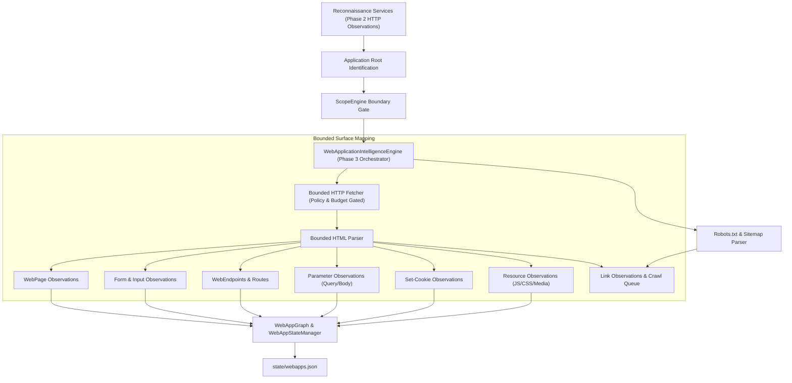

# Web Application Intelligence & Security Methodology

## Core Objective
Systematically map, model, and analyze web applications across their observable attack surface: applications, pages, routes, endpoints, query/body parameters, forms, cookies, and linked static/dynamic resources without executing intrusive vulnerability payloads.

Web Application Intelligence consumes confirmed web services from Phase 2 reconnaissance and constructs an authoritative attack surface relationship model stored atomically in `state/webapps.json` (Phase 3).

---

## 1. Web Application Intelligence Architecture



---

## 2. CLI Tool & Orchestration (`bb-webapp`)

The web application mapping workflow is invoked via `bb-webapp`:

```bash
# Map attack surface for all web applications in a program workspace
bb-webapp --program <program-name> --tree

# Restrict crawl to a specific application or asset with bounded budgets
bb-webapp --program <program-name> --asset app.example.com --max-pages 50 --max-depth 2

# Run passive analysis using existing Phase 2 observations without active requests
bb-webapp --program <program-name> --passive-only

# Resume previous crawl, skipping already-visited URLs
bb-webapp --program <program-name> --resume --tree

# Output complete JSON web application intelligence observations
bb-webapp --program <program-name> --json
```

---

## 3. Discovered Attack Surface Entities

| Entity | Model & Attributes Captured | Purpose in Lifecycle |
| :--- | :--- | :--- |
| **`WebApplication`** | Canonical base URL, host, scheme, port, page title, detected technologies, server banner. | Central anchor for application-level attack surface. |
| **`WebPage`** | Canonical URL, path, status code, content type, title, parent URL, depth, link/form counts. | Document nodes in navigation graph. |
| **`WebEndpoint`** | Method, canonical route, parameter names, parameter locations, response content type. | Identifies callable API routes and web endpoints. |
| **`ParameterObservation`** | Parameter name, location (`query`, `path`, `body`, `cookie`, `header`), method, datatype. | Input targets for subsequent targeted testing. |
| **`FormObservation`** | Form action URL, method (`POST`/`GET`), enctype, field names, input types, password/file flags. | Form submission vectors and authentication surfaces. |
| **`CookieObservation`** | Cookie name, domain, path, `Secure`, `HttpOnly`, `SameSite` attribute flags. | Session token tracking and security architecture review. |
| **`ResourceObservation`** | Resource URL, type (`js`, `css`, `image`, `json`, `wasm`), parent page, size. | Static asset inventory; feeds JavaScript Intelligence (Phase 4). |
| **`LinkObservation`** | Source URL, destination URL, same-origin flag, in-scope flag. | Navigation topology connecting pages and external systems. |

---

## 4. Crawl Policy & Safety Invariants

1. **Strict Scope Precedence**: Every candidate URL, form action, script URL, and redirected destination is verified against `ScopeEngine` before any HTTP request is issued. Out-of-scope targets are immediately rejected and recorded in `rejected_urls`.
2. **Conservative Defaults**:
   - `max_pages`: 500
   - `max_depth`: 3
   - `max_requests`: 2000
   - `max_response_bytes`: 2 MB (bounded read prevents memory exhaustion)
   - `same_origin_only`: True by default (prevents unintentional cross-domain crawls).
3. **No Vulnerability Exploitation**: Phase 3 is strictly mapping and intelligence gathering. Forms are **never automatically submitted**, inputs are never fuzzed, and application state is never mutated.
4. **Deterministic Normalization**: All URLs are canonicalized via `canonicalize_url()` (default ports stripped, path traversal resolved, fragments removed, query parameters sorted deterministically).
5. **Atomic State Persistence**: Stored in `~/BugBounty-Workspace/programs/<name>/state/webapps.json` using atomic temporary file swaps (`_atomic_write_json`).

---

## 5. HTTP / Header Trust & Protocol Security (Phase 11)

Header manipulation alone is never a finding. Phase 11 analyzes whether user-supplied metadata in headers is trusted by the server/proxy to produce a security-sensitive effect:

```
header manipulation → server/proxy trust → security-sensitive effect → proof → finding
```

### Key Capabilities & Vectors (`bb-http`)
* **Host Header Injection**: Tests whether `Host` controls password-reset URLs, invitation links, activation tokens, or OpenGraph URLs.
* **Proxy / Forwarded Trust**: Tests whether reverse-proxy headers (`X-Forwarded-Host`, `X-Original-Host`, `Forwarded`) take precedence over `Host`.
* **Scheme Trust**: Validates `X-Forwarded-Proto` and `X-Forwarded-Port` for scheme downgrade or insecure link generation.
* **Redirect Host Poisoning**: Evaluates whether `Location` redirect targets are poisoned to point to the researcher canary domain (`bb11-<program>-<id>.researcher-controlled.example`).
* **CORS Trust Boundaries**: Distinguishes public wildcard CORS (`*` without creds) from dangerous reflected origin with `Access-Control-Allow-Credentials: true`.
* **HTTP Parameter Pollution (HPP)**: Evaluates backend parser precedence (`FIRST_VALUE`, `LAST_VALUE`, `ARRAY`) when duplicate parameters are supplied.
* **Cache-Poisoning Foundation**: Inspects caching headers (`Cache-Control`, `X-Cache`, `Age`) and detects unkeyed header variations without aggressive shared-cache poisoning (`MANUAL_REVIEW_REQUIRED` for production safety).

```bash
# Run passive analysis and render ranked candidate tree
bb-http --program <program-name> --passive-only --tree

# Dry-run validation plan on target endpoint
bb-http --program <program-name> -e "https://app.example.com/login" --category host --dry-run

# Local deterministic security lab testing
bb-http --lab --tree
bb-http --lab -e "http://lab.local/auth/forgot-password" --approve
```

---

## 6. File Upload, Path Traversal & Local File Exposure (Phase 15)

Phase 15 provides bounded, hypothesis-driven security validation for file handling, directory traversal, and server-side document exposure without destructive exploitation.

### Distinction of Assessment Levels

| Level | Definition | Handling in BugBounty-Agent |
| :--- | :--- | :--- |
| **Discovered Attack Surface** | Identified upload forms (`FormObservation.has_file_upload`), multipart endpoints, or parameters (`file`, `path`, `doc`, `view`, `template`). | Documented in `state/webapps.json`; **never** an indicator of vulnerability. |
| **Candidate Vulnerability** | Structured `SecurityTestCase` planned for evaluation based on input roles or parameter semantics. | Fingerprinted and tracked in `state/tests.json` under `FindingLifecycle.CANDIDATE`. |
| **Observed Signal** | Differential HTTP response delta (status code change, size delta, server error pattern). | Empirical signal only; **strictly rejected** as insufficient proof on its own. |
| **Validated Vulnerability** | Unambiguous proof demonstrating retrieval of a synthetic canary token (`bb_canary_<token>.txt`) or verified write traversal. | Attaches SHA-256 evidence, progresses through `OBSERVED` → `VALIDATED` lifecycle. |
| **Inconclusive Result** | Server returns generic 500 error, ambiguous status change, or no canary reflection. | Classified as `REJECTED` or flagged for manual review with `NEEDS_MANUAL_REVIEW`. |
| **Capability Unavailable** | Advanced injection categories without bounded validator implementations (`sql-injection`, `ssrf`, `command-injection`, `authorization`). | Explicitly return `CAPABILITY_UNAVAILABLE` stub. |

### Strict Safety & Operational Boundaries

1. **Path Traversal & Local File Exposure**:
   - **Synthetic Canaries Only**: Probes look exclusively for controlled synthetic canary files (`bb_canary_<token>.txt`).
   - **NEVER Target System Files**: Traversal probes **never** request `/etc/passwd`, `win.ini`, `.env`, private keys, or cloud metadata (`169.254.169.254`).
   - **Weak Signal Rejection**: Status code changes (e.g., 200 → 500) or generic database/server error messages without synthetic canary content are strictly rejected as unvalidated weak signals.
   - **Variant Coverage**: Evaluates relative directory traversals (`../../`), URL-encoded variants (`%2e%2e%2f`), and Windows path separators (`..\`).
2. **File Upload Security**:
   - **Harmless Content**: Only plain-text synthetic files with unique tokens (`test_<token>.txt`) are submitted during active upload checks.
   - **Distinguish Benign Uploads**: An upload endpoint functioning as intended is classified as `INFORMATIONAL`, **never** as a vulnerability.
   - **No Executables or Webshells**: Testing never submits executable files (`.php`, `.jsp`, `.exe`, `.sh`, `.asp`), web shells, or destructive payloads.
   - **No Overwrite or Deletion**: File deletion or overwrite operations are strictly forbidden.
   - **Policy Gating**: When safety policy restricts state-changing `POST` requests, the engine produces a safe `NEEDS_MANUAL_REVIEW` observation instead of violating policy.

---

## 7. Infrastructure & Configuration Exposure Intelligence (Phase 19)

Phase 19 systematically discovers, evaluates, and safely validates exposed administrative interfaces, configuration artifacts, version control metadata, and deployment mistakes across 8 structured exposure classes without broad or disruptive scanning.

### Core CLI Tool (`bb-infra`)

```bash
# View visual ASCII tree of candidates, categories, and findings
bb-infra --program <program-name> --tree

# Passive discovery from prior recon/webapps state without network egress
bb-infra --program <program-name> --passive-only --json

# Execute dry-run of planned exposure checks
bb-infra --program <program-name> --dry-run

# Run active validation with operator approval
bb-infra --program <program-name> --approve

# Run local deterministic simulation lab
bb-infra --lab --tree
```

### The 8 Exposure Categories

| Category | Typical Targets | Verification Invariant | Realistic Severity |
| :--- | :--- | :--- | :--- |
| **`VERSION_CONTROL`** | `/.git/HEAD`, `/.svn/entries` | Valid `ref: refs/heads/...` or 40-hex SHA format. | `MEDIUM` |
| **`CONFIG_FILE`** | `/.env`, `/web.config` | KEY=VALUE syntax; sensitive key presence calibrated. | `HIGH` (sensitive) / `MEDIUM` (benign) |
| **`BACKUP_ARCHIVE`** | `/backup.zip`, `/site.tar.gz` | Magic bytes (`PK\x03\x04`, `\x1f\x8b`, `ustar`) within first 1 KB. | `MEDIUM` |
| **`ADMIN_INTERFACE`** | `/actuator/health`, `/admin` | Unauthenticated admin console vs login interface. | `MEDIUM` (unauthenticated) / `OBSERVATION` (login form) |
| **`DEPLOYMENT_MANIFEST`**| `/package.json`, `/composer.json` | Valid JSON structure with expected manifest keys. | `LOW` |
| **`SOURCE_MAP`** | `*.js.map` | Valid JSON containing `"sources"` and `"mappings"`. | `LOW` |
| **`DIRECTORY_LISTING`** | `/uploads/`, `/static/` | Web server directory index patterns (`Index of /`). | `LOW` |
| **`DEBUG_INTERFACE`** | `/_debug`, `/__trace` | Diagnostic outputs, stack traces, framework debug pages. | `MEDIUM` |

### Key Safety & Operational Invariants

1. **Differential Soft-404 Validation**:
   * Evaluates candidates against an application-subpath baseline response.
   * Dynamically normalizes volatile nonces, timestamps, hashes, and CSRF tokens before computing Jaccard similarity.
   * Enforces the non-rejection invariant: a candidate is **never** rejected solely because the baseline returned HTTP 200 (common in SPAs and custom 404 handlers).
2. **Strict Response Byte Ceilings**:
   * General HTTP responses capped at 32 KB (`max_response_bytes = 32_768`).
   * Config files evaluated within 8 KB (`max_config_bytes = 8_192`).
   * Backup archives inspected using only the first 1 KB binary magic bytes (`max_binary_magic_bytes = 1_024`); archives are **never** fully downloaded.
3. **Safe Read-Only Methods**:
   * Probes use strictly `GET`, `HEAD`, or `OPTIONS`. `POST`, `PUT`, `DELETE`, and `TRACE` are blocked.
   * State-changing query parameters (e.g., `?action=delete`) are blocked pre-dispatch.
4. **Zero Secret Persistence**:
   * All discovered secret values (passwords, tokens, private keys) are automatically sanitized to `[REDACTED_BY_BB_AGENT]` before persisting to `state/infrastructure.json` or markdown reports.
   * SHA-256 evidence fingerprints authenticate the sanitized representation.
5. **Finding vs Observation Semantics**:
   * Standard login interfaces (forms with username/password fields) are expected functionality and are classified strictly as `OBSERVATION` (`INFORMATIONAL`, `HIGH` confidence), never as high-severity vulnerabilities.
   * HTTP 403 Forbidden responses are classified as `OBSERVED` / `ACCESS_RESTRICTED` (confirming active authorization controls).
   * Local lab findings are strictly marked `SIMULATED` (`INFORMATIONAL`, `CONFIRMED` confidence).
